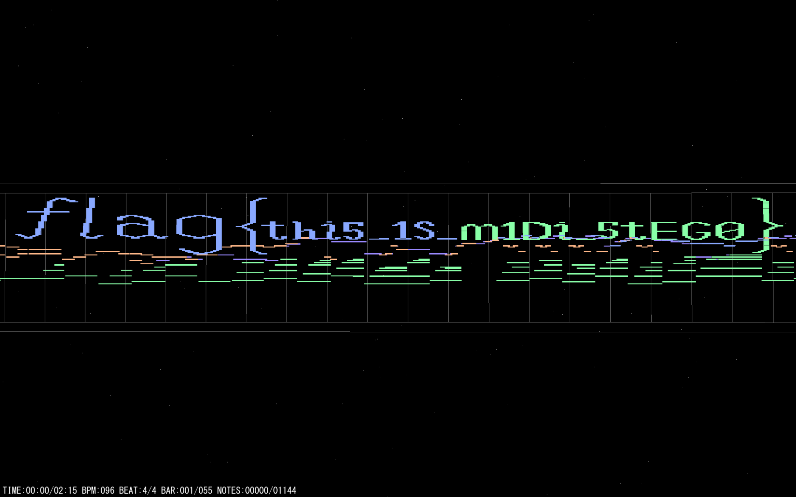

# NewStar CTF 2025 / 美妙的音乐

> 本文由授权中文赛事 WP 正文导入（阶段 1，仅散文，代码段未导入）。
>
> - 来源：https://github.com/pj-newstar/wiki-docs/blob/1a0f2ba21a30f950276396118b315eef0328371c/docs/wp/2025/week2/misc/beautiful-music.md
> - 许可：MIT
> - 署名：（未提供）
> - 文档族：official_event_archive
> - 赛事：NewStar CTF 2025
> - 年份：2025
> - 核验状态：official_source_not_reproduced
> - 正文 sha256：3505c69bd87af33f36578bb0699417dda5647a640603bba828608be30f9ca761
> - 导入 ID：official-9cdd35e323da50dc1cd1e0
> - 原 domain：misc
> - 本地快照：62_官方赛事题库/objects/0799bc4b27714039b7ee53b5283be3c8460d7d8a9b9d784ff34b3d5a103b448e.blob
> - 源修订：1a0f2ba21a30f950276396118b315eef0328371c
> - 收录说明：官方发布来源的说明正文；代码单独索引，未运行或分析。按文件收录，不把多份文件算作多道题。图片及附件下载状态见清单；仅按路径/原题分类标方向，binary 等跨方向资料留待分类。
> - 判定依据：original_prose_not_runtime_verified
> - 附件引用：[{"owner_id": "official-9cdd35e323da50dc1cd1e0", "relative_path": "docs/assets/images/wp/2025/week2/beautiful-music_1.png", "local_path": "62_官方赛事题库/objects/8acbbd1e36e0f176869873f36ebfc97ac1cdd1b17a313eb42c6005e556d393f3.blob", "downloaded_bytes": 150670, "source_url": "https://github.com/pj-newstar/wiki-docs/blob/1a0f2ba21a30f950276396118b315eef0328371c/docs/assets/images/wp/2025/week2/beautiful-music_1.png", "sha256": "8acbbd1e36e0f176869873f36ebfc97ac1cdd1b17a313eb42c6005e556d393f3", "kind": "image", "policy": "reference_only_no_execution"}]

> 原文：https://github.com/pj-newstar/wiki-docs/blob/1a0f2ba21a30f950276396118b315eef0328371c/docs/wp/2025/week2/misc/beautiful-music.md

## 正文

---
titleTemplate: ":title | WriteUp - NewStar CTF 2025"
---

import Container from '@/components/docs/Container.vue'

## 美妙的音乐

本题考查 midi 音频隐写的分析。

midi 音频隐写，听声音没听出来什么异常，那么有可能是不发声的音符隐写，用 [miditrail](https://www.yknk.org/miditrail/en/download/)（也可以是其他工具，只要能查看 midi 的音符就行）打开，可以观察到：

于是最后的 flag 就是 `flag{thi5_1S_m1Di_5tEG0}`。

## 原文配图

