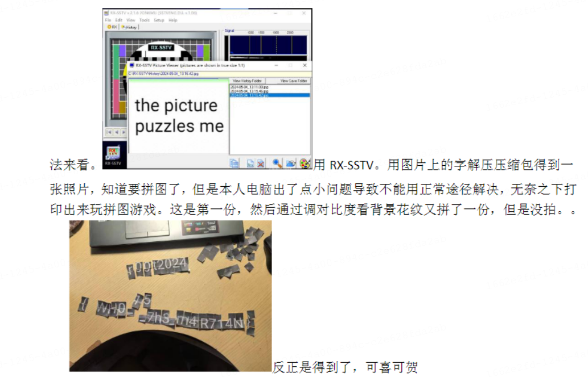
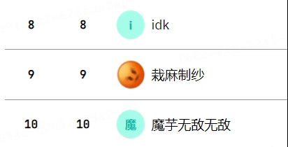
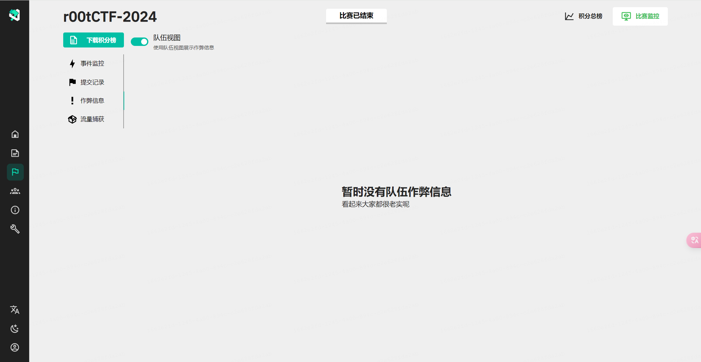
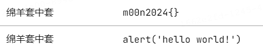
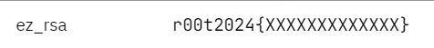
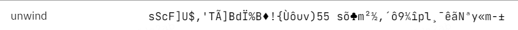
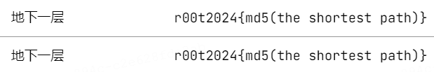
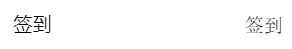
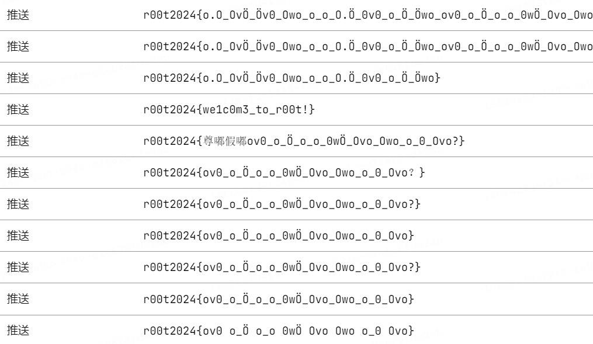

# r00t CTF 2024 / 花絮

> 本文由授权中文赛事 WP 正文导入（阶段 1，仅散文，代码段未导入）。
>
> - 来源：https://github.com/r00t-security-lab/rtctf2024/blob/a273041a04a5dd1eed3e5f49c9345719923a8e9f/Trivia/README.md
> - 许可：not_declared
> - 署名：（未提供）
> - 文档族：official_event_archive
> - 赛事：r00t CTF 2024
> - 年份：2024
> - 核验状态：official_source_not_reproduced
> - 正文 sha256：60987b369eb5b4d36ff0c99b856862afc7a170810436887a0259effafe7bfa91
> - 导入 ID：official-1ce31f1f00d73b4d73a6c2
> - 原 domain：misc
> - 本地快照：62_官方赛事题库/objects/cd9731fe11c111aaafd1a383600aa09969cd091aa4a18566901f35d9e45139e5.blob
> - 源修订：a273041a04a5dd1eed3e5f49c9345719923a8e9f
> - 收录说明：官方发布来源的说明正文；代码单独索引，未运行或分析。按文件收录，不把多份文件算作多道题。图片及附件下载状态见清单；仅按路径/原题分类标方向，binary 等跨方向资料留待分类。
> - 判定依据：original_prose_not_runtime_verified
> - 附件引用：[{"owner_id": "official-1ce31f1f00d73b4d73a6c2", "relative_path": "Trivia/.assets/image-20240530165617333.png", "local_path": "62_官方赛事题库/objects/32e522beb3ffdd95b6e1337bd212342a2648a628a852f5e4f53629d59c22a616.blob", "downloaded_bytes": 318152, "source_url": "https://github.com/r00t-security-lab/rtctf2024/blob/a273041a04a5dd1eed3e5f49c9345719923a8e9f/Trivia/.assets/image-20240530165617333.png", "sha256": "32e522beb3ffdd95b6e1337bd212342a2648a628a852f5e4f53629d59c22a616", "kind": "image", "policy": "reference_only_no_execution"}, {"owner_id": "official-1ce31f1f00d73b4d73a6c2", "relative_path": "Trivia/.assets/image-20240530170044686.png", "local_path": "62_官方赛事题库/objects/b95b649b6071f93f59f9ca14493e40036bb2a099d021fb58dbc521adb2d26cb3.blob", "downloaded_bytes": 9602, "source_url": "https://github.com/r00t-security-lab/rtctf2024/blob/a273041a04a5dd1eed3e5f49c9345719923a8e9f/Trivia/.assets/image-20240530170044686.png", "sha256": "b95b649b6071f93f59f9ca14493e40036bb2a099d021fb58dbc521adb2d26cb3", "kind": "image", "policy": "reference_only_no_execution"}, {"owner_id": "official-1ce31f1f00d73b4d73a6c2", "relative_path": "Trivia/.assets/image-20240530170055270.png", "local_path": "62_官方赛事题库/objects/72bfa63a642a31dfce79c79f11fe69069d4ecdf8a62c1746c958ff03f525ab2b.blob", "downloaded_bytes": 19218, "source_url": "https://github.com/r00t-security-lab/rtctf2024/blob/a273041a04a5dd1eed3e5f49c9345719923a8e9f/Trivia/.assets/image-20240530170055270.png", "sha256": "72bfa63a642a31dfce79c79f11fe69069d4ecdf8a62c1746c958ff03f525ab2b", "kind": "image", "policy": "reference_only_no_execution"}, {"owner_id": "official-1ce31f1f00d73b4d73a6c2", "relative_path": "Trivia/.assets/20240530_170927.gif", "local_path": "62_官方赛事题库/objects/88574b3e7224ec753a9afd4164179b773e48b13aeba5c2b60e9227ba6dbb5f68.blob", "downloaded_bytes": 150883, "source_url": "https://github.com/r00t-security-lab/rtctf2024/blob/a273041a04a5dd1eed3e5f49c9345719923a8e9f/Trivia/.assets/20240530_170927.gif", "sha256": "88574b3e7224ec753a9afd4164179b773e48b13aeba5c2b60e9227ba6dbb5f68", "kind": "image", "policy": "reference_only_no_execution"}, {"owner_id": "official-1ce31f1f00d73b4d73a6c2", "relative_path": "Trivia/.assets/image-20240530171826542.png", "local_path": "62_官方赛事题库/objects/2963f92419b66d9b5a15ebbacdbe10d5e825820390ee4a6773b69d56bdb7c51e.blob", "downloaded_bytes": 107218, "source_url": "https://github.com/r00t-security-lab/rtctf2024/blob/a273041a04a5dd1eed3e5f49c9345719923a8e9f/Trivia/.assets/image-20240530171826542.png", "sha256": "2963f92419b66d9b5a15ebbacdbe10d5e825820390ee4a6773b69d56bdb7c51e", "kind": "image", "policy": "reference_only_no_execution"}, {"owner_id": "official-1ce31f1f00d73b4d73a6c2", "relative_path": "Trivia/.assets/image-20240530172927471.png", "local_path": "62_官方赛事题库/objects/d5ba6d2771ddc72498c4aa453ee21ebc32766134cb66590e4ebaa58473671769.blob", "downloaded_bytes": 9251, "source_url": "https://github.com/r00t-security-lab/rtctf2024/blob/a273041a04a5dd1eed3e5f49c9345719923a8e9f/Trivia/.assets/image-20240530172927471.png", "sha256": "d5ba6d2771ddc72498c4aa453ee21ebc32766134cb66590e4ebaa58473671769", "kind": "image", "policy": "reference_only_no_execution"}, {"owner_id": "official-1ce31f1f00d73b4d73a6c2", "relative_path": "Trivia/.assets/image-20240530173047540.png", "local_path": "62_官方赛事题库/objects/5ab3bc2a3285d585bb94729201652c12b8caea30b342e3d05c638a1fbddf4bdd.blob", "downloaded_bytes": 3908, "source_url": "https://github.com/r00t-security-lab/rtctf2024/blob/a273041a04a5dd1eed3e5f49c9345719923a8e9f/Trivia/.assets/image-20240530173047540.png", "sha256": "5ab3bc2a3285d585bb94729201652c12b8caea30b342e3d05c638a1fbddf4bdd", "kind": "image", "policy": "reference_only_no_execution"}, {"owner_id": "official-1ce31f1f00d73b4d73a6c2", "relative_path": "Trivia/.assets/image-20240530172722588.png", "local_path": "62_官方赛事题库/objects/e187ea78642f70bdf0e8bc25276134a2d2ac99cf1f74f412e57a931a05b155b7.blob", "downloaded_bytes": 11358, "source_url": "https://github.com/r00t-security-lab/rtctf2024/blob/a273041a04a5dd1eed3e5f49c9345719923a8e9f/Trivia/.assets/image-20240530172722588.png", "sha256": "e187ea78642f70bdf0e8bc25276134a2d2ac99cf1f74f412e57a931a05b155b7", "kind": "image", "policy": "reference_only_no_execution"}, {"owner_id": "official-1ce31f1f00d73b4d73a6c2", "relative_path": "Trivia/.assets/image-20240530173330497.png", "local_path": "62_官方赛事题库/objects/1f20ee9294dc7e39add01fc6a992420a8cd61eb944712dbdf78192c309193053.blob", "downloaded_bytes": 13190, "source_url": "https://github.com/r00t-security-lab/rtctf2024/blob/a273041a04a5dd1eed3e5f49c9345719923a8e9f/Trivia/.assets/image-20240530173330497.png", "sha256": "1f20ee9294dc7e39add01fc6a992420a8cd61eb944712dbdf78192c309193053", "kind": "image", "policy": "reference_only_no_execution"}, {"owner_id": "official-1ce31f1f00d73b4d73a6c2", "relative_path": "Trivia/.assets/image-20240530173509950.png", "local_path": "62_官方赛事题库/objects/8ca5d4c151ecee92a37afacbacf40a369b02f5e6bc2518958bb266a9452cfb15.blob", "downloaded_bytes": 2268, "source_url": "https://github.com/r00t-security-lab/rtctf2024/blob/a273041a04a5dd1eed3e5f49c9345719923a8e9f/Trivia/.assets/image-20240530173509950.png", "sha256": "8ca5d4c151ecee92a37afacbacf40a369b02f5e6bc2518958bb266a9452cfb15", "kind": "image", "policy": "reference_only_no_execution"}, {"owner_id": "official-1ce31f1f00d73b4d73a6c2", "relative_path": "Trivia/.assets/image-20240530173620091.png", "local_path": "62_官方赛事题库/objects/7a77cabdd920a82bc1e21c6222511f64bcf2eef1fc98e64f381168a218cbaa32.blob", "downloaded_bytes": 86923, "source_url": "https://github.com/r00t-security-lab/rtctf2024/blob/a273041a04a5dd1eed3e5f49c9345719923a8e9f/Trivia/.assets/image-20240530173620091.png", "sha256": "7a77cabdd920a82bc1e21c6222511f64bcf2eef1fc98e64f381168a218cbaa32", "kind": "image", "policy": "reference_only_no_execution"}]

> 原文：https://github.com/r00t-security-lab/rtctf2024/blob/a273041a04a5dd1eed3e5f49c9345719923a8e9f/Trivia/README.md

## 花絮

每次新生赛都应该有一些有趣的事嘛！

ghostflyby 师傅的 MC 游戏题不幸流产，但 r00t 在近期的比赛中赢下了一台三个月的且性能还不错的服务器，并且正在（打算）筹划着搭建一个 MC 服务器一起玩耍，或许可以期待一下？（咕咕咕，r00t 的各位发出了这般肯定的声音）

Lethe 师傅（Misc 拼图题的出题人）在「呀嘿！」同学的 WP 中发现这位同学将拼图打印下来手拼，大受震撼的同时被这位同学的精神打动，并决定为其特赠一份拼图奖品（往年手拼的同学可以要求补一份吗？）

排行榜前三的两位师傅辛苦打题，竟是为了...

你说得对，但是每次我一打开榜就能看到「裁麻制纱」同学的头在转

暂时没有队伍作弊信息，看起来大家都很老实呢

暂时没有队伍作弊信息，看起来大家都很老实呢

但是各位同学的 flag 提交姿势依旧多样，有试图给 r00t 改名，顺便打 XSS 的（GZCTF 平台的洞就交给你来挖了）：

有提交样例 flag 识图萌混过关的：

有试图用不可见字符说服平台的：

有试图用不可见字符说服平台的：

有试图在 flag 提交框调用函数的：

有耿直签到的：

以及一大片被尊嘟语折磨的：

以及一大片被尊嘟语折磨的：

尊嘟假嘟 O.o？

期待与各位同学们的线下见面以及明年的新生赛~

—— Festu

## 原文配图

