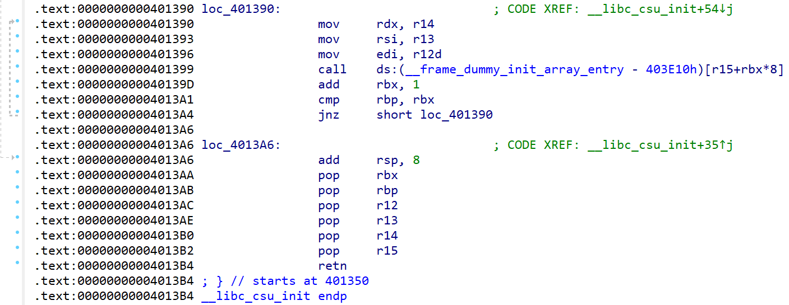

# NewStar CTF 2024 / My_GBC!!!!!

> 本文由授权中文赛事 WP 正文导入（阶段 1，仅散文，代码段未导入）。
>
> - 来源：https://github.com/pj-newstar/wiki-docs/blob/1a0f2ba21a30f950276396118b315eef0328371c/docs/wp/2024/week2/pwn/my-gbc.md
> - 许可：MIT
> - 署名：（未提供）
> - 文档族：official_event_archive
> - 赛事：NewStar CTF 2024
> - 年份：2024
> - 核验状态：official_source_not_reproduced
> - 正文 sha256：687ddfdc3694b402f715820434f8e446bf5ed236864a3bc5e611205e528a6a5d
> - 导入 ID：official-e1e16f8fcdc1d0d0604554
> - 原 domain：pwn
> - 本地快照：62_官方赛事题库/objects/346a1a6216578e162f8eb3c1cf110f02a2104b754f22c321676bf56374abff89.blob
> - 源修订：1a0f2ba21a30f950276396118b315eef0328371c
> - 收录说明：官方发布来源的说明正文；代码单独索引，未运行或分析。按文件收录，不把多份文件算作多道题。图片及附件下载状态见清单；仅按路径/原题分类标方向，binary 等跨方向资料留待分类。
> - 判定依据：original_prose_not_runtime_verified
> - 附件引用：[{"owner_id": "official-e1e16f8fcdc1d0d0604554", "relative_path": "docs/assets/images/wp/2024/week2/my-gbc_1.png", "local_path": "62_官方赛事题库/objects/c74b60eddfa4d9908918b3c225f5104c37a1848acaee143a04c58b1aef61dd5c.blob", "downloaded_bytes": 65184, "source_url": "https://github.com/pj-newstar/wiki-docs/blob/1a0f2ba21a30f950276396118b315eef0328371c/docs/assets/images/wp/2024/week2/my-gbc_1.png", "sha256": "c74b60eddfa4d9908918b3c225f5104c37a1848acaee143a04c58b1aef61dd5c", "kind": "image", "policy": "reference_only_no_execution"}]

> 原文：https://github.com/pj-newstar/wiki-docs/blob/1a0f2ba21a30f950276396118b315eef0328371c/docs/wp/2024/week2/pwn/my-gbc.md

## 正文

---
titleTemplate: ":title | WriteUp - NewStar CTF 2024"
---

## My_GBC!!!!!

先将程序拖入 IDA 分析

发现存在一个简单的栈溢出，并且输入的数据经过了某种加密处理，异或后左移

运行程序后发现，栈溢出时，`rdx` 寄存器值为 1，而程序中能利用的函数 `read` `write` 的三参都是长度，这对我们利用十分不利，因此我们选择 ret2csu

这是 csu 的代码片段，第一段代码能将 `r12` `r13` `r14` 分别 mov 到 `rdi` `rsi` `rdx`，这样我们便能控制 `rdx`，即控制函数的三参，并且后面还有 `call [r15+rbx*8]`，能控制程序的走向；第二段代码则是一长串的 `pop`，配合上述代码，即可达到 ROP，控制程序流程

需要注意的是，`call` 后面有 `add rbx, 1;` `cmp rbp, rbx;` `jnz` ...，我们需要控制 `rbx = 0` `rbp = 1`

对于加密函数，异或和左移都是可逆运算，我们只需对我们输入的内容先右移后异或 `0x5A` 即可

## 原文配图

