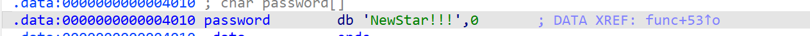

# NewStar CTF 2024 / Real Login

> 本文由授权中文赛事 WP 正文导入（阶段 1，仅散文，代码段未导入）。
>
> - 来源：https://github.com/pj-newstar/wiki-docs/blob/1a0f2ba21a30f950276396118b315eef0328371c/docs/wp/2024/week1/pwn/real-login.md
> - 许可：MIT
> - 署名：（未提供）
> - 文档族：official_event_archive
> - 赛事：NewStar CTF 2024
> - 年份：2024
> - 核验状态：official_source_not_reproduced
> - 正文 sha256：687ddfdc3694b402f715820434f8e446bf5ed236864a3bc5e611205e528a6a5d
> - 导入 ID：official-0749eaea318fb462fb98f2
> - 原 domain：pwn
> - 本地快照：62_官方赛事题库/objects/5cbfb020076c35d188f908846015a9132f66bb3f40330af3c26e67038295ba64.blob
> - 源修订：1a0f2ba21a30f950276396118b315eef0328371c
> - 收录说明：官方发布来源的说明正文；代码单独索引，未运行或分析。按文件收录，不把多份文件算作多道题。图片及附件下载状态见清单；仅按路径/原题分类标方向，binary 等跨方向资料留待分类。
> - 判定依据：original_prose_not_runtime_verified
> - 附件引用：[{"owner_id": "official-0749eaea318fb462fb98f2", "relative_path": "docs/assets/images/wp/2024/week1/real-login_1.png", "local_path": "62_官方赛事题库/objects/2bdc92ec6a75cbba9eaf2d6b9ba38e27bbc454d2372c0a37a4c59587d917ddb7.blob", "downloaded_bytes": 10870, "source_url": "https://github.com/pj-newstar/wiki-docs/blob/1a0f2ba21a30f950276396118b315eef0328371c/docs/assets/images/wp/2024/week1/real-login_1.png", "sha256": "2bdc92ec6a75cbba9eaf2d6b9ba38e27bbc454d2372c0a37a4c59587d917ddb7", "kind": "image", "policy": "reference_only_no_execution"}]

> 原文：https://github.com/pj-newstar/wiki-docs/blob/1a0f2ba21a30f950276396118b315eef0328371c/docs/wp/2024/week1/pwn/real-login.md

## 正文

---
titleTemplate: ":title | WriteUp - NewStar CTF 2024"
---

## Real Login

使用 IDA 反编译。很明显，输入的内容和全局变量 `password` 一致，就能进入 `win` 函数获取 Shell.

`password` 内容为 `NewStar!!!`

所以 nc 连上后输入 `NewStar!!!` 即可

## 原文配图

