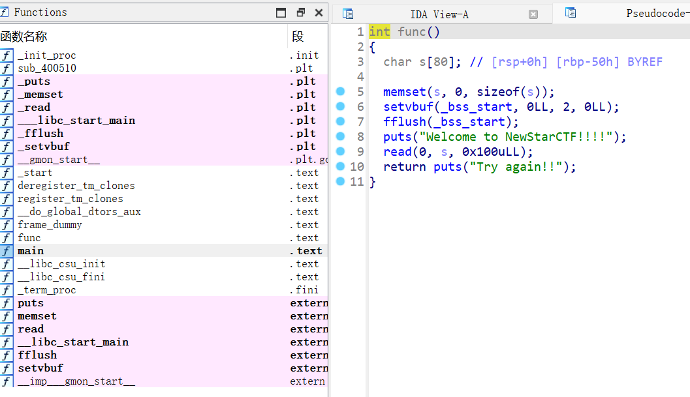
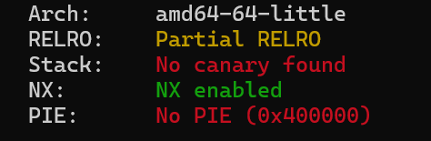

# NewStar CTF 2024 / ez_game

> 本文由授权中文赛事 WP 正文导入（阶段 1，仅散文，代码段未导入）。
>
> - 来源：https://github.com/pj-newstar/wiki-docs/blob/1a0f2ba21a30f950276396118b315eef0328371c/docs/wp/2024/week2/pwn/ez-game.md
> - 许可：MIT
> - 署名：（未提供）
> - 文档族：official_event_archive
> - 赛事：NewStar CTF 2024
> - 年份：2024
> - 核验状态：official_source_not_reproduced
> - 正文 sha256：687ddfdc3694b402f715820434f8e446bf5ed236864a3bc5e611205e528a6a5d
> - 导入 ID：official-eb8e339955f687dd0b2833
> - 原 domain：pwn
> - 本地快照：62_官方赛事题库/objects/1b61a037002b1916ab7188d4f37df04c429bae8896d69d4d7b4dce57f8c59ba1.blob
> - 源修订：1a0f2ba21a30f950276396118b315eef0328371c
> - 收录说明：官方发布来源的说明正文；代码单独索引，未运行或分析。按文件收录，不把多份文件算作多道题。图片及附件下载状态见清单；仅按路径/原题分类标方向，binary 等跨方向资料留待分类。
> - 判定依据：original_prose_not_runtime_verified
> - 附件引用：[{"owner_id": "official-eb8e339955f687dd0b2833", "relative_path": "docs/assets/images/wp/2024/week2/ez-game_1.png", "local_path": "62_官方赛事题库/objects/006c78b26586dd5be3a00a39d3f9e2f1cc28c1b5be2282712698f31e7e2734eb.blob", "downloaded_bytes": 88029, "source_url": "https://github.com/pj-newstar/wiki-docs/blob/1a0f2ba21a30f950276396118b315eef0328371c/docs/assets/images/wp/2024/week2/ez-game_1.png", "sha256": "006c78b26586dd5be3a00a39d3f9e2f1cc28c1b5be2282712698f31e7e2734eb", "kind": "image", "policy": "reference_only_no_execution"}, {"owner_id": "official-eb8e339955f687dd0b2833", "relative_path": "docs/assets/images/wp/2024/week2/ez-game_2.png", "local_path": "62_官方赛事题库/objects/0509a7806c7fb8f91e46e2d9cfe2a54108988cf7ee623d6bb96f906110c73354.blob", "downloaded_bytes": 13452, "source_url": "https://github.com/pj-newstar/wiki-docs/blob/1a0f2ba21a30f950276396118b315eef0328371c/docs/assets/images/wp/2024/week2/ez-game_2.png", "sha256": "0509a7806c7fb8f91e46e2d9cfe2a54108988cf7ee623d6bb96f906110c73354", "kind": "image", "policy": "reference_only_no_execution"}]

> 原文：https://github.com/pj-newstar/wiki-docs/blob/1a0f2ba21a30f950276396118b315eef0328371c/docs/wp/2024/week2/pwn/ez-game.md

## 正文

---
titleTemplate: ":title | WriteUp - NewStar CTF 2024"
---

## ez_game

明显的栈溢出且没有后门函数

再 checksec 一下，没有开启 pie

直接打 ret2libc（但是得进行栈对齐）

1. 先通过 puts 泄露出 puts 地址，通过 puts 地址与 libc 基地址的偏移得到 libc 基地址，并返回 `main` 函数进行第二次溢出，实现 getshell
2. 构建 `system("/bin/sh")` 取 shell

:::tip 提示
可以用 ret 地址进行栈对齐
:::

EXP:

## 原文配图

