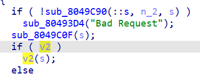
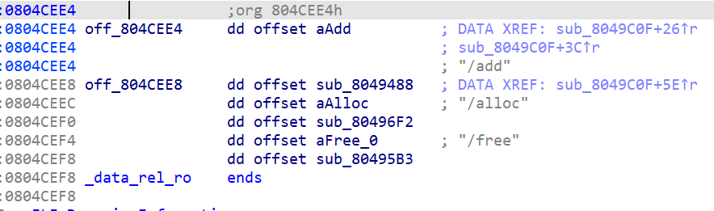
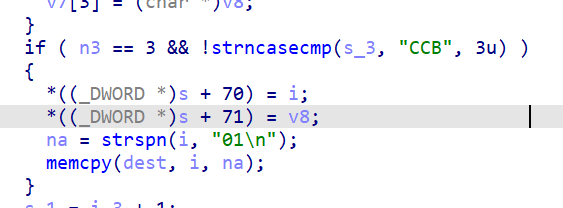
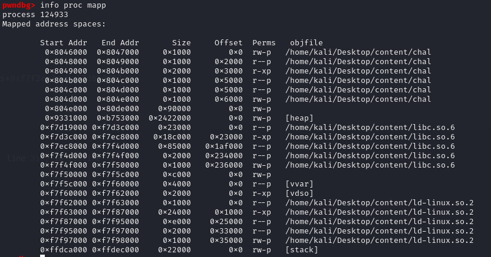
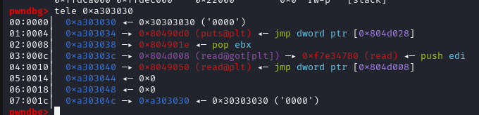
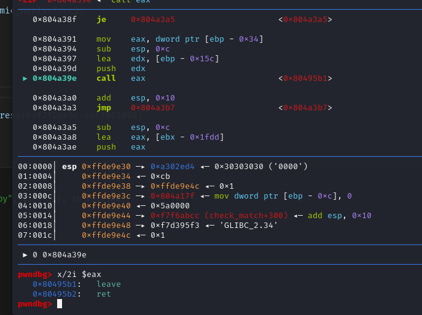

# NewStar CTF 2025 / content

> 本文由授权中文赛事 WP 正文导入（阶段 1，仅散文，代码段未导入）。
>
> - 来源：https://github.com/pj-newstar/wiki-docs/blob/1a0f2ba21a30f950276396118b315eef0328371c/docs/wp/2025/week4/pwn/content.md
> - 许可：MIT
> - 署名：（未提供）
> - 文档族：official_event_archive
> - 赛事：NewStar CTF 2025
> - 年份：2025
> - 核验状态：official_source_not_reproduced
> - 正文 sha256：46be4dee7413a0e557e883b20d933f502314ccca596eac91129f31092e378579
> - 导入 ID：official-c335eb73fea8977981e71c
> - 原 domain：pwn
> - 本地快照：62_官方赛事题库/objects/c0052f128a36f2af1302bd80a82816af928a8766a2604986618e24a6ca8d6a80.blob
> - 源修订：1a0f2ba21a30f950276396118b315eef0328371c
> - 收录说明：官方发布来源的说明正文；代码单独索引，未运行或分析。按文件收录，不把多份文件算作多道题。图片及附件下载状态见清单；仅按路径/原题分类标方向，binary 等跨方向资料留待分类。
> - 判定依据：original_prose_not_runtime_verified
> - 附件引用：[{"owner_id": "official-c335eb73fea8977981e71c", "relative_path": "docs/assets/images/wp/2025/week4/content_1.png", "local_path": "62_官方赛事题库/objects/abb7374233500ab8e5e9751fb430d76e2729fcf225222dc96637d4750523e1f1.blob", "downloaded_bytes": 9964, "source_url": "https://github.com/pj-newstar/wiki-docs/blob/1a0f2ba21a30f950276396118b315eef0328371c/docs/assets/images/wp/2025/week4/content_1.png", "sha256": "abb7374233500ab8e5e9751fb430d76e2729fcf225222dc96637d4750523e1f1", "kind": "image", "policy": "reference_only_no_execution"}, {"owner_id": "official-c335eb73fea8977981e71c", "relative_path": "docs/assets/images/wp/2025/week4/content_2.png", "local_path": "62_官方赛事题库/objects/f256a88b69841df92da145adb77c68006b0f0159d6572d2bbde70c253431e9ca.blob", "downloaded_bytes": 34326, "source_url": "https://github.com/pj-newstar/wiki-docs/blob/1a0f2ba21a30f950276396118b315eef0328371c/docs/assets/images/wp/2025/week4/content_2.png", "sha256": "f256a88b69841df92da145adb77c68006b0f0159d6572d2bbde70c253431e9ca", "kind": "image", "policy": "reference_only_no_execution"}, {"owner_id": "official-c335eb73fea8977981e71c", "relative_path": "docs/assets/images/wp/2025/week4/content_3.png", "local_path": "62_官方赛事题库/objects/fa386eb5d5efc2c77442375914882ef4b0c91cfa9fe82fbe9cdc34ea590248ee.blob", "downloaded_bytes": 15385, "source_url": "https://github.com/pj-newstar/wiki-docs/blob/1a0f2ba21a30f950276396118b315eef0328371c/docs/assets/images/wp/2025/week4/content_3.png", "sha256": "fa386eb5d5efc2c77442375914882ef4b0c91cfa9fe82fbe9cdc34ea590248ee", "kind": "image", "policy": "reference_only_no_execution"}, {"owner_id": "official-c335eb73fea8977981e71c", "relative_path": "docs/assets/images/wp/2025/week4/content_4.png", "local_path": "62_官方赛事题库/objects/aa4be2b2cfc1387b99e56af323a4b6b6b28e72b07d4274944a93f216e79439c9.blob", "downloaded_bytes": 101118, "source_url": "https://github.com/pj-newstar/wiki-docs/blob/1a0f2ba21a30f950276396118b315eef0328371c/docs/assets/images/wp/2025/week4/content_4.png", "sha256": "aa4be2b2cfc1387b99e56af323a4b6b6b28e72b07d4274944a93f216e79439c9", "kind": "image", "policy": "reference_only_no_execution"}, {"owner_id": "official-c335eb73fea8977981e71c", "relative_path": "docs/assets/images/wp/2025/week4/content_5.png", "local_path": "62_官方赛事题库/objects/da8c8011906e09fa95e65c27c1830de3b81c2d97558d37dbd236043f38aa6751.blob", "downloaded_bytes": 38821, "source_url": "https://github.com/pj-newstar/wiki-docs/blob/1a0f2ba21a30f950276396118b315eef0328371c/docs/assets/images/wp/2025/week4/content_5.png", "sha256": "da8c8011906e09fa95e65c27c1830de3b81c2d97558d37dbd236043f38aa6751", "kind": "image", "policy": "reference_only_no_execution"}, {"owner_id": "official-c335eb73fea8977981e71c", "relative_path": "docs/assets/images/wp/2025/week4/content_6.png", "local_path": "62_官方赛事题库/objects/c263a194f01368122f213f83a6019f2ba07755c3e5fa755ea769f541001b10a1.blob", "downloaded_bytes": 85582, "source_url": "https://github.com/pj-newstar/wiki-docs/blob/1a0f2ba21a30f950276396118b315eef0328371c/docs/assets/images/wp/2025/week4/content_6.png", "sha256": "c263a194f01368122f213f83a6019f2ba07755c3e5fa755ea769f541001b10a1", "kind": "image", "policy": "reference_only_no_execution"}]

> 原文：https://github.com/pj-newstar/wiki-docs/blob/1a0f2ba21a30f950276396118b315eef0328371c/docs/wp/2025/week4/pwn/content.md

## 正文

---
titleTemplate: ":title | WriteUp - NewStar CTF 2025"
---

## 题解

通过对程序的逆向可以发现是一个httpd，用http格式就能进行交互

路由在这里

提供了三个功能，malloc一个小于0x4000的堆块，连续申请堆块和释放最后一个add的堆块

通过函数指针进行调用，这个函数指针在main函数栈上

漏洞点在CCB请求头的处理中

strspn检测了01\n字符集，进行溢出

strspn检测了01\n字符集，进行溢出

也就是 0x30 0x31 0xa的溢出

在正常情况下这三个字符构成的地址为非法地址，但是通过大量堆的分配可以将其变为合法地址，而且这个题的堆是可以预测状态的

所以进行大量的add请求将其填充至0xa303030

这里的内容也是可控的，直接写就可以

最后控制了函数指针，leave ret把栈放到堆上面，然后就是ret2libc就可以了

## 原文配图

