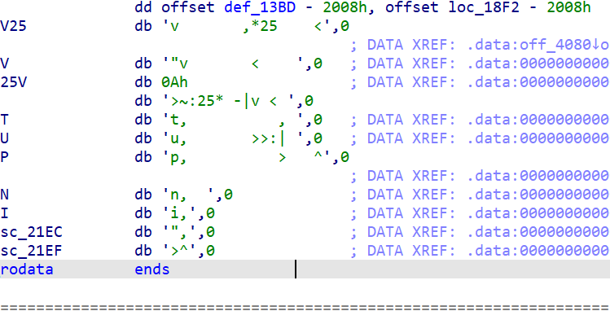
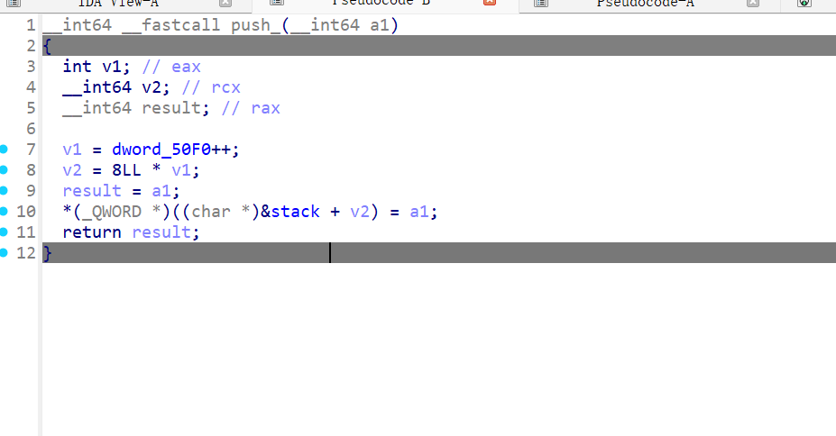
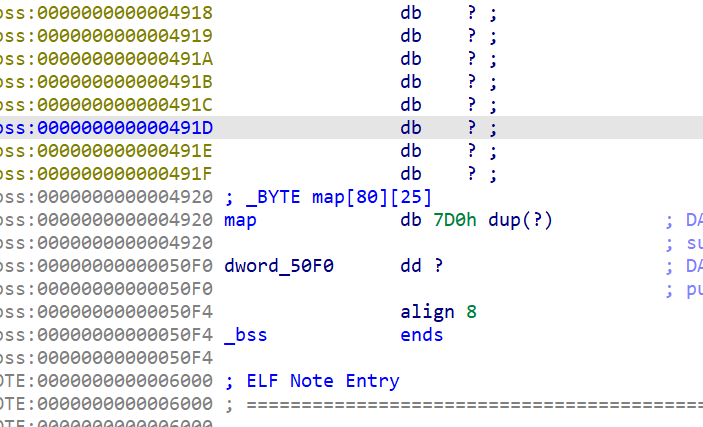

# NewStar CTF 2025 / go?

> 本文由授权中文赛事 WP 正文导入（阶段 1，仅散文，代码段未导入）。
>
> - 来源：https://github.com/pj-newstar/wiki-docs/blob/1a0f2ba21a30f950276396118b315eef0328371c/docs/wp/2025/week5/pwn/go-question.md
> - 许可：MIT
> - 署名：（未提供）
> - 文档族：official_event_archive
> - 赛事：NewStar CTF 2025
> - 年份：2025
> - 核验状态：official_source_not_reproduced
> - 正文 sha256：46be4dee7413a0e557e883b20d933f502314ccca596eac91129f31092e378579
> - 导入 ID：official-f3a5d596264b860dc9d4af
> - 原 domain：pwn
> - 本地快照：62_官方赛事题库/objects/9b9783013cd942e80a06189c3e2fcc39b21da3e702169e37c3aea357ea045022.blob
> - 源修订：1a0f2ba21a30f950276396118b315eef0328371c
> - 收录说明：官方发布来源的说明正文；代码单独索引，未运行或分析。按文件收录，不把多份文件算作多道题。图片及附件下载状态见清单；仅按路径/原题分类标方向，binary 等跨方向资料留待分类。
> - 判定依据：original_prose_not_runtime_verified
> - 附件引用：[{"owner_id": "official-f3a5d596264b860dc9d4af", "relative_path": "docs/assets/images/wp/2025/week5/go-question_1.png", "local_path": "62_官方赛事题库/objects/850ab9597b2f8dd076e6264a4c8785086d4250a0ad39bb12d428398d2dab848b.blob", "downloaded_bytes": 36881, "source_url": "https://github.com/pj-newstar/wiki-docs/blob/1a0f2ba21a30f950276396118b315eef0328371c/docs/assets/images/wp/2025/week5/go-question_1.png", "sha256": "850ab9597b2f8dd076e6264a4c8785086d4250a0ad39bb12d428398d2dab848b", "kind": "image", "policy": "reference_only_no_execution"}, {"owner_id": "official-f3a5d596264b860dc9d4af", "relative_path": "docs/assets/images/wp/2025/week5/go-question_2.png", "local_path": "62_官方赛事题库/objects/f7a1f322f6063445a8eb6b41fff01461daf9f887232aa2653959e7e6416bc10e.blob", "downloaded_bytes": 26474, "source_url": "https://github.com/pj-newstar/wiki-docs/blob/1a0f2ba21a30f950276396118b315eef0328371c/docs/assets/images/wp/2025/week5/go-question_2.png", "sha256": "f7a1f322f6063445a8eb6b41fff01461daf9f887232aa2653959e7e6416bc10e", "kind": "image", "policy": "reference_only_no_execution"}, {"owner_id": "official-f3a5d596264b860dc9d4af", "relative_path": "docs/assets/images/wp/2025/week5/go-question_3.png", "local_path": "62_官方赛事题库/objects/cffb4a27155ab0fa74449523c2d4d72d2f827eebf5968d8f67571aa9cedca720.blob", "downloaded_bytes": 35830, "source_url": "https://github.com/pj-newstar/wiki-docs/blob/1a0f2ba21a30f950276396118b315eef0328371c/docs/assets/images/wp/2025/week5/go-question_3.png", "sha256": "cffb4a27155ab0fa74449523c2d4d72d2f827eebf5968d8f67571aa9cedca720", "kind": "image", "policy": "reference_only_no_execution"}]

> 原文：https://github.com/pj-newstar/wiki-docs/blob/1a0f2ba21a30f950276396118b315eef0328371c/docs/wp/2025/week5/pwn/go-question.md

## 正文

---
titleTemplate: ":title | WriteUp - NewStar CTF 2025"
---

## go?

一个 befunge 解释器，内置了一小段代码

## 题解

首先通过逆向还原出每个指令的意义，可以大概看出 `pc` 在一个二维数组上面运动，具有方向惯性，初始在 `(0, 0)` 的位置，方向为左。

文件自带的代码为

首先线下，遇到 `进入字符模式开始压栈，随后输出input>`。

进入一个循环，每次输入之后尝试复制字符检测是否为回车 `\x0a`，通过 `|` 进入分支判断。如果输入回车，则跳出输入循环进入输出，直到将栈上全部数据输出，随后重复。

通过观察可以发现栈的类型为qword而且没有上限检测，可以一直push造成溢出，只要不输入回车

同时p和g的自修改指令是没有范围限制的

同时p和g的自修改指令是没有范围限制的

可以发现stack是在map的低地址的，栈这里向高地址增长，可以覆盖正在执行的指令，但是输入时有一个 : 进行复制，可以选择覆盖第一行在输出结束时进行控制或者是覆盖第二行的v让具有惯性的指针在这一行循环

用&进行输入方便控制8个字节内的每一个指令

&&&g.&$$保持栈平衡到原来的位置方便修改，同时进行泄露

最后用p指令修改got表的rand函数为system，参数就是当前的指令位置写入sh

getshell

## 原文配图

