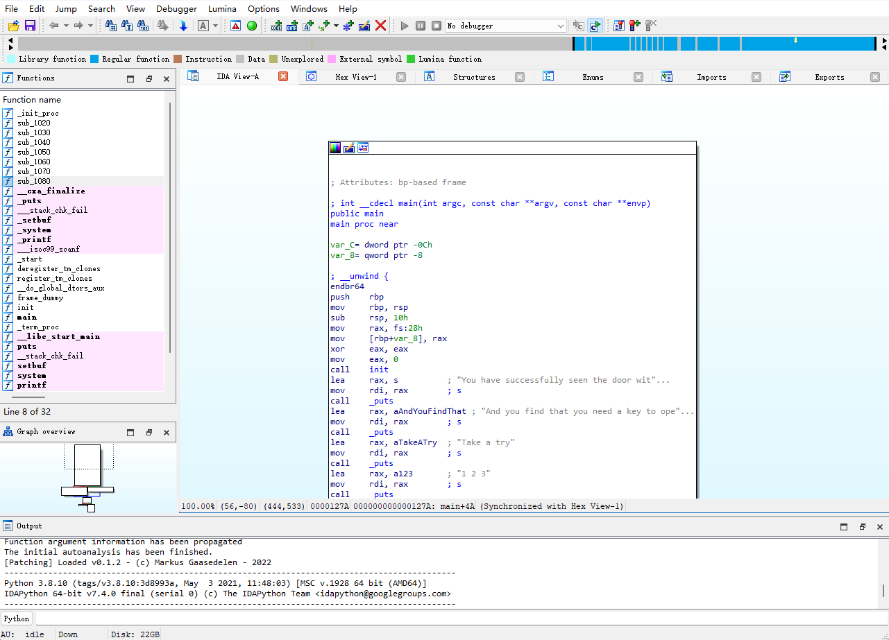
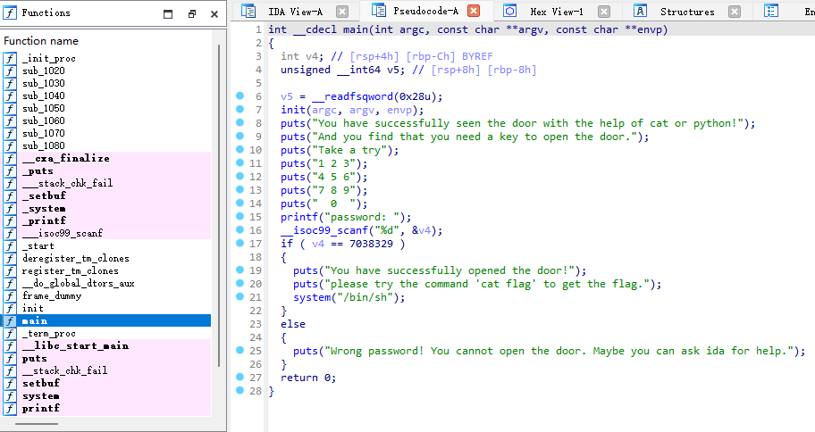
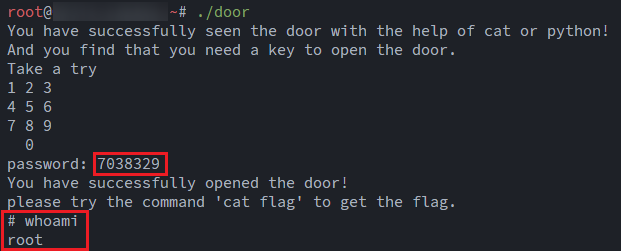
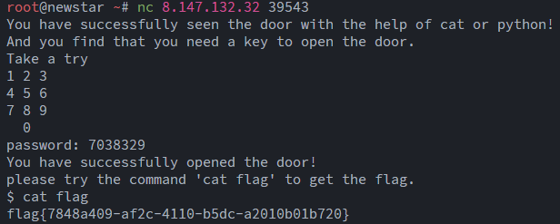

# NewStar CTF 2025 / pwn's door

> 本文由授权中文赛事 WP 正文导入（阶段 1，仅散文，代码段未导入）。
>
> - 来源：https://github.com/pj-newstar/wiki-docs/blob/1a0f2ba21a30f950276396118b315eef0328371c/docs/wp/2025/week1/pwn/pwn-door.md
> - 许可：MIT
> - 署名：（未提供）
> - 文档族：official_event_archive
> - 赛事：NewStar CTF 2025
> - 年份：2025
> - 核验状态：official_source_not_reproduced
> - 正文 sha256：3505c69bd87af33f36578bb0699417dda5647a640603bba828608be30f9ca761
> - 导入 ID：official-52d2c1c647c515d00dd9eb
> - 原 domain：pwn
> - 本地快照：62_官方赛事题库/objects/1409cc21b863b6f6a77be3346285ce0f09be28694c78bead505a5cbdad594034.blob
> - 源修订：1a0f2ba21a30f950276396118b315eef0328371c
> - 收录说明：官方发布来源的说明正文；代码单独索引，未运行或分析。按文件收录，不把多份文件算作多道题。图片及附件下载状态见清单；仅按路径/原题分类标方向，binary 等跨方向资料留待分类。
> - 判定依据：original_prose_not_runtime_verified
> - 附件引用：[{"owner_id": "official-52d2c1c647c515d00dd9eb", "relative_path": "docs/assets/images/wp/2025/week1/pwn-door_1.png", "local_path": "62_官方赛事题库/objects/f8b8da0315873cb4329483270a18b734e03c0bf45c5e11b7b24d3b977d1f4518.blob", "downloaded_bytes": 55861, "source_url": "https://github.com/pj-newstar/wiki-docs/blob/1a0f2ba21a30f950276396118b315eef0328371c/docs/assets/images/wp/2025/week1/pwn-door_1.png", "sha256": "f8b8da0315873cb4329483270a18b734e03c0bf45c5e11b7b24d3b977d1f4518", "kind": "image", "policy": "reference_only_no_execution"}, {"owner_id": "official-52d2c1c647c515d00dd9eb", "relative_path": "docs/assets/images/wp/2025/week1/pwn-door_2.png", "local_path": "62_官方赛事题库/objects/9c00a210d86fb4ad24c7b35ebdfa9289fed6358b8e90749dbbe29fba84555d44.blob", "downloaded_bytes": 88381, "source_url": "https://github.com/pj-newstar/wiki-docs/blob/1a0f2ba21a30f950276396118b315eef0328371c/docs/assets/images/wp/2025/week1/pwn-door_2.png", "sha256": "9c00a210d86fb4ad24c7b35ebdfa9289fed6358b8e90749dbbe29fba84555d44", "kind": "image", "policy": "reference_only_no_execution"}, {"owner_id": "official-52d2c1c647c515d00dd9eb", "relative_path": "docs/assets/images/wp/2025/week1/pwn-door_3.png", "local_path": "62_官方赛事题库/objects/8e1680a21562a48271292a27a17211a36f8d76db436a615071f9e93439acc049.blob", "downloaded_bytes": 58596, "source_url": "https://github.com/pj-newstar/wiki-docs/blob/1a0f2ba21a30f950276396118b315eef0328371c/docs/assets/images/wp/2025/week1/pwn-door_3.png", "sha256": "8e1680a21562a48271292a27a17211a36f8d76db436a615071f9e93439acc049", "kind": "image", "policy": "reference_only_no_execution"}, {"owner_id": "official-52d2c1c647c515d00dd9eb", "relative_path": "docs/assets/images/wp/2025/week1/pwn-door_4.png", "local_path": "62_官方赛事题库/objects/951bc5e0e16cd42ef7d62153990171cbe4208b4f9b2108b3a3136b3346240f47.blob", "downloaded_bytes": 21890, "source_url": "https://github.com/pj-newstar/wiki-docs/blob/1a0f2ba21a30f950276396118b315eef0328371c/docs/assets/images/wp/2025/week1/pwn-door_4.png", "sha256": "951bc5e0e16cd42ef7d62153990171cbe4208b4f9b2108b3a3136b3346240f47", "kind": "image", "policy": "reference_only_no_execution"}, {"owner_id": "official-52d2c1c647c515d00dd9eb", "relative_path": "docs/assets/images/wp/2025/week1/pwn-door_5.png", "local_path": "62_官方赛事题库/objects/2159f32be537e826a2b27055e9498848093bf412ca50f7d945f41e38b10b7556.blob", "downloaded_bytes": 25566, "source_url": "https://github.com/pj-newstar/wiki-docs/blob/1a0f2ba21a30f950276396118b315eef0328371c/docs/assets/images/wp/2025/week1/pwn-door_5.png", "sha256": "2159f32be537e826a2b27055e9498848093bf412ca50f7d945f41e38b10b7556", "kind": "image", "policy": "reference_only_no_execution"}]

> 原文：https://github.com/pj-newstar/wiki-docs/blob/1a0f2ba21a30f950276396118b315eef0328371c/docs/wp/2025/week1/pwn/pwn-door.md

## 正文

---
titleTemplate: ":title | WriteUp - NewStar CTF 2025"
---

import Container from '@/components/docs/Container.vue'

## pwn's door

本题考查 nc 的使用。

在点击下发赛题后会有如下内容：

这表示题目需要使用 nc 进行访问，命令格式为：

其中 `ip` 和 `port` 分别是访问 IP（也可以是域名）和端口，在安装了 netcat 的情况下，在终端指向上述命令就能连接上靶机。关于安装 netcat，可参见 [Netcat 使用指南](/learn/nc)。

如上图所示，只需要在终端输入 `nc 8.147.132.32 39543` 即可访问题目环境。具体的访问地址不同选手不一致。

题目给了一个附件，需要进行程序分析，使用用 IDA Pro 打开，会看到如图所示的界面：

按下 <kbd>F5</kbd> 可以查看反编译后的 C 代码。在左侧「Function name」中找到 `main` 函数并查看反编译结果。

代码大意为：用户输入一个数字，存入 `v4` 变量，如果 `v4` 等于 `7038329`，则执行 `system("/bin/sh")`，进入 shell.

附件是 Linux 操作系统中的可执行文件格式 ELF，在本地 Linux 环境中运行程序，我们输入 `7038329` 并回车，进入 shell，运行 `whoami` 成功。

连接远程环境，输入 `7038329` 进入 shell 并运行 `cat flag` 即可获取 FLAG.

## 原文配图

