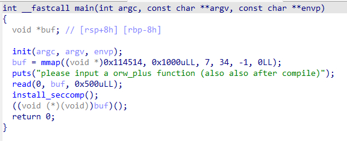
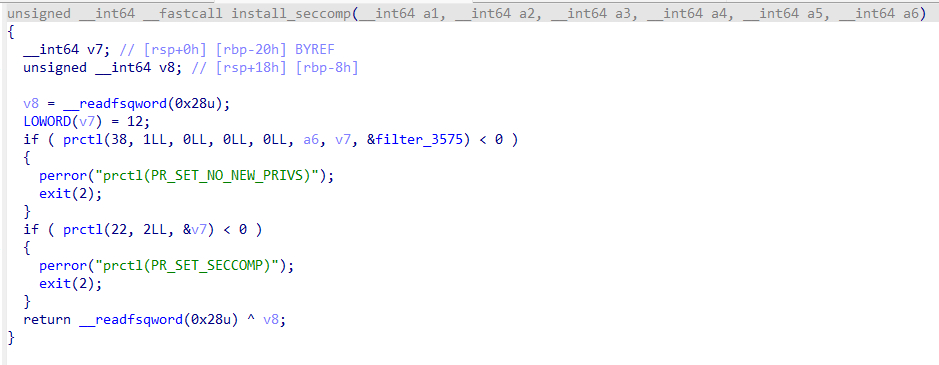
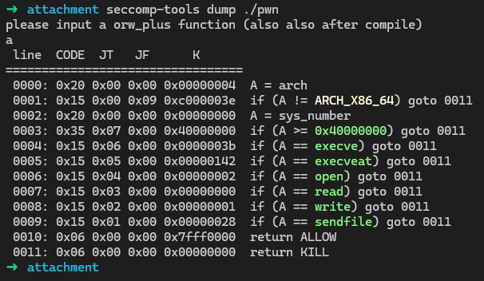

# NewStar CTF 2025 / sandbox_plus

> 本文由授权中文赛事 WP 正文导入（阶段 1，仅散文，代码段未导入）。
>
> - 来源：https://github.com/pj-newstar/wiki-docs/blob/1a0f2ba21a30f950276396118b315eef0328371c/docs/wp/2025/week3/pwn/sandbox-plus.md
> - 许可：MIT
> - 署名：（未提供）
> - 文档族：official_event_archive
> - 赛事：NewStar CTF 2025
> - 年份：2025
> - 核验状态：official_source_not_reproduced
> - 正文 sha256：46be4dee7413a0e557e883b20d933f502314ccca596eac91129f31092e378579
> - 导入 ID：official-5007fd131092f47f613d8d
> - 原 domain：pwn
> - 本地快照：62_官方赛事题库/objects/aecea55106c5a62e7f63caf646f73edbac34b00d304579faf98d982fd03bb4f1.blob
> - 源修订：1a0f2ba21a30f950276396118b315eef0328371c
> - 收录说明：官方发布来源的说明正文；代码单独索引，未运行或分析。按文件收录，不把多份文件算作多道题。图片及附件下载状态见清单；仅按路径/原题分类标方向，binary 等跨方向资料留待分类。
> - 判定依据：original_prose_not_runtime_verified
> - 附件引用：[{"owner_id": "official-5007fd131092f47f613d8d", "relative_path": "docs/assets/images/wp/2025/week3/sandbox-plus_1.jpg", "local_path": "62_官方赛事题库/objects/6247b19f661afd696ccedb3b6977197072481b0dbc859ca602e3357e1289e1ca.blob", "downloaded_bytes": 143576, "source_url": "https://github.com/pj-newstar/wiki-docs/blob/1a0f2ba21a30f950276396118b315eef0328371c/docs/assets/images/wp/2025/week3/sandbox-plus_1.jpg", "sha256": "6247b19f661afd696ccedb3b6977197072481b0dbc859ca602e3357e1289e1ca", "kind": "image", "policy": "reference_only_no_execution"}, {"owner_id": "official-5007fd131092f47f613d8d", "relative_path": "docs/assets/images/wp/2025/week3/sandbox-plus_2.jpg", "local_path": "62_官方赛事题库/objects/9f3061be1c45a709d50444c29edd5ae9fbf223b9989a101ffb98862e4b89998a.blob", "downloaded_bytes": 174759, "source_url": "https://github.com/pj-newstar/wiki-docs/blob/1a0f2ba21a30f950276396118b315eef0328371c/docs/assets/images/wp/2025/week3/sandbox-plus_2.jpg", "sha256": "9f3061be1c45a709d50444c29edd5ae9fbf223b9989a101ffb98862e4b89998a", "kind": "image", "policy": "reference_only_no_execution"}, {"owner_id": "official-5007fd131092f47f613d8d", "relative_path": "docs/assets/images/wp/2025/week3/sandbox-plus_3.jpg", "local_path": "62_官方赛事题库/objects/3206ad70a1f759aefb8f01962fcdfa55dd602a364137fc9339a22d7c14ed1adb.blob", "downloaded_bytes": 172891, "source_url": "https://github.com/pj-newstar/wiki-docs/blob/1a0f2ba21a30f950276396118b315eef0328371c/docs/assets/images/wp/2025/week3/sandbox-plus_3.jpg", "sha256": "3206ad70a1f759aefb8f01962fcdfa55dd602a364137fc9339a22d7c14ed1adb", "kind": "image", "policy": "reference_only_no_execution"}]

> 原文：https://github.com/pj-newstar/wiki-docs/blob/1a0f2ba21a30f950276396118b315eef0328371c/docs/wp/2025/week3/pwn/sandbox-plus.md

## 正文

---
titleTemplate: ":title | WriteUp - NewStar CTF 2025"
---

## sandbox_plus

这道题目还是考查 `shellcode`，但是在执行之前会先经过一个 `install_seccomp` 函数，我们去看看函数内容。

可以看到程序加载了 seccomp 沙箱。可以通过 `seccomp-tools dump 文件地址` 快速查看沙箱规则。沙箱规则通常分为白名单和黑名单：白名单表示仅允许指定系统调用，黑名单表示禁止指定系统调用。

可以看到程序禁用了 `execve`、`execveat`、`open`、`read`、`write`、`sendfile`，当程序发现系统调用号和上面五个函数的系统调用号相同时，会直接结束进程。

因此需要绕过沙箱读取 FLAG。这里考虑通过 `openat` 打开 `/flag` 文件，随后通过 `readv` 和 `writev` 将内容输出到终端。

在 `openat` 函数中，第一个参数传入 `-100`，第二个参数传入 `"/flag"` 的地址即可打开 FLAG 文件。

调用 `openat` 的 shellcode 可以写为：

`readv` 和 `writev` 依赖 `iov` 结构体，该结构体如下：

因此需要先构建该结构体，随后将结构体地址设置为 `readv` 和 `writev` 的第二个参数。函数的第三个参数是 `iov` 数组中的元素数量，可以设置为 1。

可以将结构体布置在栈上。执行上面的 `openat` shellcode 后，`rsi` 中保留了栈地址，因此可以通过 `rsi` 指定 `readv` 读入地址和 `writev` 写出地址。shellcode 如下：

因此可以得到 EXP：

## 原文配图

