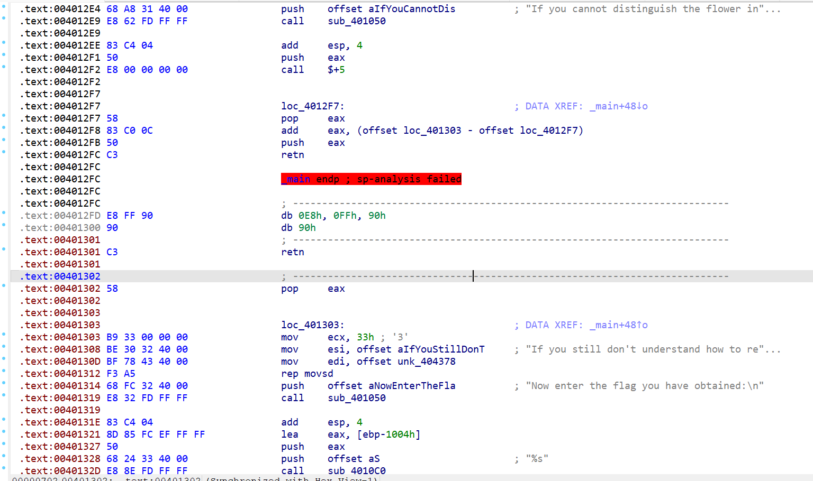
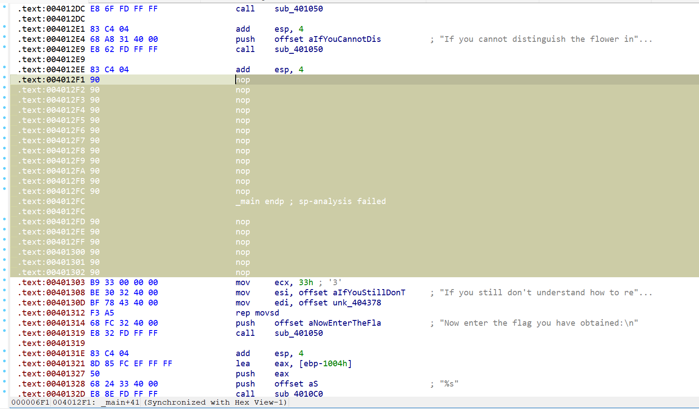
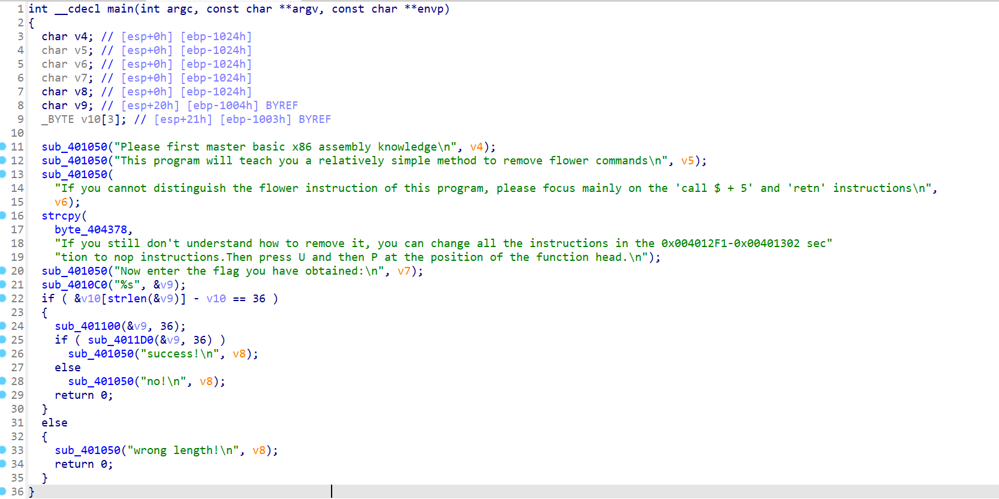
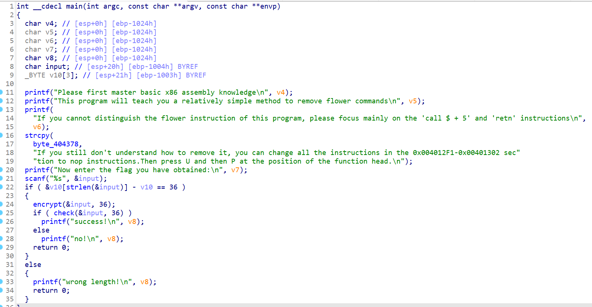
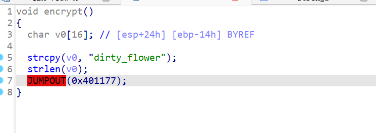
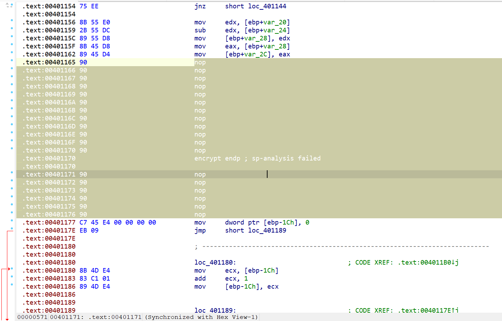
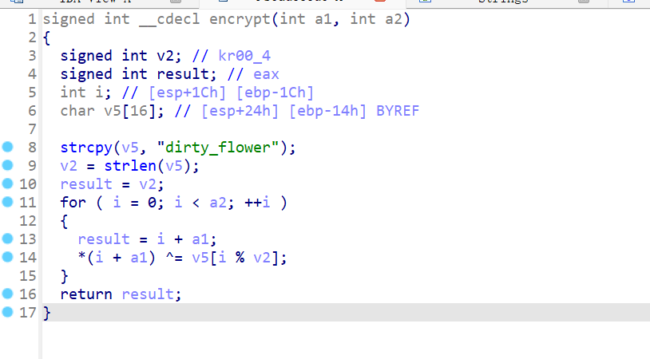

# NewStar CTF 2024 / Dirty_flowers

> 本文由授权中文赛事 WP 正文导入（阶段 1，仅散文，代码段未导入）。
>
> - 来源：https://github.com/pj-newstar/wiki-docs/blob/1a0f2ba21a30f950276396118b315eef0328371c/docs/wp/2024/week2/reverse/dirty-flowers.md
> - 许可：MIT
> - 署名：（未提供）
> - 文档族：official_event_archive
> - 赛事：NewStar CTF 2024
> - 年份：2024
> - 核验状态：official_source_not_reproduced
> - 正文 sha256：687ddfdc3694b402f715820434f8e446bf5ed236864a3bc5e611205e528a6a5d
> - 导入 ID：official-1c5c598b9e42bd3147bf04
> - 原 domain：reverse
> - 本地快照：62_官方赛事题库/objects/8d96954e1e11675b1af168241c526f0799d9b1105c69df682735e6e1d03eada3.blob
> - 源修订：1a0f2ba21a30f950276396118b315eef0328371c
> - 收录说明：官方发布来源的说明正文；代码单独索引，未运行或分析。按文件收录，不把多份文件算作多道题。图片及附件下载状态见清单；仅按路径/原题分类标方向，binary 等跨方向资料留待分类。
> - 判定依据：original_prose_not_runtime_verified
> - 附件引用：[{"owner_id": "official-1c5c598b9e42bd3147bf04", "relative_path": "docs/assets/images/wp/2024/week2/dirty-flowers_1.png", "local_path": "62_官方赛事题库/objects/b6598461062bce00e3f5f18d9b3ec5899e4c440070a3a47f48534a5ec1fe45ef.blob", "downloaded_bytes": 111640, "source_url": "https://github.com/pj-newstar/wiki-docs/blob/1a0f2ba21a30f950276396118b315eef0328371c/docs/assets/images/wp/2024/week2/dirty-flowers_1.png", "sha256": "b6598461062bce00e3f5f18d9b3ec5899e4c440070a3a47f48534a5ec1fe45ef", "kind": "image", "policy": "reference_only_no_execution"}, {"owner_id": "official-1c5c598b9e42bd3147bf04", "relative_path": "docs/assets/images/wp/2024/week2/dirty-flowers_2.png", "local_path": "62_官方赛事题库/objects/1b3fcbe05652056e98f844951d17218b997eee6480703361a9cf52fe2ac26315.blob", "downloaded_bytes": 111825, "source_url": "https://github.com/pj-newstar/wiki-docs/blob/1a0f2ba21a30f950276396118b315eef0328371c/docs/assets/images/wp/2024/week2/dirty-flowers_2.png", "sha256": "1b3fcbe05652056e98f844951d17218b997eee6480703361a9cf52fe2ac26315", "kind": "image", "policy": "reference_only_no_execution"}, {"owner_id": "official-1c5c598b9e42bd3147bf04", "relative_path": "docs/assets/images/wp/2024/week2/dirty-flowers_3.png", "local_path": "62_官方赛事题库/objects/5a086dba32c68fabe542fe042ea8c0c7e06bd85d65d55a53579e5ac6a6328d10.blob", "downloaded_bytes": 89360, "source_url": "https://github.com/pj-newstar/wiki-docs/blob/1a0f2ba21a30f950276396118b315eef0328371c/docs/assets/images/wp/2024/week2/dirty-flowers_3.png", "sha256": "5a086dba32c68fabe542fe042ea8c0c7e06bd85d65d55a53579e5ac6a6328d10", "kind": "image", "policy": "reference_only_no_execution"}, {"owner_id": "official-1c5c598b9e42bd3147bf04", "relative_path": "docs/assets/images/wp/2024/week2/dirty-flowers_4.png", "local_path": "62_官方赛事题库/objects/001ae0d7172de990a3df0e2a79f0568648e72933ae6eb681b01b1b954fadb43b.blob", "downloaded_bytes": 84920, "source_url": "https://github.com/pj-newstar/wiki-docs/blob/1a0f2ba21a30f950276396118b315eef0328371c/docs/assets/images/wp/2024/week2/dirty-flowers_4.png", "sha256": "001ae0d7172de990a3df0e2a79f0568648e72933ae6eb681b01b1b954fadb43b", "kind": "image", "policy": "reference_only_no_execution"}, {"owner_id": "official-1c5c598b9e42bd3147bf04", "relative_path": "docs/assets/images/wp/2024/week2/dirty-flowers_5.png", "local_path": "62_官方赛事题库/objects/d514e59bf761ae8f74098770c9df383a6c0cd70c96a316fc36d8fab3c4856b70.blob", "downloaded_bytes": 15028, "source_url": "https://github.com/pj-newstar/wiki-docs/blob/1a0f2ba21a30f950276396118b315eef0328371c/docs/assets/images/wp/2024/week2/dirty-flowers_5.png", "sha256": "d514e59bf761ae8f74098770c9df383a6c0cd70c96a316fc36d8fab3c4856b70", "kind": "image", "policy": "reference_only_no_execution"}, {"owner_id": "official-1c5c598b9e42bd3147bf04", "relative_path": "docs/assets/images/wp/2024/week2/dirty-flowers_6.png", "local_path": "62_官方赛事题库/objects/b05c5b8ee09ad600a0cf1b8c14ff7d5893156848244695cc470080d44013309d.blob", "downloaded_bytes": 101161, "source_url": "https://github.com/pj-newstar/wiki-docs/blob/1a0f2ba21a30f950276396118b315eef0328371c/docs/assets/images/wp/2024/week2/dirty-flowers_6.png", "sha256": "b05c5b8ee09ad600a0cf1b8c14ff7d5893156848244695cc470080d44013309d", "kind": "image", "policy": "reference_only_no_execution"}, {"owner_id": "official-1c5c598b9e42bd3147bf04", "relative_path": "docs/assets/images/wp/2024/week2/dirty-flowers_7.png", "local_path": "62_官方赛事题库/objects/5ba3c4b5b16f6a0d1d999e2bd83cf39009ed249d22ec155b0035a1756973b4ad.blob", "downloaded_bytes": 31027, "source_url": "https://github.com/pj-newstar/wiki-docs/blob/1a0f2ba21a30f950276396118b315eef0328371c/docs/assets/images/wp/2024/week2/dirty-flowers_7.png", "sha256": "5ba3c4b5b16f6a0d1d999e2bd83cf39009ed249d22ec155b0035a1756973b4ad", "kind": "image", "policy": "reference_only_no_execution"}]

> 原文：https://github.com/pj-newstar/wiki-docs/blob/1a0f2ba21a30f950276396118b315eef0328371c/docs/wp/2024/week2/reverse/dirty-flowers.md

## 正文

---
titleTemplate: ":title | WriteUp - NewStar CTF 2024"
---

## Dirty_flowers

考查内容是花指令，但是事实上新生在 week2 就学过汇编还是不敢奢望，因此实际考查内容是学习怎么用 `nop` 改汇编指令。

按下 <kbd>⇧ Shift</kbd><kbd>F12</kbd> 查找字符串就可以发现提示。

提示说将 `0x4012f1`\~`0x401302`的指令全部改成 `nop` 指令，随后在函数头位置按下 <kbd>U</kbd> <kbd>P</kbd>.

在此不对这段的花指令再进行解释，自己模拟一遍栈帧操作即可理解。

将从 `push eax` 到 `pop eax` 这一段全部 nop 掉。

然后在函数头位置按下 <kbd>U</kbd> <kbd>P</kbd>，再按下 <kbd>F5</kbd>，即可正确反编译。

稍微分析一下，将几个函数重命名一下。在函数名位置处按下 <kbd>N</kbd>，进行重命名。

基本思路就是先判断长度是否是 36，再进行加密，最后比较。

点进 `check` 函数可以找到密文，但是点进加密函数却发现 IDA 再次飘红。

可以很容易发现加密函数里面的花指令与主函数的花指令完全一样。因此再操作一遍即可。

加密函数非常简单。

## 原文配图

