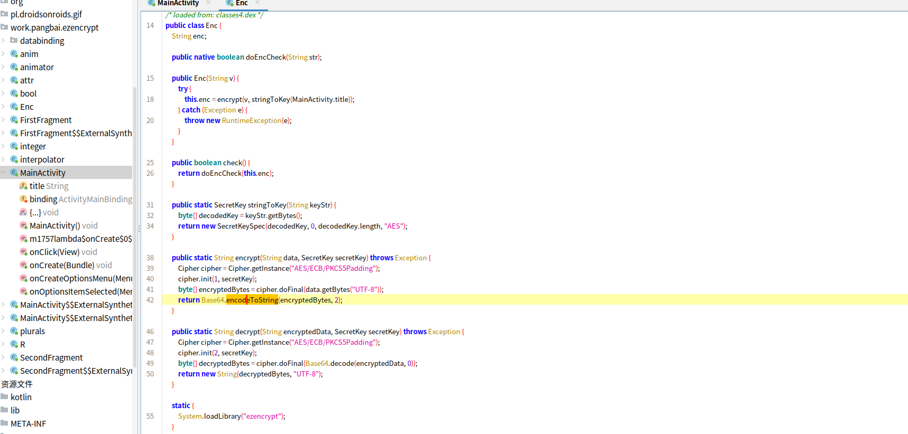
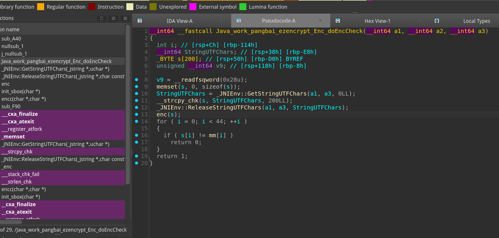
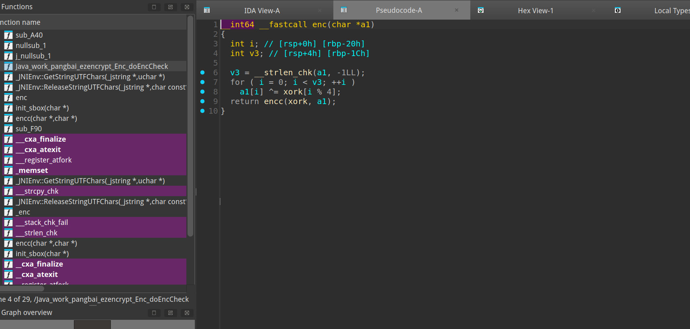
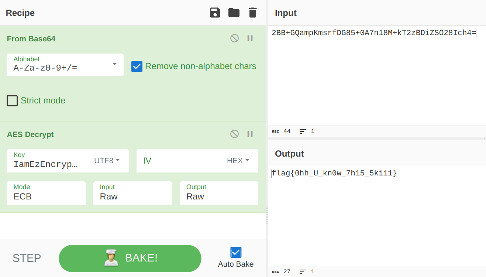

# NewStar CTF 2024 / Ezencypt

> 本文由授权中文赛事 WP 正文导入（阶段 1，仅散文，代码段未导入）。
>
> - 来源：https://github.com/pj-newstar/wiki-docs/blob/1a0f2ba21a30f950276396118b315eef0328371c/docs/wp/2024/week2/reverse/ezencypt.md
> - 许可：MIT
> - 署名：（未提供）
> - 文档族：official_event_archive
> - 赛事：NewStar CTF 2024
> - 年份：2024
> - 核验状态：official_source_not_reproduced
> - 正文 sha256：687ddfdc3694b402f715820434f8e446bf5ed236864a3bc5e611205e528a6a5d
> - 导入 ID：official-663b259225318fd39068e2
> - 原 domain：reverse
> - 本地快照：62_官方赛事题库/objects/49ef21313bb31e740cb4f5388687fa64eda585239306347518a3067b66fe93d8.blob
> - 源修订：1a0f2ba21a30f950276396118b315eef0328371c
> - 收录说明：官方发布来源的说明正文；代码单独索引，未运行或分析。按文件收录，不把多份文件算作多道题。图片及附件下载状态见清单；仅按路径/原题分类标方向，binary 等跨方向资料留待分类。
> - 判定依据：original_prose_not_runtime_verified
> - 附件引用：[{"owner_id": "official-663b259225318fd39068e2", "relative_path": "docs/assets/images/wp/2024/week2/ezencrypt_1.png", "local_path": "62_官方赛事题库/objects/ff19fdccb6c993af423390693834941ca590fd382348cc03e331afcdf3522bf9.blob", "downloaded_bytes": 196935, "source_url": "https://github.com/pj-newstar/wiki-docs/blob/1a0f2ba21a30f950276396118b315eef0328371c/docs/assets/images/wp/2024/week2/ezencrypt_1.png", "sha256": "ff19fdccb6c993af423390693834941ca590fd382348cc03e331afcdf3522bf9", "kind": "image", "policy": "reference_only_no_execution"}, {"owner_id": "official-663b259225318fd39068e2", "relative_path": "docs/assets/images/wp/2024/week2/ezencrypt_2.png", "local_path": "62_官方赛事题库/objects/fe31f7069ff11f928e9efa93e626cb2bfc1fc40099a0112b772d8edf4e571d4c.blob", "downloaded_bytes": 235411, "source_url": "https://github.com/pj-newstar/wiki-docs/blob/1a0f2ba21a30f950276396118b315eef0328371c/docs/assets/images/wp/2024/week2/ezencrypt_2.png", "sha256": "fe31f7069ff11f928e9efa93e626cb2bfc1fc40099a0112b772d8edf4e571d4c", "kind": "image", "policy": "reference_only_no_execution"}, {"owner_id": "official-663b259225318fd39068e2", "relative_path": "docs/assets/images/wp/2024/week2/ezencrypt_3.png", "local_path": "62_官方赛事题库/objects/c757e05a0a0fceda8b10f1d334c13ff0c390afcbe28555730a5c88427bdb0a92.blob", "downloaded_bytes": 168630, "source_url": "https://github.com/pj-newstar/wiki-docs/blob/1a0f2ba21a30f950276396118b315eef0328371c/docs/assets/images/wp/2024/week2/ezencrypt_3.png", "sha256": "c757e05a0a0fceda8b10f1d334c13ff0c390afcbe28555730a5c88427bdb0a92", "kind": "image", "policy": "reference_only_no_execution"}, {"owner_id": "official-663b259225318fd39068e2", "relative_path": "docs/assets/images/wp/2024/week2/ezencrypt_4.png", "local_path": "62_官方赛事题库/objects/dd02a294978d4356a280b87ad7ef08e550e5bc62508987ea50b0e16b3cc9b8df.blob", "downloaded_bytes": 78908, "source_url": "https://github.com/pj-newstar/wiki-docs/blob/1a0f2ba21a30f950276396118b315eef0328371c/docs/assets/images/wp/2024/week2/ezencrypt_4.png", "sha256": "dd02a294978d4356a280b87ad7ef08e550e5bc62508987ea50b0e16b3cc9b8df", "kind": "image", "policy": "reference_only_no_execution"}]

> 原文：https://github.com/pj-newstar/wiki-docs/blob/1a0f2ba21a30f950276396118b315eef0328371c/docs/wp/2024/week2/reverse/ezencypt.md

## 正文

---
titleTemplate: ":title | WriteUp - NewStar CTF 2024"
---

## Ezencypt

打开 MainActivity 查看 Onclick 逻辑，`Enc enc = new Enc(tx)`，加密逻辑在 `Enc`

Enc 的构造函数里进行了第一次加密，代码可以看出是 ECB 模式的 AES，密钥是 MainActivity 的 title.

`doEncCheck` 函数进行加密数据检查，有 native 标签说明函数是 C 语言编写的，主体在 so 文件。

IDA 打开 so 文件，找到 `doEncCheck` 的实现

发现数据经过 `enc` 函数的加密，再在循环里检验

`enc` 里一个异或加密，一个 RC4，key是 `xork`

思路全部清楚了，写解密脚本:

将 so 层解密后的数据（输出）用 CyberChef 进行 Base64 和 AES 解密就行了：[Recipe](<https://gchq.github.io/CyberChef/#recipe=From_Base64('A-Za-z0-9%2B/%3D',true,false)AES_Decrypt(%7B'option':'UTF8','string':'IamEzEncryptGame'%7D,%7B'option':'Hex','string':''%7D,'ECB','Raw','Raw',%7B'option':'Hex','string':''%7D,%7B'option':'Hex','string':''%7D)>).

## 原文配图

