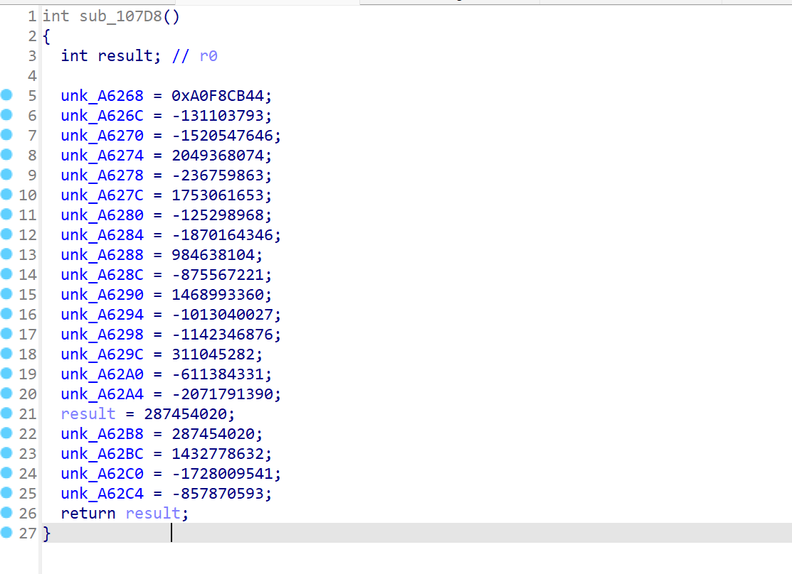

# NewStar CTF 2024 / MY_ARM

> 本文由授权中文赛事 WP 正文导入（阶段 1，仅散文，代码段未导入）。
>
> - 来源：https://github.com/pj-newstar/wiki-docs/blob/1a0f2ba21a30f950276396118b315eef0328371c/docs/wp/2024/week5/reverse/my_arm.md
> - 许可：MIT
> - 署名：（未提供）
> - 文档族：official_event_archive
> - 赛事：NewStar CTF 2024
> - 年份：2024
> - 核验状态：official_source_not_reproduced
> - 正文 sha256：687ddfdc3694b402f715820434f8e446bf5ed236864a3bc5e611205e528a6a5d
> - 导入 ID：official-2af8e7c4b34ed6dfcc413c
> - 原 domain：reverse
> - 本地快照：62_官方赛事题库/objects/edc805bbe1f334f9257ff5853747539e3a9cebc8ef984b604320d4cf968a560e.blob
> - 源修订：1a0f2ba21a30f950276396118b315eef0328371c
> - 收录说明：官方发布来源的说明正文；代码单独索引，未运行或分析。按文件收录，不把多份文件算作多道题。图片及附件下载状态见清单；仅按路径/原题分类标方向，binary 等跨方向资料留待分类。
> - 判定依据：original_prose_not_runtime_verified
> - 附件引用：[{"owner_id": "official-2af8e7c4b34ed6dfcc413c", "relative_path": "docs/assets/images/wp/2024/week5/my_arm_1.png", "local_path": "62_官方赛事题库/objects/bee85e88dc89b14527ac5ad2cf2f11407dd75e7e64a104c6e1974c25ab5d720f.blob", "downloaded_bytes": 78075, "source_url": "https://github.com/pj-newstar/wiki-docs/blob/1a0f2ba21a30f950276396118b315eef0328371c/docs/assets/images/wp/2024/week5/my_arm_1.png", "sha256": "bee85e88dc89b14527ac5ad2cf2f11407dd75e7e64a104c6e1974c25ab5d720f", "kind": "image", "policy": "reference_only_no_execution"}]

> 原文：https://github.com/pj-newstar/wiki-docs/blob/1a0f2ba21a30f950276396118b315eef0328371c/docs/wp/2024/week5/reverse/my_arm.md

## 正文

---
titleTemplate: ":title | WriteUp - NewStar CTF 2024"
---

## MY_ARM

静态编译

使用 qemu 进行动态调试，可以参考[这篇文章](https://xz.aliyun.com/t/10214)进行动态调试

程序本身没有加很多混淆，因此其实静态分析也可以

程序本身没有加很多混淆，因此其实静态分析也可以

本身使用 TEA 进行加密，并且没有进行任何魔改

唯一需要注意的是有一个函数在 `main` 函数执行前执行了，覆盖了密文数组和密钥数

这个函数是真正运行的，其他几个函数都是用来迷惑的。

写出解密代码

## 原文配图

