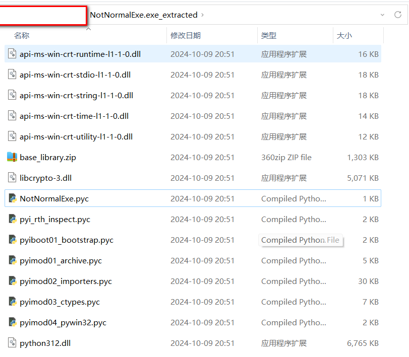
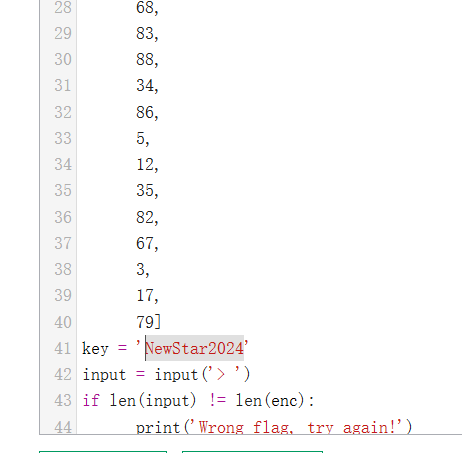

# NewStar CTF 2024 / PangBai 过家家（3）

> 本文由授权中文赛事 WP 正文导入（阶段 1，仅散文，代码段未导入）。
>
> - 来源：https://github.com/pj-newstar/wiki-docs/blob/1a0f2ba21a30f950276396118b315eef0328371c/docs/wp/2024/week3/reverse/pangbai3.md
> - 许可：MIT
> - 署名：（未提供）
> - 文档族：official_event_archive
> - 赛事：NewStar CTF 2024
> - 年份：2024
> - 核验状态：official_source_not_reproduced
> - 正文 sha256：e4948a0ac253ee177ae081b53b30755b98c1551de5c3ef7f429d62eb61a35750
> - 导入 ID：official-5caa2011c3e9582644e106
> - 原 domain：reverse
> - 本地快照：62_官方赛事题库/objects/27f17e3dd1cd6650d27e79a315392489c2a853ec4e4b514f3db6765922f6806e.blob
> - 源修订：1a0f2ba21a30f950276396118b315eef0328371c
> - 收录说明：官方发布来源的说明正文；代码单独索引，未运行或分析。按文件收录，不把多份文件算作多道题。图片及附件下载状态见清单；仅按路径/原题分类标方向，binary 等跨方向资料留待分类。
> - 判定依据：original_prose_not_runtime_verified
> - 附件引用：[{"owner_id": "official-5caa2011c3e9582644e106", "relative_path": "docs/assets/images/wp/2024/week3/pangbai3_1.png", "local_path": "62_官方赛事题库/objects/ca4e7f1da5d84302a5332873b92882177d03e84e595098bb4df2479f2f9d2d7e.blob", "downloaded_bytes": 60465, "source_url": "https://github.com/pj-newstar/wiki-docs/blob/1a0f2ba21a30f950276396118b315eef0328371c/docs/assets/images/wp/2024/week3/pangbai3_1.png", "sha256": "ca4e7f1da5d84302a5332873b92882177d03e84e595098bb4df2479f2f9d2d7e", "kind": "image", "policy": "reference_only_no_execution"}, {"owner_id": "official-5caa2011c3e9582644e106", "relative_path": "docs/assets/images/wp/2024/week3/pangbai3_2.png", "local_path": "62_官方赛事题库/objects/78e2f41945ab23e1e65bde3819dcbf59bbd8d72f09dd067e805587ff49e3f6bf.blob", "downloaded_bytes": 18853, "source_url": "https://github.com/pj-newstar/wiki-docs/blob/1a0f2ba21a30f950276396118b315eef0328371c/docs/assets/images/wp/2024/week3/pangbai3_2.png", "sha256": "78e2f41945ab23e1e65bde3819dcbf59bbd8d72f09dd067e805587ff49e3f6bf", "kind": "image", "policy": "reference_only_no_execution"}]

> 原文：https://github.com/pj-newstar/wiki-docs/blob/1a0f2ba21a30f950276396118b315eef0328371c/docs/wp/2024/week3/reverse/pangbai3.md

## 正文

---
titleTemplate: ":title | WriteUp - NewStar CTF 2024"
---

import Container from '@/components/docs/Container.vue'

## PangBai 过家家（3）

本题预计解数很多，校内赛道没达到预期。

如果你用了 DIE，那应该会看到 PyInstaller 字样，这是一个 Python 库，能把 `.py` 脚本打包成 `.exe`. 如果你用 IDA 直接分析，里面大量的 Python 字样也是它的显著特征。当然，直接用 IDA 是难以分析 Python 脚本逻辑的。

对于此种程序，解包方法很多，大家可以上网查关键词 PyInstaller 解包，资料也很多。我使用的是 PyInstaller Extractor.

解包后得到一个目录。

对于这个题，我们没有加密，也没有魔改 magic，也没有在库里面藏东西，所以说我们只关心和程序同名的 `NotNormalExe.pyc`. 反编译他看逻辑即可。

为什么一个脚本语言存在编译？这个过程叫预编译，如果感兴趣可以去查资料。

反编译方法也有很多，如在线网站，或各种脚本，如 [tool.lu/pyc](https://tool.lu/pyc/).

此处由于字节码的版本较高，前面会反编译出错，此时大家可以直接猜这是异或，或者用另一款工具 pycdas 去看机器码，然后找到关键的异或逻辑。

本题其实对于没接触过的人来说主打一个猜，还有查询资料的能力。

如果上面的东西没看懂，[这篇文章](https://blog.csdn.net/qq_51116518/article/details/138270490)可能会帮助你。

## 原文配图

