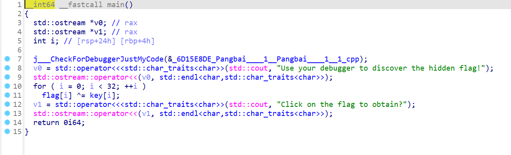
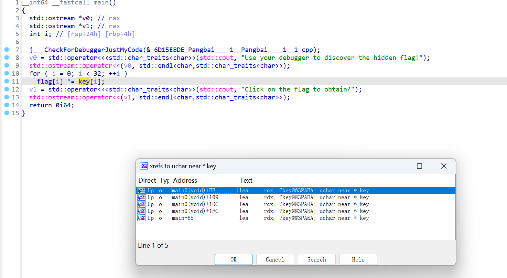
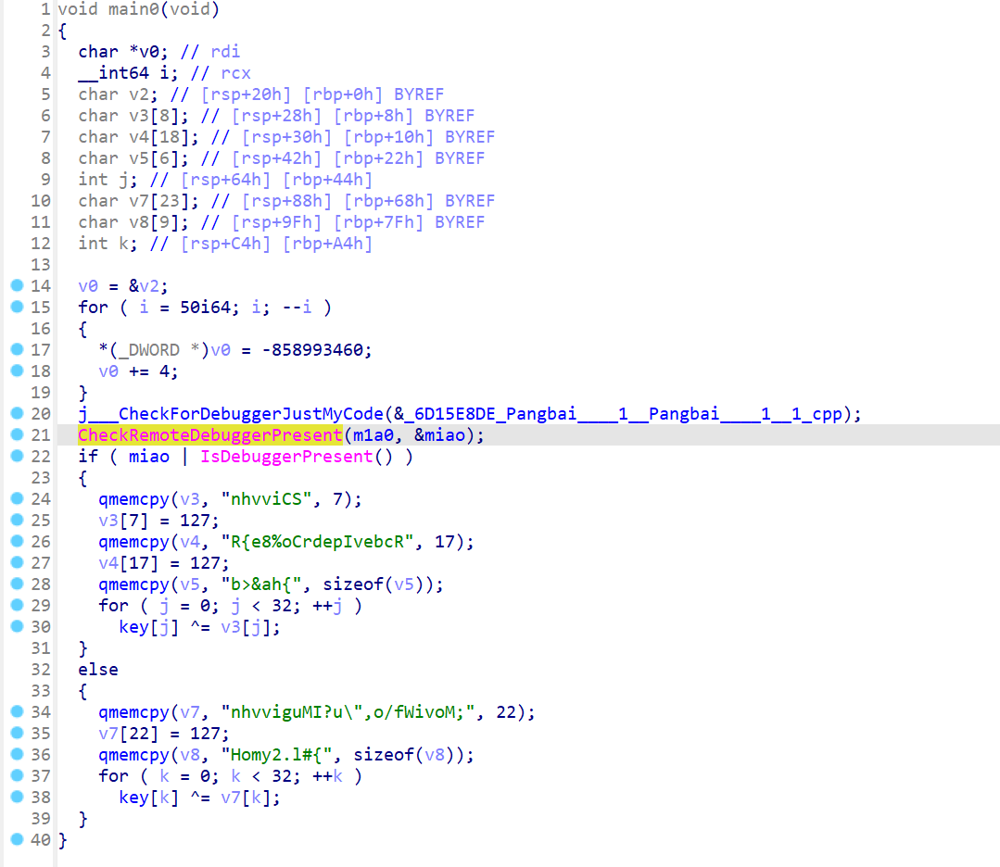
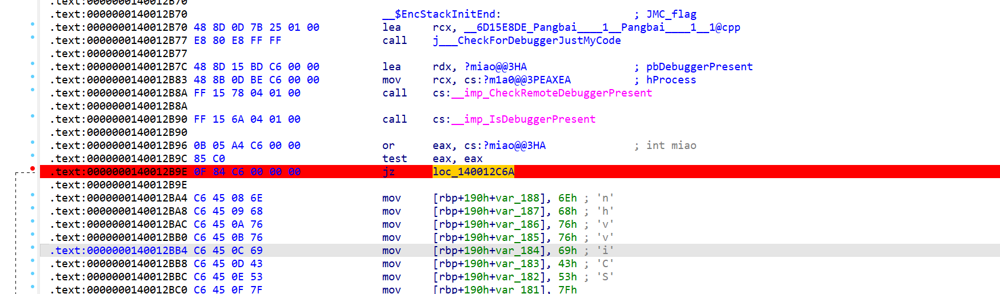
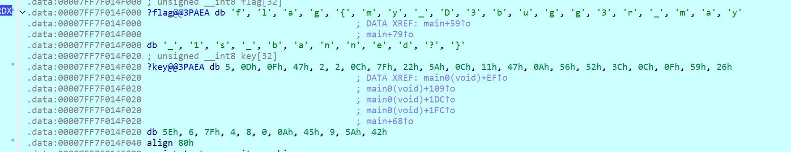

# NewStar CTF 2024 / Pangbai 泰拉记（1）

> 本文由授权中文赛事 WP 正文导入（阶段 1，仅散文，代码段未导入）。
>
> - 来源：https://github.com/pj-newstar/wiki-docs/blob/1a0f2ba21a30f950276396118b315eef0328371c/docs/wp/2024/week2/reverse/pangbai-terra1.md
> - 许可：MIT
> - 署名：（未提供）
> - 文档族：official_event_archive
> - 赛事：NewStar CTF 2024
> - 年份：2024
> - 核验状态：official_source_not_reproduced
> - 正文 sha256：687ddfdc3694b402f715820434f8e446bf5ed236864a3bc5e611205e528a6a5d
> - 导入 ID：official-a62f435a1f3ffd5accf2a9
> - 原 domain：reverse
> - 本地快照：62_官方赛事题库/objects/6b6253737cde56f064611adb996a1023e865bc44f146f0a54461e3b30b57ab66.blob
> - 源修订：1a0f2ba21a30f950276396118b315eef0328371c
> - 收录说明：官方发布来源的说明正文；代码单独索引，未运行或分析。按文件收录，不把多份文件算作多道题。图片及附件下载状态见清单；仅按路径/原题分类标方向，binary 等跨方向资料留待分类。
> - 判定依据：original_prose_not_runtime_verified
> - 附件引用：[{"owner_id": "official-a62f435a1f3ffd5accf2a9", "relative_path": "docs/assets/images/wp/2024/week2/pangbai-terra1_1.png", "local_path": "62_官方赛事题库/objects/00d3f101bc4e88efa5e16f50676ed1a07b8627978fece28d393acf55772cf929.blob", "downloaded_bytes": 45580, "source_url": "https://github.com/pj-newstar/wiki-docs/blob/1a0f2ba21a30f950276396118b315eef0328371c/docs/assets/images/wp/2024/week2/pangbai-terra1_1.png", "sha256": "00d3f101bc4e88efa5e16f50676ed1a07b8627978fece28d393acf55772cf929", "kind": "image", "policy": "reference_only_no_execution"}, {"owner_id": "official-a62f435a1f3ffd5accf2a9", "relative_path": "docs/assets/images/wp/2024/week2/pangbai-terra1_2.png", "local_path": "62_官方赛事题库/objects/662f0b5ba768ad3184ac93b55e59cb4a24d1675814844f69eeb77f91a1435764.blob", "downloaded_bytes": 112157, "source_url": "https://github.com/pj-newstar/wiki-docs/blob/1a0f2ba21a30f950276396118b315eef0328371c/docs/assets/images/wp/2024/week2/pangbai-terra1_2.png", "sha256": "662f0b5ba768ad3184ac93b55e59cb4a24d1675814844f69eeb77f91a1435764", "kind": "image", "policy": "reference_only_no_execution"}, {"owner_id": "official-a62f435a1f3ffd5accf2a9", "relative_path": "docs/assets/images/wp/2024/week2/pangbai-terra1_3.png", "local_path": "62_官方赛事题库/objects/253209767753316010dd7d53c64dae854e9bfb70b858d69d564e8643552fcdac.blob", "downloaded_bytes": 89329, "source_url": "https://github.com/pj-newstar/wiki-docs/blob/1a0f2ba21a30f950276396118b315eef0328371c/docs/assets/images/wp/2024/week2/pangbai-terra1_3.png", "sha256": "253209767753316010dd7d53c64dae854e9bfb70b858d69d564e8643552fcdac", "kind": "image", "policy": "reference_only_no_execution"}, {"owner_id": "official-a62f435a1f3ffd5accf2a9", "relative_path": "docs/assets/images/wp/2024/week2/pangbai-terra1_4.png", "local_path": "62_官方赛事题库/objects/1af2fb1be828597cee3bbee4480aad66cfb845386aed8b97257aeab0f52b29eb.blob", "downloaded_bytes": 93600, "source_url": "https://github.com/pj-newstar/wiki-docs/blob/1a0f2ba21a30f950276396118b315eef0328371c/docs/assets/images/wp/2024/week2/pangbai-terra1_4.png", "sha256": "1af2fb1be828597cee3bbee4480aad66cfb845386aed8b97257aeab0f52b29eb", "kind": "image", "policy": "reference_only_no_execution"}, {"owner_id": "official-a62f435a1f3ffd5accf2a9", "relative_path": "docs/assets/images/wp/2024/week2/pangbai-terra1_5.png", "local_path": "62_官方赛事题库/objects/a95294356c7c80a86659e26df020ce4d79322e55fecfff9f9c063ad39940f4f2.blob", "downloaded_bytes": 53334, "source_url": "https://github.com/pj-newstar/wiki-docs/blob/1a0f2ba21a30f950276396118b315eef0328371c/docs/assets/images/wp/2024/week2/pangbai-terra1_5.png", "sha256": "a95294356c7c80a86659e26df020ce4d79322e55fecfff9f9c063ad39940f4f2", "kind": "image", "policy": "reference_only_no_execution"}]

> 原文：https://github.com/pj-newstar/wiki-docs/blob/1a0f2ba21a30f950276396118b315eef0328371c/docs/wp/2024/week2/reverse/pangbai-terra1.md

## 正文

---
titleTemplate: ":title | WriteUp - NewStar CTF 2024"
---

## Pangbai 泰拉记（1）

函数表给了，方便做题

主函数是一个很简单的 flag 异或一个 key，但是在主函数前，有个前置函数，会对 key 进行修改

找到前置函数，可以对 key 按 <kbd>X</kbd> 进行交叉引用，或者直接在函数表表里找有个 `main0`

前置函数里写了两个很经典的反调试

逻辑是：当检测到你调试的时候，你的 key 会被异或替换成错误的 key，但是如果你正常运行，key 会被替换异或成正确的 key

- 解法 1：直接把反调试函数 `nop` 掉，不太推荐，对汇编不太熟悉的话会报错

- 解法 2：改跳转（推荐解法）

断到这里的时候，改 `jz` 为 `jnz` 或者，改 ZF 寄存器，就可以跳到正确的 key，得到正确的 flag

- 解法 3：装自动绕过反调试插件，小幽灵

- 解法 3：装自动绕过反调试插件，小幽灵

得到正确的 flag 和 key，如果还没学到调试的话，其实看逻辑应该也可能解出这题

## 原文配图

