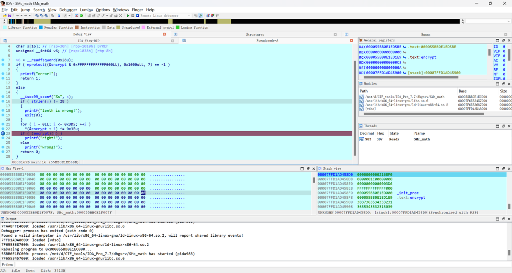
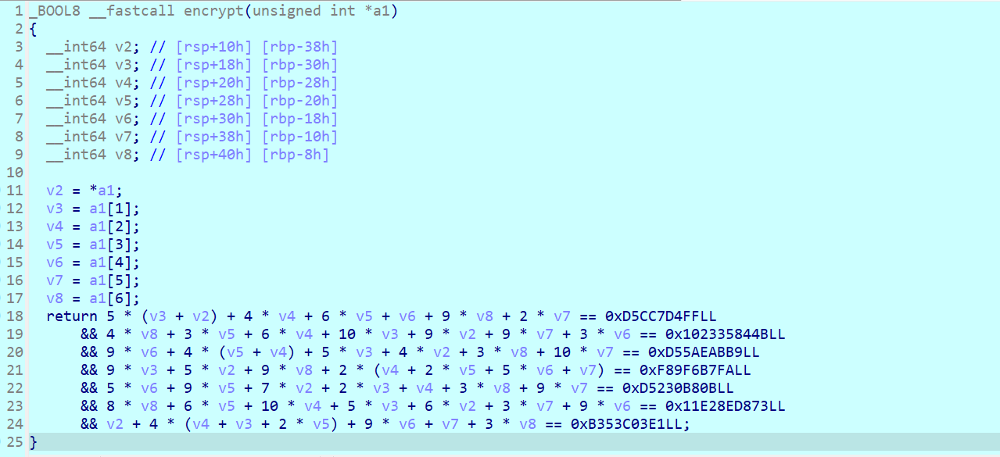

# NewStar CTF 2024 / SMc_math

> 本文由授权中文赛事 WP 正文导入（阶段 1，仅散文，代码段未导入）。
>
> - 来源：https://github.com/pj-newstar/wiki-docs/blob/1a0f2ba21a30f950276396118b315eef0328371c/docs/wp/2024/week3/reverse/smc-math.md
> - 许可：MIT
> - 署名：（未提供）
> - 文档族：official_event_archive
> - 赛事：NewStar CTF 2024
> - 年份：2024
> - 核验状态：official_source_not_reproduced
> - 正文 sha256：687ddfdc3694b402f715820434f8e446bf5ed236864a3bc5e611205e528a6a5d
> - 导入 ID：official-a3fbabda4e37ca37701396
> - 原 domain：reverse
> - 本地快照：62_官方赛事题库/objects/e700193e6fae91750a47f5cfb3fba43481676ddaa6b48bf9ef2ed002d9df7d48.blob
> - 源修订：1a0f2ba21a30f950276396118b315eef0328371c
> - 收录说明：官方发布来源的说明正文；代码单独索引，未运行或分析。按文件收录，不把多份文件算作多道题。图片及附件下载状态见清单；仅按路径/原题分类标方向，binary 等跨方向资料留待分类。
> - 判定依据：original_prose_not_runtime_verified
> - 附件引用：[{"owner_id": "official-a3fbabda4e37ca37701396", "relative_path": "docs/assets/images/wp/2024/week3/smc-math_1.png", "local_path": "62_官方赛事题库/objects/aa03cce5e53514f9454a9a8180e0355eeca68de6c5855c79cdb01f5e089728fa.blob", "downloaded_bytes": 312521, "source_url": "https://github.com/pj-newstar/wiki-docs/blob/1a0f2ba21a30f950276396118b315eef0328371c/docs/assets/images/wp/2024/week3/smc-math_1.png", "sha256": "aa03cce5e53514f9454a9a8180e0355eeca68de6c5855c79cdb01f5e089728fa", "kind": "image", "policy": "reference_only_no_execution"}, {"owner_id": "official-a3fbabda4e37ca37701396", "relative_path": "docs/assets/images/wp/2024/week3/smc-math_2.png", "local_path": "62_官方赛事题库/objects/64e86fc23632a017d29f98b776cb54d03baa4dae88a7dd7458edabe1e3a9c801.blob", "downloaded_bytes": 63762, "source_url": "https://github.com/pj-newstar/wiki-docs/blob/1a0f2ba21a30f950276396118b315eef0328371c/docs/assets/images/wp/2024/week3/smc-math_2.png", "sha256": "64e86fc23632a017d29f98b776cb54d03baa4dae88a7dd7458edabe1e3a9c801", "kind": "image", "policy": "reference_only_no_execution"}]

> 原文：https://github.com/pj-newstar/wiki-docs/blob/1a0f2ba21a30f950276396118b315eef0328371c/docs/wp/2024/week3/reverse/smc-math.md

## 正文

---
titleTemplate: ":title | WriteUp - NewStar CTF 2024"
---

## SMc_math

静态看是很难看出来的，除非使用 IDAPython 进行解密，如果不会 IDAPython 的话也可以动调起来直接看。

这个断点设置在 for 循环结束即可，此时是解密完成的状态，我们可以点进 `encrypt` 函数查看。

点进来看虽然还是一堆乱码，但是这只是 IDA 没有识别出来而已。

在指令开头处按下 <kbd>C</kbd> 键即可识别出这个指令。如果失败，那么可以再按一下 <kbd>U</kbd> 或者 <kbd>P</kbd> 键，总之最后一定可以使用 <kbd>C</kbd> 键得到正确的指令。

之后在函数头处按下 <kbd>U</kbd> 和 <kbd>P</kbd> 键，再按下 <kbd>F5</kbd> 即可得到正确的加密函数。

可以看到是七元一次方程组，当然可以使用在线网站解方程，但是这里更推荐使用 z3 来进行解决。

## 原文配图

