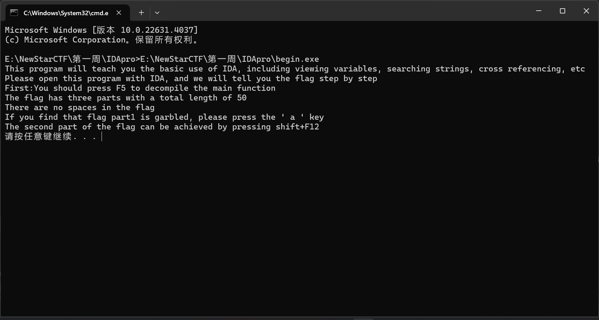
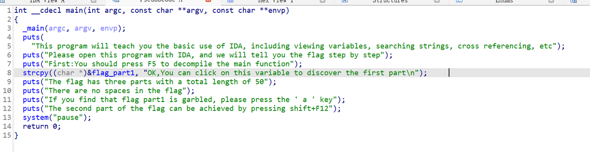
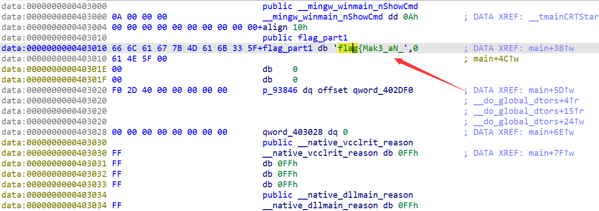
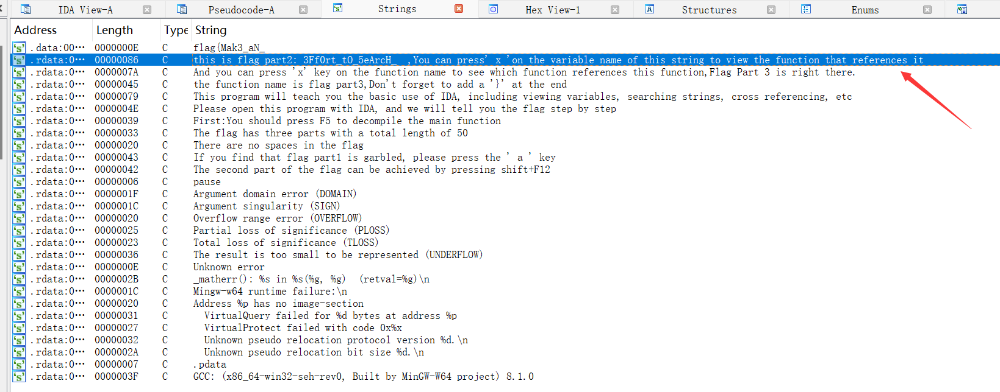
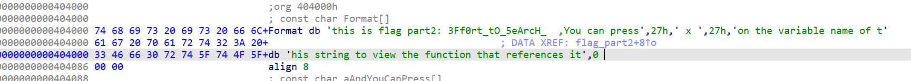
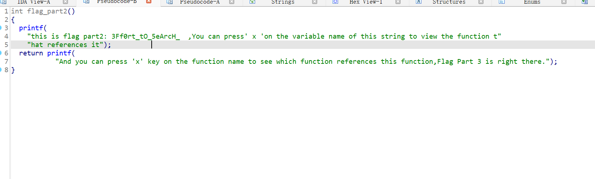
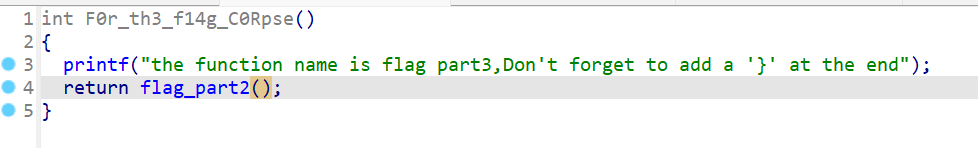

# NewStar CTF 2024 / begin

> 本文由授权中文赛事 WP 正文导入（阶段 1，仅散文，代码段未导入）。
>
> - 来源：https://github.com/pj-newstar/wiki-docs/blob/1a0f2ba21a30f950276396118b315eef0328371c/docs/wp/2024/week1/reverse/begin.md
> - 许可：MIT
> - 署名：（未提供）
> - 文档族：official_event_archive
> - 赛事：NewStar CTF 2024
> - 年份：2024
> - 核验状态：official_source_not_reproduced
> - 正文 sha256：687ddfdc3694b402f715820434f8e446bf5ed236864a3bc5e611205e528a6a5d
> - 导入 ID：official-9c4564d566c4d34941fc4d
> - 原 domain：reverse
> - 本地快照：62_官方赛事题库/objects/d7b58f168aac6f9733ca606037298548f70fa388e4eec23234d3719e43210ae0.blob
> - 源修订：1a0f2ba21a30f950276396118b315eef0328371c
> - 收录说明：官方发布来源的说明正文；代码单独索引，未运行或分析。按文件收录，不把多份文件算作多道题。图片及附件下载状态见清单；仅按路径/原题分类标方向，binary 等跨方向资料留待分类。
> - 判定依据：original_prose_not_runtime_verified
> - 附件引用：[{"owner_id": "official-9c4564d566c4d34941fc4d", "relative_path": "docs/assets/images/wp/2024/week1/begin_1.png", "local_path": "62_官方赛事题库/objects/9f1540c21e0711ba974d6e7e811ff04dea389007ad6cffb4a98485f37aaea92d.blob", "downloaded_bytes": 72182, "source_url": "https://github.com/pj-newstar/wiki-docs/blob/1a0f2ba21a30f950276396118b315eef0328371c/docs/assets/images/wp/2024/week1/begin_1.png", "sha256": "9f1540c21e0711ba974d6e7e811ff04dea389007ad6cffb4a98485f37aaea92d", "kind": "image", "policy": "reference_only_no_execution"}, {"owner_id": "official-9c4564d566c4d34941fc4d", "relative_path": "docs/assets/images/wp/2024/week1/begin_2.png", "local_path": "62_官方赛事题库/objects/ea774eda01a217dc24a74075308cb7762bc910a0cfe4bfe7e79f4fed54d2b78b.blob", "downloaded_bytes": 187098, "source_url": "https://github.com/pj-newstar/wiki-docs/blob/1a0f2ba21a30f950276396118b315eef0328371c/docs/assets/images/wp/2024/week1/begin_2.png", "sha256": "ea774eda01a217dc24a74075308cb7762bc910a0cfe4bfe7e79f4fed54d2b78b", "kind": "image", "policy": "reference_only_no_execution"}, {"owner_id": "official-9c4564d566c4d34941fc4d", "relative_path": "docs/assets/images/wp/2024/week1/begin_3.png", "local_path": "62_官方赛事题库/objects/7e40dbbb6e131a2769c9d19a56d4cee67163afb92c427f28f774cc99dadceb72.blob", "downloaded_bytes": 69385, "source_url": "https://github.com/pj-newstar/wiki-docs/blob/1a0f2ba21a30f950276396118b315eef0328371c/docs/assets/images/wp/2024/week1/begin_3.png", "sha256": "7e40dbbb6e131a2769c9d19a56d4cee67163afb92c427f28f774cc99dadceb72", "kind": "image", "policy": "reference_only_no_execution"}, {"owner_id": "official-9c4564d566c4d34941fc4d", "relative_path": "docs/assets/images/wp/2024/week1/begin_4.png", "local_path": "62_官方赛事题库/objects/f79d87beb50d470d4fd73940e7e83f95e938c8d8ad15b5651289d05604697fa1.blob", "downloaded_bytes": 121725, "source_url": "https://github.com/pj-newstar/wiki-docs/blob/1a0f2ba21a30f950276396118b315eef0328371c/docs/assets/images/wp/2024/week1/begin_4.png", "sha256": "f79d87beb50d470d4fd73940e7e83f95e938c8d8ad15b5651289d05604697fa1", "kind": "image", "policy": "reference_only_no_execution"}, {"owner_id": "official-9c4564d566c4d34941fc4d", "relative_path": "docs/assets/images/wp/2024/week1/begin_5.png", "local_path": "62_官方赛事题库/objects/8347a4d18ae13aca84eadfeff74f570be6cd9904c84d529da65a695f2d2b5b1d.blob", "downloaded_bytes": 23655, "source_url": "https://github.com/pj-newstar/wiki-docs/blob/1a0f2ba21a30f950276396118b315eef0328371c/docs/assets/images/wp/2024/week1/begin_5.png", "sha256": "8347a4d18ae13aca84eadfeff74f570be6cd9904c84d529da65a695f2d2b5b1d", "kind": "image", "policy": "reference_only_no_execution"}, {"owner_id": "official-9c4564d566c4d34941fc4d", "relative_path": "docs/assets/images/wp/2024/week1/begin_6.png", "local_path": "62_官方赛事题库/objects/b3bf89a723d717def0c25e6bbe6445e90d96e8e30e0c61aa70116e8c2764f1ab.blob", "downloaded_bytes": 27602, "source_url": "https://github.com/pj-newstar/wiki-docs/blob/1a0f2ba21a30f950276396118b315eef0328371c/docs/assets/images/wp/2024/week1/begin_6.png", "sha256": "b3bf89a723d717def0c25e6bbe6445e90d96e8e30e0c61aa70116e8c2764f1ab", "kind": "image", "policy": "reference_only_no_execution"}, {"owner_id": "official-9c4564d566c4d34941fc4d", "relative_path": "docs/assets/images/wp/2024/week1/begin_7.png", "local_path": "62_官方赛事题库/objects/8c30edd7ae2237d6228c0ddf77cbea7f15953fb9a87e507d84901db350978f45.blob", "downloaded_bytes": 11237, "source_url": "https://github.com/pj-newstar/wiki-docs/blob/1a0f2ba21a30f950276396118b315eef0328371c/docs/assets/images/wp/2024/week1/begin_7.png", "sha256": "8c30edd7ae2237d6228c0ddf77cbea7f15953fb9a87e507d84901db350978f45", "kind": "image", "policy": "reference_only_no_execution"}]

> 原文：https://github.com/pj-newstar/wiki-docs/blob/1a0f2ba21a30f950276396118b315eef0328371c/docs/wp/2024/week1/reverse/begin.md

## 正文

---
titleTemplate: ":title | WriteUp - NewStar CTF 2024"
---

## begin

首先运行一下这个程序

可以发现很多提示，我们根据提示首先使用 IDA 打开，接下来按下 <kbd>F5</kbd> 得到伪代码

根据提示，我们点击 `flag_part1` 这个变量，从而得到 flag 的第一部分

如果 IDA 显示是十六进制数据，则可以在十六进制数据那按下 <kbd>A</kbd>，从而得到字符串

接下来返回主函数界面，可以点击标签栏中的 Pseudocode-A

再根据提示，按下 <kbd>⇧ Shift</kbd><kbd>F12</kbd>

可以看到一个很明显的字符串，点进去，从而得到 flag 第二部分

根据提示，在 Format 上按下 <kbd>X</kbd> 查看是谁引用了这个字符串

再根据提示，在函数名字上按下x键找到是哪个函数引用了这个函数

根据提示，这个函数名就是最后一部分，并且在最后加上 `}`

则最后拼起来的 flag 是 `flag{Mak3_aN_3Ff0rt_tO_5eArcH_F0r_th3_f14g_C0Rpse}`

## 原文配图

