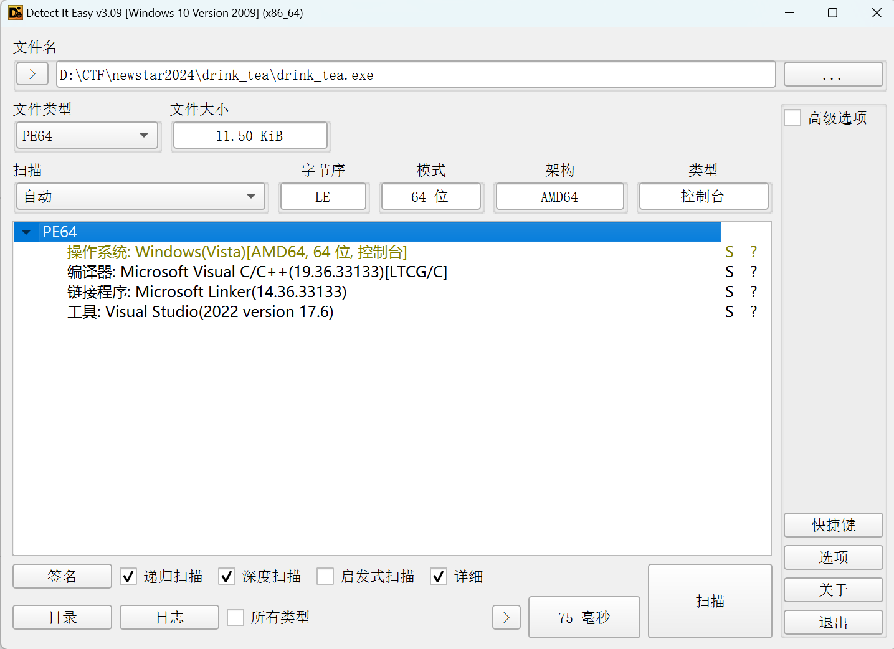
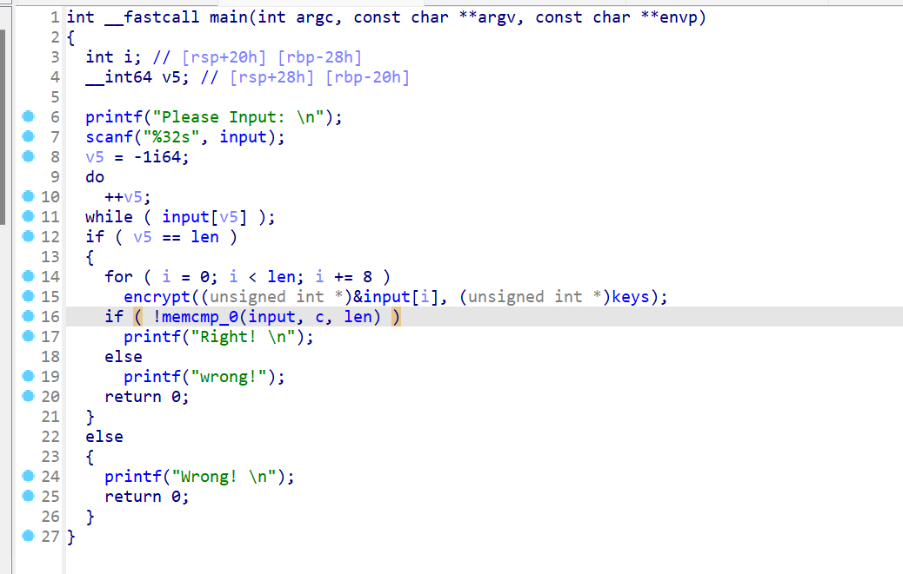
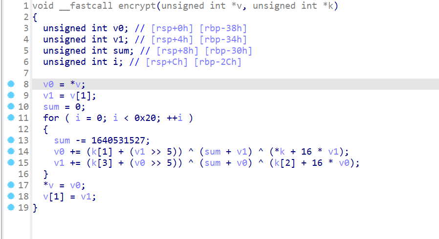

# NewStar CTF 2024 / drink_tea

> 本文由授权中文赛事 WP 正文导入（阶段 1，仅散文，代码段未导入）。
>
> - 来源：https://github.com/pj-newstar/wiki-docs/blob/1a0f2ba21a30f950276396118b315eef0328371c/docs/wp/2024/week2/reverse/drink_tea.md
> - 许可：MIT
> - 署名：（未提供）
> - 文档族：official_event_archive
> - 赛事：NewStar CTF 2024
> - 年份：2024
> - 核验状态：official_source_not_reproduced
> - 正文 sha256：687ddfdc3694b402f715820434f8e446bf5ed236864a3bc5e611205e528a6a5d
> - 导入 ID：official-781e67b288e11655c9943a
> - 原 domain：reverse
> - 本地快照：62_官方赛事题库/objects/ba76ce9365e072c8467389233a027b26bafbfb37125b02da2141d61975670e9a.blob
> - 源修订：1a0f2ba21a30f950276396118b315eef0328371c
> - 收录说明：官方发布来源的说明正文；代码单独索引，未运行或分析。按文件收录，不把多份文件算作多道题。图片及附件下载状态见清单；仅按路径/原题分类标方向，binary 等跨方向资料留待分类。
> - 判定依据：original_prose_not_runtime_verified
> - 附件引用：[{"owner_id": "official-781e67b288e11655c9943a", "relative_path": "docs/assets/images/wp/2024/week2/drink_tea_1.png", "local_path": "62_官方赛事题库/objects/b47e56e6de73d32e857c8a3b6364eea0da79ff2f355cc3a2a675970e78a0263c.blob", "downloaded_bytes": 85776, "source_url": "https://github.com/pj-newstar/wiki-docs/blob/1a0f2ba21a30f950276396118b315eef0328371c/docs/assets/images/wp/2024/week2/drink_tea_1.png", "sha256": "b47e56e6de73d32e857c8a3b6364eea0da79ff2f355cc3a2a675970e78a0263c", "kind": "image", "policy": "reference_only_no_execution"}, {"owner_id": "official-781e67b288e11655c9943a", "relative_path": "docs/assets/images/wp/2024/week2/drink_tea_2.png", "local_path": "62_官方赛事题库/objects/bffcaf1661bedcf9ccd0a921614095e383191bd4470d23d6c2cd758d96d2df2a.blob", "downloaded_bytes": 52993, "source_url": "https://github.com/pj-newstar/wiki-docs/blob/1a0f2ba21a30f950276396118b315eef0328371c/docs/assets/images/wp/2024/week2/drink_tea_2.png", "sha256": "bffcaf1661bedcf9ccd0a921614095e383191bd4470d23d6c2cd758d96d2df2a", "kind": "image", "policy": "reference_only_no_execution"}, {"owner_id": "official-781e67b288e11655c9943a", "relative_path": "docs/assets/images/wp/2024/week2/drink_tea_3.png", "local_path": "62_官方赛事题库/objects/25cceb9e7db00d639da87cfb8a8aacf1cbe75b6f067c1429f6885a5d273274f5.blob", "downloaded_bytes": 39623, "source_url": "https://github.com/pj-newstar/wiki-docs/blob/1a0f2ba21a30f950276396118b315eef0328371c/docs/assets/images/wp/2024/week2/drink_tea_3.png", "sha256": "25cceb9e7db00d639da87cfb8a8aacf1cbe75b6f067c1429f6885a5d273274f5", "kind": "image", "policy": "reference_only_no_execution"}]

> 原文：https://github.com/pj-newstar/wiki-docs/blob/1a0f2ba21a30f950276396118b315eef0328371c/docs/wp/2024/week2/reverse/drink_tea.md

## 正文

---
titleTemplate: ":title | WriteUp - NewStar CTF 2024"
---

## drink_tea

逆向的第一步永远都是先用 DIE 查看文件基本信息，发现无壳，文件为 64 位，用 IDA64 打开

主函数的逻辑很简单，就是先判读输入字符串的长度是否为 32，然后再和 key 进入一个加密函数

而这个加密就是大名鼎鼎的 TEA 算法，以后我们几乎会在所有比赛看到这个算法以及它的变形

解密脚本：

## 原文配图

