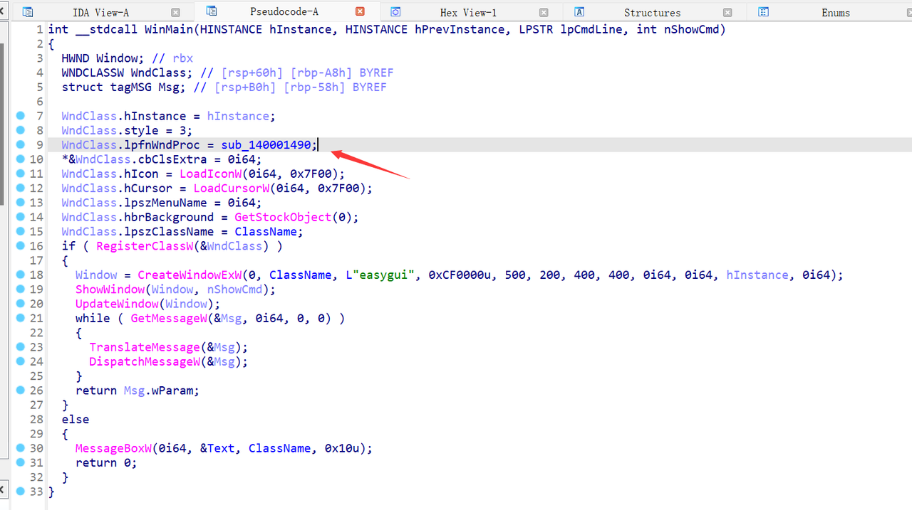
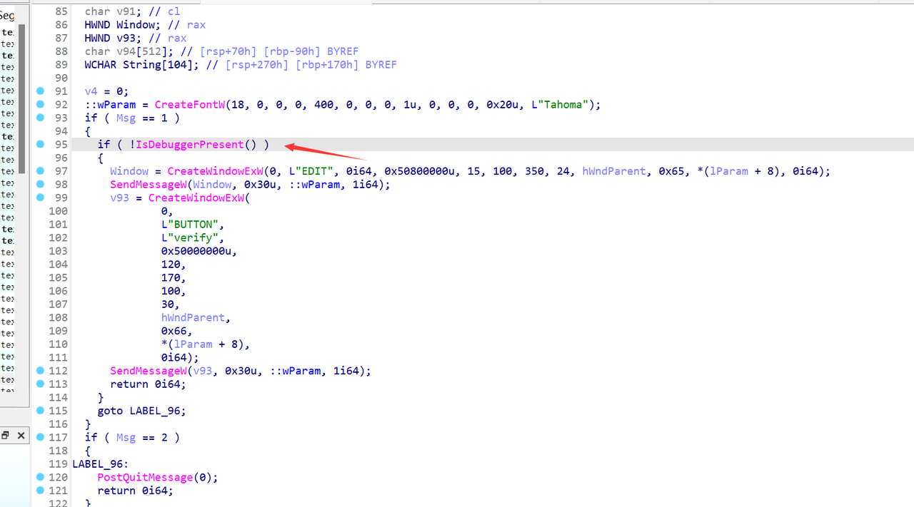
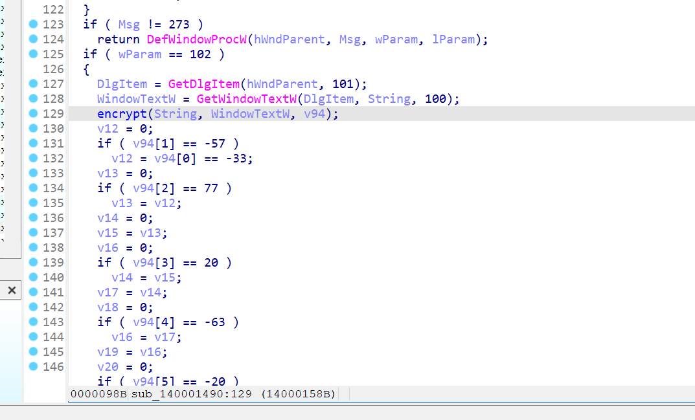
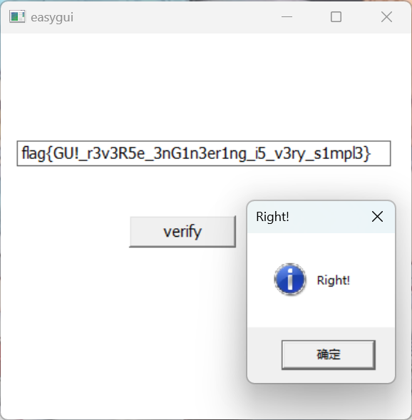

# NewStar CTF 2024 / easygui

> 本文由授权中文赛事 WP 正文导入（阶段 1，仅散文，代码段未导入）。
>
> - 来源：https://github.com/pj-newstar/wiki-docs/blob/1a0f2ba21a30f950276396118b315eef0328371c/docs/wp/2024/week4/reverse/easygui.md
> - 许可：MIT
> - 署名：（未提供）
> - 文档族：official_event_archive
> - 赛事：NewStar CTF 2024
> - 年份：2024
> - 核验状态：official_source_not_reproduced
> - 正文 sha256：687ddfdc3694b402f715820434f8e446bf5ed236864a3bc5e611205e528a6a5d
> - 导入 ID：official-055e5d9606f5f40fa9c18a
> - 原 domain：reverse
> - 本地快照：62_官方赛事题库/objects/cd4d4c59b2c3de301e5f38ef578a0ba6ad427d2669ab219207d7665663476590.blob
> - 源修订：1a0f2ba21a30f950276396118b315eef0328371c
> - 收录说明：官方发布来源的说明正文；代码单独索引，未运行或分析。按文件收录，不把多份文件算作多道题。图片及附件下载状态见清单；仅按路径/原题分类标方向，binary 等跨方向资料留待分类。
> - 判定依据：original_prose_not_runtime_verified
> - 附件引用：[{"owner_id": "official-055e5d9606f5f40fa9c18a", "relative_path": "docs/assets/images/wp/2024/week4/easygui_1.png", "local_path": "62_官方赛事题库/objects/c3dbfe88563a397517f002b634194de64a03ca3d86a539c1ace592053384d1d2.blob", "downloaded_bytes": 265670, "source_url": "https://github.com/pj-newstar/wiki-docs/blob/1a0f2ba21a30f950276396118b315eef0328371c/docs/assets/images/wp/2024/week4/easygui_1.png", "sha256": "c3dbfe88563a397517f002b634194de64a03ca3d86a539c1ace592053384d1d2", "kind": "image", "policy": "reference_only_no_execution"}, {"owner_id": "official-055e5d9606f5f40fa9c18a", "relative_path": "docs/assets/images/wp/2024/week4/easygui_2.png", "local_path": "62_官方赛事题库/objects/8485b4c8f5144cff17b7e198ebb3e96c41f011f7050e94af6c906cbe3280bc0f.blob", "downloaded_bytes": 207076, "source_url": "https://github.com/pj-newstar/wiki-docs/blob/1a0f2ba21a30f950276396118b315eef0328371c/docs/assets/images/wp/2024/week4/easygui_2.png", "sha256": "8485b4c8f5144cff17b7e198ebb3e96c41f011f7050e94af6c906cbe3280bc0f", "kind": "image", "policy": "reference_only_no_execution"}, {"owner_id": "official-055e5d9606f5f40fa9c18a", "relative_path": "docs/assets/images/wp/2024/week4/easygui_3.png", "local_path": "62_官方赛事题库/objects/46c1b1982752370cfac5a4c0e3b313245f985804ff2f49d435d4f214d73b1b56.blob", "downloaded_bytes": 61836, "source_url": "https://github.com/pj-newstar/wiki-docs/blob/1a0f2ba21a30f950276396118b315eef0328371c/docs/assets/images/wp/2024/week4/easygui_3.png", "sha256": "46c1b1982752370cfac5a4c0e3b313245f985804ff2f49d435d4f214d73b1b56", "kind": "image", "policy": "reference_only_no_execution"}, {"owner_id": "official-055e5d9606f5f40fa9c18a", "relative_path": "docs/assets/images/wp/2024/week4/easygui_4.png", "local_path": "62_官方赛事题库/objects/9f85be6b5243b98dc2d2c383036ecd89edc466ca3ebbf9e10ca4997a264288b0.blob", "downloaded_bytes": 38853, "source_url": "https://github.com/pj-newstar/wiki-docs/blob/1a0f2ba21a30f950276396118b315eef0328371c/docs/assets/images/wp/2024/week4/easygui_4.png", "sha256": "9f85be6b5243b98dc2d2c383036ecd89edc466ca3ebbf9e10ca4997a264288b0", "kind": "image", "policy": "reference_only_no_execution"}]

> 原文：https://github.com/pj-newstar/wiki-docs/blob/1a0f2ba21a30f950276396118b315eef0328371c/docs/wp/2024/week4/reverse/easygui.md

## 正文

---
titleTemplate: ":title | WriteUp - NewStar CTF 2024"
---

## easygui

建议新生在做这道题时了解一下 Windows 的消息循环机制。

首先使用 IDA 打开程序。

`sub_140001490` 这个函数就是回调函数，点进即可发现主要逻辑。

首先有一个反调试函数，可以让 `IsDebuggerPresent` 函数返回值 patch 成 `0`，或者直接 nop 掉这个函数的调用。

在这部分就是读取文本框的字符串，然后加密比较的环节。

点进 `encrypt` 函数可以加密算法比较复杂。

总体的加密算法逻辑是这样的，首先对所有字符进行查表代换，之后每四个字节为一组，每组整体循环右移 3 位，最后使用 RC4 算法进行加密。

在 `encrypt` 函数之后就是密文比较，由于 VS 的优化导致比较难提取数据，最后写出解密脚本。

其中 `subbytes_reverse` 函数中的 `table_reverse` 表可以由下面这段代码得到

最后的 flag: `flag{GU!_r3v3R5e_3nG1n3er1ng_i5_v3ry_s1mpl3}`

## 原文配图

