# NewStar CTF 2024 / ez_debug

> 本文由授权中文赛事 WP 正文导入（阶段 1，仅散文，代码段未导入）。
>
> - 来源：https://github.com/pj-newstar/wiki-docs/blob/1a0f2ba21a30f950276396118b315eef0328371c/docs/wp/2024/week1/reverse/ez-debug.md
> - 许可：MIT
> - 署名：（未提供）
> - 文档族：official_event_archive
> - 赛事：NewStar CTF 2024
> - 年份：2024
> - 核验状态：official_source_not_reproduced
> - 正文 sha256：687ddfdc3694b402f715820434f8e446bf5ed236864a3bc5e611205e528a6a5d
> - 导入 ID：official-2f1017e9f83acab12e90d2
> - 原 domain：reverse
> - 本地快照：62_官方赛事题库/objects/783095408fac0c2b7f1109c5bc968fc85c0b26d48548841951edfd191a41405b.blob
> - 源修订：1a0f2ba21a30f950276396118b315eef0328371c
> - 收录说明：官方发布来源的说明正文；代码单独索引，未运行或分析。按文件收录，不把多份文件算作多道题。图片及附件下载状态见清单；仅按路径/原题分类标方向，binary 等跨方向资料留待分类。
> - 判定依据：original_prose_not_runtime_verified
> - 附件引用：[{"owner_id": "official-2f1017e9f83acab12e90d2", "relative_path": "docs/assets/images/wp/2024/week1/ez-debug_1.png", "local_path": "62_官方赛事题库/objects/13d2b0979c61c05443adbaca4709b5b8f37333012d23308167d8f4ea2e1e077b.blob", "downloaded_bytes": 38597, "source_url": "https://github.com/pj-newstar/wiki-docs/blob/1a0f2ba21a30f950276396118b315eef0328371c/docs/assets/images/wp/2024/week1/ez-debug_1.png", "sha256": "13d2b0979c61c05443adbaca4709b5b8f37333012d23308167d8f4ea2e1e077b", "kind": "image", "policy": "reference_only_no_execution"}, {"owner_id": "official-2f1017e9f83acab12e90d2", "relative_path": "docs/assets/images/wp/2024/week1/ez-debug_2.png", "local_path": "62_官方赛事题库/objects/92cc1a71b3a0109806854cfe79c51ce55865a9181403d52f7e1d52409055c563.blob", "downloaded_bytes": 30126, "source_url": "https://github.com/pj-newstar/wiki-docs/blob/1a0f2ba21a30f950276396118b315eef0328371c/docs/assets/images/wp/2024/week1/ez-debug_2.png", "sha256": "92cc1a71b3a0109806854cfe79c51ce55865a9181403d52f7e1d52409055c563", "kind": "image", "policy": "reference_only_no_execution"}, {"owner_id": "official-2f1017e9f83acab12e90d2", "relative_path": "docs/assets/images/wp/2024/week1/ez-debug_3.png", "local_path": "62_官方赛事题库/objects/6cf0f526db9f7a9658aeae97a9e9811d0a31fa667d696f1b2c3d3d5430aca7b0.blob", "downloaded_bytes": 138134, "source_url": "https://github.com/pj-newstar/wiki-docs/blob/1a0f2ba21a30f950276396118b315eef0328371c/docs/assets/images/wp/2024/week1/ez-debug_3.png", "sha256": "6cf0f526db9f7a9658aeae97a9e9811d0a31fa667d696f1b2c3d3d5430aca7b0", "kind": "image", "policy": "reference_only_no_execution"}, {"owner_id": "official-2f1017e9f83acab12e90d2", "relative_path": "docs/assets/images/wp/2024/week1/ez-debug_4.png", "local_path": "62_官方赛事题库/objects/cfaa6499d85979ded70d5305813cf825681e916a7f418fad9d49e1304e6b352e.blob", "downloaded_bytes": 50422, "source_url": "https://github.com/pj-newstar/wiki-docs/blob/1a0f2ba21a30f950276396118b315eef0328371c/docs/assets/images/wp/2024/week1/ez-debug_4.png", "sha256": "cfaa6499d85979ded70d5305813cf825681e916a7f418fad9d49e1304e6b352e", "kind": "image", "policy": "reference_only_no_execution"}, {"owner_id": "official-2f1017e9f83acab12e90d2", "relative_path": "docs/assets/images/wp/2024/week1/ez-debug_5.png", "local_path": "62_官方赛事题库/objects/07ec028d9ebb5dd2793456adbb31bf9ff194472287349c5571c87a4d6417d28c.blob", "downloaded_bytes": 7190, "source_url": "https://github.com/pj-newstar/wiki-docs/blob/1a0f2ba21a30f950276396118b315eef0328371c/docs/assets/images/wp/2024/week1/ez-debug_5.png", "sha256": "07ec028d9ebb5dd2793456adbb31bf9ff194472287349c5571c87a4d6417d28c", "kind": "image", "policy": "reference_only_no_execution"}, {"owner_id": "official-2f1017e9f83acab12e90d2", "relative_path": "docs/assets/images/wp/2024/week1/ez-debug_6.png", "local_path": "62_官方赛事题库/objects/1b05a69fba2a0fe069c61851df4d979bcff9776849131bd698686195352dd9e9.blob", "downloaded_bytes": 58827, "source_url": "https://github.com/pj-newstar/wiki-docs/blob/1a0f2ba21a30f950276396118b315eef0328371c/docs/assets/images/wp/2024/week1/ez-debug_6.png", "sha256": "1b05a69fba2a0fe069c61851df4d979bcff9776849131bd698686195352dd9e9", "kind": "image", "policy": "reference_only_no_execution"}, {"owner_id": "official-2f1017e9f83acab12e90d2", "relative_path": "docs/assets/images/wp/2024/week1/ez-debug_7.png", "local_path": "62_官方赛事题库/objects/acfb942ca4a7fac8f16ad88539e619a5c215c4c7f87cfe6cc2892be17b2b47ad.blob", "downloaded_bytes": 45298, "source_url": "https://github.com/pj-newstar/wiki-docs/blob/1a0f2ba21a30f950276396118b315eef0328371c/docs/assets/images/wp/2024/week1/ez-debug_7.png", "sha256": "acfb942ca4a7fac8f16ad88539e619a5c215c4c7f87cfe6cc2892be17b2b47ad", "kind": "image", "policy": "reference_only_no_execution"}, {"owner_id": "official-2f1017e9f83acab12e90d2", "relative_path": "docs/assets/images/wp/2024/week1/ez-debug_8.png", "local_path": "62_官方赛事题库/objects/49f959b3e486e16038f1c39f55ee90254311b89fdd9e78a994bd1bd12f0015ee.blob", "downloaded_bytes": 7223, "source_url": "https://github.com/pj-newstar/wiki-docs/blob/1a0f2ba21a30f950276396118b315eef0328371c/docs/assets/images/wp/2024/week1/ez-debug_8.png", "sha256": "49f959b3e486e16038f1c39f55ee90254311b89fdd9e78a994bd1bd12f0015ee", "kind": "image", "policy": "reference_only_no_execution"}, {"owner_id": "official-2f1017e9f83acab12e90d2", "relative_path": "docs/assets/images/wp/2024/week1/ez-debug_9.png", "local_path": "62_官方赛事题库/objects/36ef6921a11ccd694470e1adbbe3ca60710b4090242a76d6528d1472b99a4a2f.blob", "downloaded_bytes": 313652, "source_url": "https://github.com/pj-newstar/wiki-docs/blob/1a0f2ba21a30f950276396118b315eef0328371c/docs/assets/images/wp/2024/week1/ez-debug_9.png", "sha256": "36ef6921a11ccd694470e1adbbe3ca60710b4090242a76d6528d1472b99a4a2f", "kind": "image", "policy": "reference_only_no_execution"}, {"owner_id": "official-2f1017e9f83acab12e90d2", "relative_path": "docs/assets/images/wp/2024/week1/ez-debug_10.png", "local_path": "62_官方赛事题库/objects/623d2fd883380a9879a98d9097ed79d2a79e6cb298cf627dd310d034b8b1a458.blob", "downloaded_bytes": 938821, "source_url": "https://github.com/pj-newstar/wiki-docs/blob/1a0f2ba21a30f950276396118b315eef0328371c/docs/assets/images/wp/2024/week1/ez-debug_10.png", "sha256": "623d2fd883380a9879a98d9097ed79d2a79e6cb298cf627dd310d034b8b1a458", "kind": "image", "policy": "reference_only_no_execution"}, {"owner_id": "official-2f1017e9f83acab12e90d2", "relative_path": "docs/assets/images/wp/2024/week1/ez-debug_11.png", "local_path": "62_官方赛事题库/objects/e98c2fa902891895b89bd2d212c45478823a1933eccd265f4d1dfcc649aed6a0.blob", "downloaded_bytes": 134278, "source_url": "https://github.com/pj-newstar/wiki-docs/blob/1a0f2ba21a30f950276396118b315eef0328371c/docs/assets/images/wp/2024/week1/ez-debug_11.png", "sha256": "e98c2fa902891895b89bd2d212c45478823a1933eccd265f4d1dfcc649aed6a0", "kind": "image", "policy": "reference_only_no_execution"}, {"owner_id": "official-2f1017e9f83acab12e90d2", "relative_path": "docs/assets/images/wp/2024/week1/ez-debug_12.png", "local_path": "62_官方赛事题库/objects/1298d6be6ff90d8b91018494e61c89b2c53ca4625c379dd30025986686ed7216.blob", "downloaded_bytes": 11146, "source_url": "https://github.com/pj-newstar/wiki-docs/blob/1a0f2ba21a30f950276396118b315eef0328371c/docs/assets/images/wp/2024/week1/ez-debug_12.png", "sha256": "1298d6be6ff90d8b91018494e61c89b2c53ca4625c379dd30025986686ed7216", "kind": "image", "policy": "reference_only_no_execution"}, {"owner_id": "official-2f1017e9f83acab12e90d2", "relative_path": "docs/assets/images/wp/2024/week1/ez-debug_13.png", "local_path": "62_官方赛事题库/objects/6e50092fef1f1241dc2cb879b5cbbd2a1f89cfa9491f8b5a48fc9792ad1ea1bd.blob", "downloaded_bytes": 229498, "source_url": "https://github.com/pj-newstar/wiki-docs/blob/1a0f2ba21a30f950276396118b315eef0328371c/docs/assets/images/wp/2024/week1/ez-debug_13.png", "sha256": "6e50092fef1f1241dc2cb879b5cbbd2a1f89cfa9491f8b5a48fc9792ad1ea1bd", "kind": "image", "policy": "reference_only_no_execution"}]

> 原文：https://github.com/pj-newstar/wiki-docs/blob/1a0f2ba21a30f950276396118b315eef0328371c/docs/wp/2024/week1/reverse/ez-debug.md

## 正文

---
titleTemplate: ":title | WriteUp - NewStar CTF 2024"
---

## 解法一：使用 IDA

步入 `main` 函数，发现给的 decrypt 提示。如果不知道关键函数可以前后都点一点，发现主要正常的逻辑是在 `you` 函数里面

双击 `you` 函数，在相关位置下断点。点击旁边的圆圈就可以下断点了，或者按下 <kbd>F2</kbd>，之后按 <kbd>F9</kbd> 或者在上方选择「Select debugger」进入调试

这里在循环处下断点或者在 decrypt 处下断点

然后开始调试，跳出弹窗让我们输入 flag

因为没有设置长度限制，所以随便输入一些东西就好了，然后就会进入下一步

回到 IDA 界面，可以看到程序在断点处自动停止了

`you` 函数是一个解密函数，接下来按下 <kbd>F8</kbd> 进行单步调试，检查所有变量后发现每过一个循环，`v5` 的值会变化，且有类似 flag 的产物，所以等单步把循环过完之后，直接双击 `v5`，查看变量

## 解法二：使用 xdbg

拖入 xdbg64，搜索字符串

搜索 `de` 或者 `flag`，发现 `decrypt flag`

在 decrypt 处按 <kbd>F2</kbd> 下断点

然后按下 <kbd>F9</kbd>，随便输入一些字符即可

继续按下 <kbd>F9</kbd>

## 原文配图

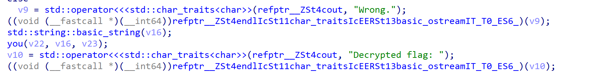

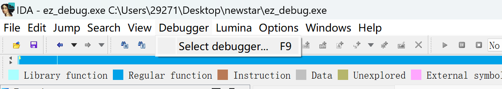

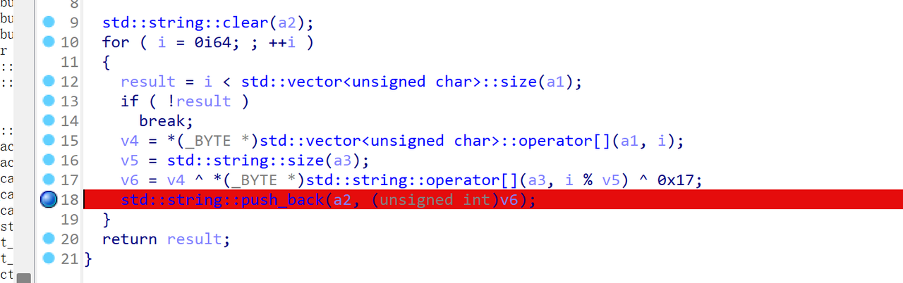

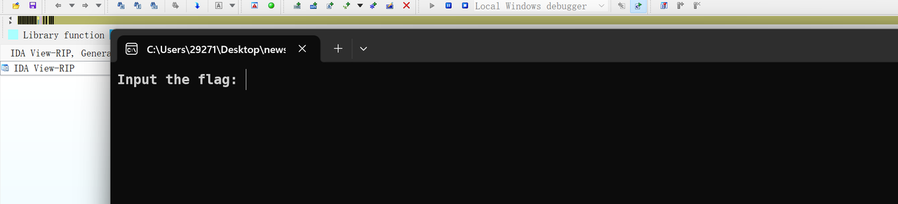

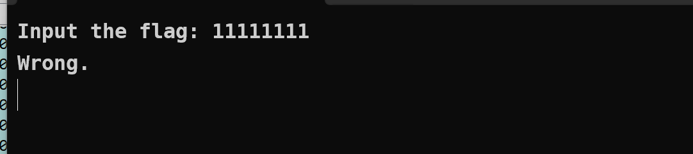

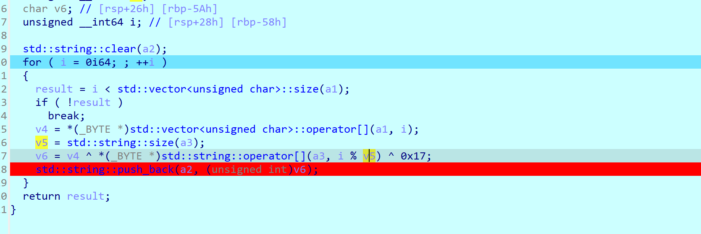

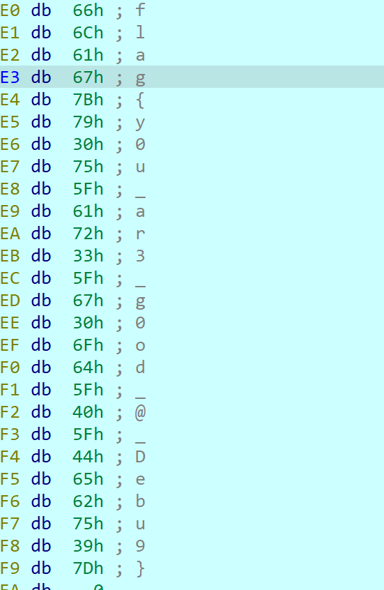

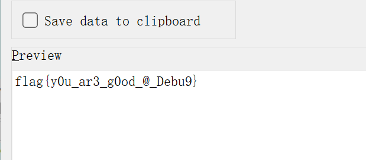

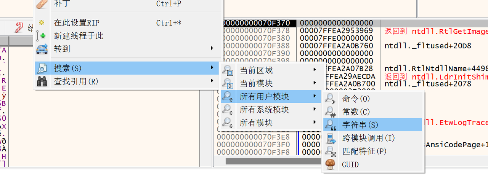

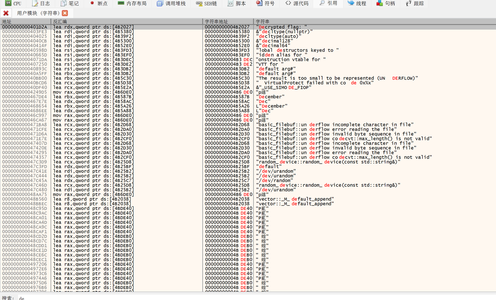

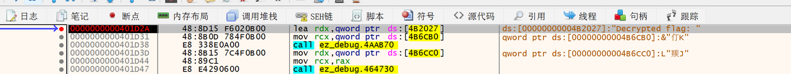

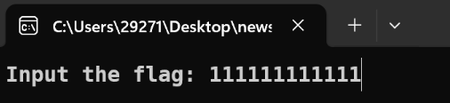

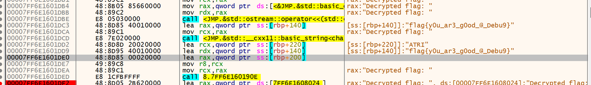
