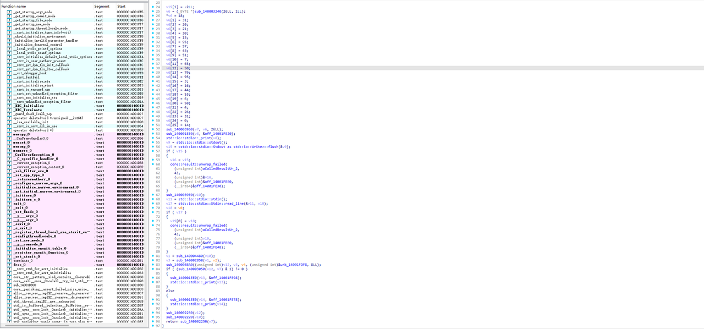
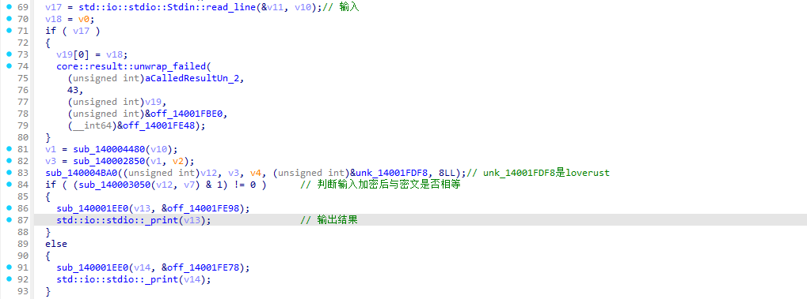
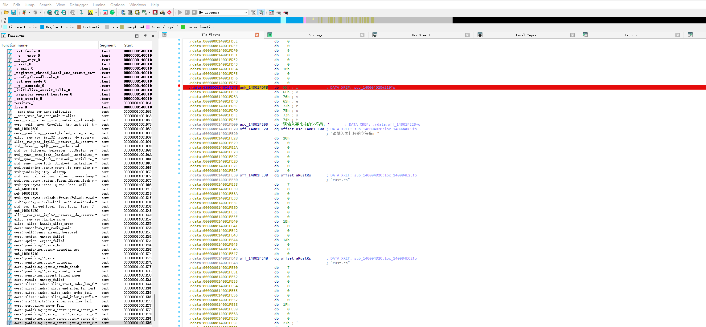
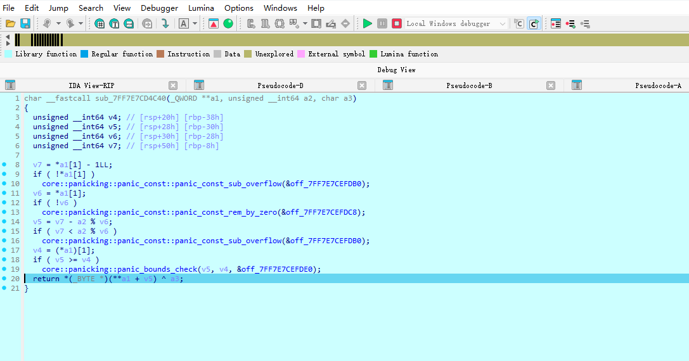
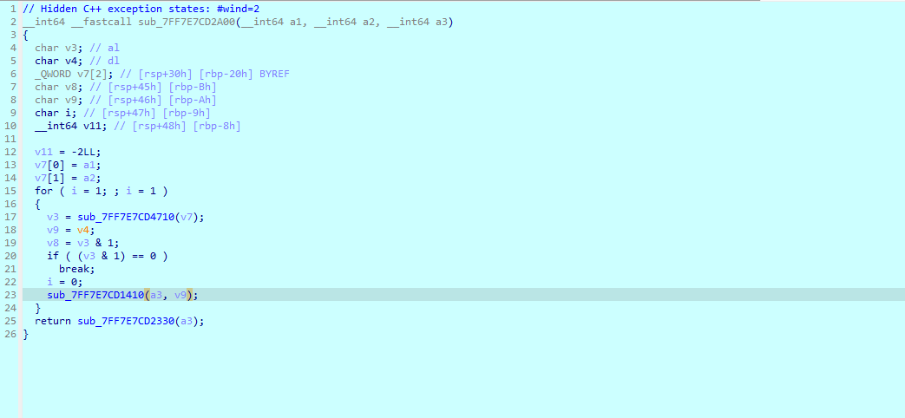
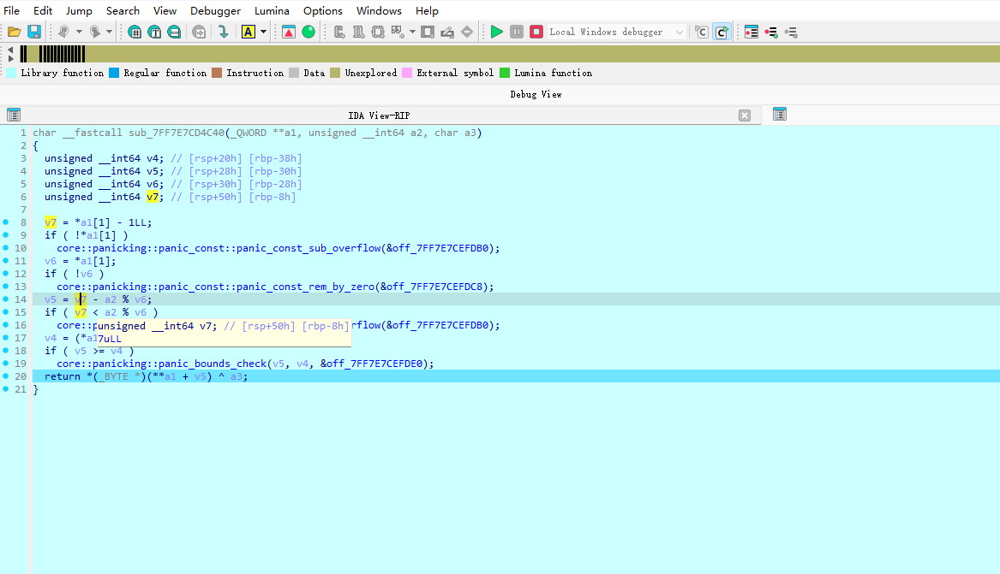

# NewStar CTF 2024 / ezrust

> 本文由授权中文赛事 WP 正文导入（阶段 1，仅散文，代码段未导入）。
>
> - 来源：https://github.com/pj-newstar/wiki-docs/blob/1a0f2ba21a30f950276396118b315eef0328371c/docs/wp/2024/week4/reverse/ezrust.md
> - 许可：MIT
> - 署名：（未提供）
> - 文档族：official_event_archive
> - 赛事：NewStar CTF 2024
> - 年份：2024
> - 核验状态：official_source_not_reproduced
> - 正文 sha256：687ddfdc3694b402f715820434f8e446bf5ed236864a3bc5e611205e528a6a5d
> - 导入 ID：official-fa946089f5bfd52518c204
> - 原 domain：reverse
> - 本地快照：62_官方赛事题库/objects/0ce8633638f96bfa94fb60fa4e6d5b04503315963618762f421cbb3eae7a82ec.blob
> - 源修订：1a0f2ba21a30f950276396118b315eef0328371c
> - 收录说明：官方发布来源的说明正文；代码单独索引，未运行或分析。按文件收录，不把多份文件算作多道题。图片及附件下载状态见清单；仅按路径/原题分类标方向，binary 等跨方向资料留待分类。
> - 判定依据：original_prose_not_runtime_verified
> - 附件引用：[{"owner_id": "official-fa946089f5bfd52518c204", "relative_path": "docs/assets/images/wp/2024/week4/ezrust_1.png", "local_path": "62_官方赛事题库/objects/453b6fba62419d7cd57c9e7f0d430b16dafc7a2b166348a6bb823daccaf341df.blob", "downloaded_bytes": 335580, "source_url": "https://github.com/pj-newstar/wiki-docs/blob/1a0f2ba21a30f950276396118b315eef0328371c/docs/assets/images/wp/2024/week4/ezrust_1.png", "sha256": "453b6fba62419d7cd57c9e7f0d430b16dafc7a2b166348a6bb823daccaf341df", "kind": "image", "policy": "reference_only_no_execution"}, {"owner_id": "official-fa946089f5bfd52518c204", "relative_path": "docs/assets/images/wp/2024/week4/ezrust_2.png", "local_path": "62_官方赛事题库/objects/ed5a57484cc3af79980dbe20fe8de927baf736ac65491d9fedee8d55f27b8fc1.blob", "downloaded_bytes": 35713, "source_url": "https://github.com/pj-newstar/wiki-docs/blob/1a0f2ba21a30f950276396118b315eef0328371c/docs/assets/images/wp/2024/week4/ezrust_2.png", "sha256": "ed5a57484cc3af79980dbe20fe8de927baf736ac65491d9fedee8d55f27b8fc1", "kind": "image", "policy": "reference_only_no_execution"}, {"owner_id": "official-fa946089f5bfd52518c204", "relative_path": "docs/assets/images/wp/2024/week4/ezrust_3.png", "local_path": "62_官方赛事题库/objects/1ae3981e3f9e4b61bff4ea9786ebe1eef94b983ded4d1978221f38c2c36957ac.blob", "downloaded_bytes": 194848, "source_url": "https://github.com/pj-newstar/wiki-docs/blob/1a0f2ba21a30f950276396118b315eef0328371c/docs/assets/images/wp/2024/week4/ezrust_3.png", "sha256": "1ae3981e3f9e4b61bff4ea9786ebe1eef94b983ded4d1978221f38c2c36957ac", "kind": "image", "policy": "reference_only_no_execution"}, {"owner_id": "official-fa946089f5bfd52518c204", "relative_path": "docs/assets/images/wp/2024/week4/ezrust_4.png", "local_path": "62_官方赛事题库/objects/2b414508e661fcf3edc5705ac551daecbfa1edf581e710140df01d47652d60d9.blob", "downloaded_bytes": 51783, "source_url": "https://github.com/pj-newstar/wiki-docs/blob/1a0f2ba21a30f950276396118b315eef0328371c/docs/assets/images/wp/2024/week4/ezrust_4.png", "sha256": "2b414508e661fcf3edc5705ac551daecbfa1edf581e710140df01d47652d60d9", "kind": "image", "policy": "reference_only_no_execution"}, {"owner_id": "official-fa946089f5bfd52518c204", "relative_path": "docs/assets/images/wp/2024/week4/ezrust_5.png", "local_path": "62_官方赛事题库/objects/8783e6fb820943c5b365f74fe64af36fdb37bd096385dc161c2af3fe042639c9.blob", "downloaded_bytes": 30490, "source_url": "https://github.com/pj-newstar/wiki-docs/blob/1a0f2ba21a30f950276396118b315eef0328371c/docs/assets/images/wp/2024/week4/ezrust_5.png", "sha256": "8783e6fb820943c5b365f74fe64af36fdb37bd096385dc161c2af3fe042639c9", "kind": "image", "policy": "reference_only_no_execution"}, {"owner_id": "official-fa946089f5bfd52518c204", "relative_path": "docs/assets/images/wp/2024/week4/ezrust_6.png", "local_path": "62_官方赛事题库/objects/790b99ee49527c02dbebe1b6a09adc58e17194cad4e206bafee1d32add651c39.blob", "downloaded_bytes": 49387, "source_url": "https://github.com/pj-newstar/wiki-docs/blob/1a0f2ba21a30f950276396118b315eef0328371c/docs/assets/images/wp/2024/week4/ezrust_6.png", "sha256": "790b99ee49527c02dbebe1b6a09adc58e17194cad4e206bafee1d32add651c39", "kind": "image", "policy": "reference_only_no_execution"}]

> 原文：https://github.com/pj-newstar/wiki-docs/blob/1a0f2ba21a30f950276396118b315eef0328371c/docs/wp/2024/week4/reverse/ezrust.md

## 正文

---
titleTemplate: ":title | WriteUp - NewStar CTF 2024"
---

## ezrust

友情建议一下，最好用 IDA 8.3 及以上分析

通过 `string` 找到主逻辑

明显看到 `stdin.read_line` 输入数据，`v6` 就是密文，后面有个判断前面一大段密文相等的逻辑，还能发现有一个 `loverust` 字符串

因为 Rust 语言的特性，很难找到具体功能的实现逻辑在哪，调用链有点复杂，实际的加密逻辑与主逻辑包了非常多层，所以采用动调

进行基本分析后可以得出 `loverust` 是加密的关键字串，也可以说是 key

可以直接在 `loverust` 上下一个硬件断点，然后开始动调

可以看到 IDA 直接断在了加密上

对函数按 <kbd>X</kbd> 做多次交叉引用可以发现加密循环

回到加密处，查看变量可以发现 `a3` 就是我们的输入，`a1` 是 `loverust`，`v5` 是指针

这里查看 `v5` 的来源，`v7` 值是 `8 - 1 = 7`，就是一个 `key[7 - (i % 8)]`的逻辑

也就是 `loverust` 是逆序与输入进行异或

写解密脚本

## 原文配图

