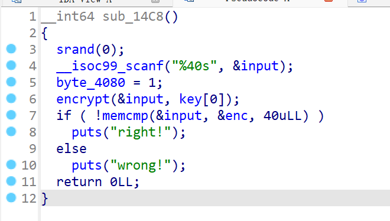
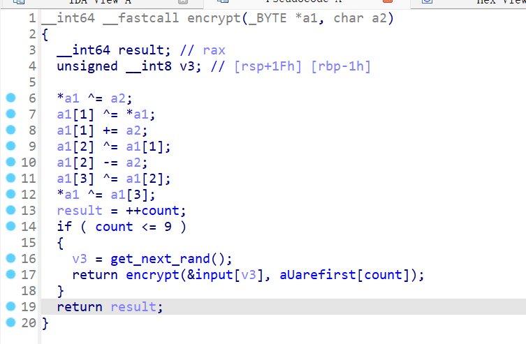

# NewStar CTF 2024 / flowering-shrubs

> 本文由授权中文赛事 WP 正文导入（阶段 1，仅散文，代码段未导入）。
>
> - 来源：https://github.com/pj-newstar/wiki-docs/blob/1a0f2ba21a30f950276396118b315eef0328371c/docs/wp/2024/week3/reverse/flowering-shrubs.md
> - 许可：MIT
> - 署名：（未提供）
> - 文档族：official_event_archive
> - 赛事：NewStar CTF 2024
> - 年份：2024
> - 核验状态：official_source_not_reproduced
> - 正文 sha256：687ddfdc3694b402f715820434f8e446bf5ed236864a3bc5e611205e528a6a5d
> - 导入 ID：official-809b719b851daae8582b09
> - 原 domain：reverse
> - 本地快照：62_官方赛事题库/objects/d132b0f13d1f5809a78eb5ce8c05e0fa9fbedc8a674cf8495c2bd99889b0bc9e.blob
> - 源修订：1a0f2ba21a30f950276396118b315eef0328371c
> - 收录说明：官方发布来源的说明正文；代码单独索引，未运行或分析。按文件收录，不把多份文件算作多道题。图片及附件下载状态见清单；仅按路径/原题分类标方向，binary 等跨方向资料留待分类。
> - 判定依据：original_prose_not_runtime_verified
> - 附件引用：[{"owner_id": "official-809b719b851daae8582b09", "relative_path": "docs/assets/images/wp/2024/week3/flowering-shrubs_1.png", "local_path": "62_官方赛事题库/objects/a43bc982553c8227967a302cc1ba4b95973981a20f413b10b76011481ebe471b.blob", "downloaded_bytes": 28337, "source_url": "https://github.com/pj-newstar/wiki-docs/blob/1a0f2ba21a30f950276396118b315eef0328371c/docs/assets/images/wp/2024/week3/flowering-shrubs_1.png", "sha256": "a43bc982553c8227967a302cc1ba4b95973981a20f413b10b76011481ebe471b", "kind": "image", "policy": "reference_only_no_execution"}, {"owner_id": "official-809b719b851daae8582b09", "relative_path": "docs/assets/images/wp/2024/week3/flowering-shrubs_2.png", "local_path": "62_官方赛事题库/objects/edeaa7aabaada9bf3fe03c0e1e3499d7a4e8606c4e7b5c5f4130e3994d7131c1.blob", "downloaded_bytes": 35669, "source_url": "https://github.com/pj-newstar/wiki-docs/blob/1a0f2ba21a30f950276396118b315eef0328371c/docs/assets/images/wp/2024/week3/flowering-shrubs_2.png", "sha256": "edeaa7aabaada9bf3fe03c0e1e3499d7a4e8606c4e7b5c5f4130e3994d7131c1", "kind": "image", "policy": "reference_only_no_execution"}]

> 原文：https://github.com/pj-newstar/wiki-docs/blob/1a0f2ba21a30f950276396118b315eef0328371c/docs/wp/2024/week3/reverse/flowering-shrubs.md

## 正文

---
titleTemplate: ":title | WriteUp - NewStar CTF 2024"
---

## flowering-shrubs

使用 IDA 可以看到程序完全无法分析。

再仔细看汇编可以发现，题目似乎在随机位置处添加了同一个花指令。

因此我们要使用 IDAPython 自动去除花指令。

`lis` 列表中的内容就是花指令的全部内容。

在 IDA 中选择 **File » Script file**，选择该 Python 文件即可。

或者在 **File » Script command** 中将上面的代码粘贴进来。

之后再按下 <kbd>F5</kbd> 即可看到清晰的伪代码。

部分函数我进行了重命名。在函数名位置处按下 <kbd>N</kbd> 即可重命名。

关键内容就是 `encrypt` 函数。

关键内容就是 `encrypt` 函数。

这里是用了递归，一共 40 个字节，每四个字节为 1 组，一共 10 组，通过 `get_next_rand` 函数得到下一组加密字节。仔细分析一下即可写出脚本。

## 原文配图

