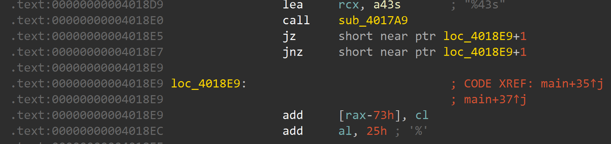
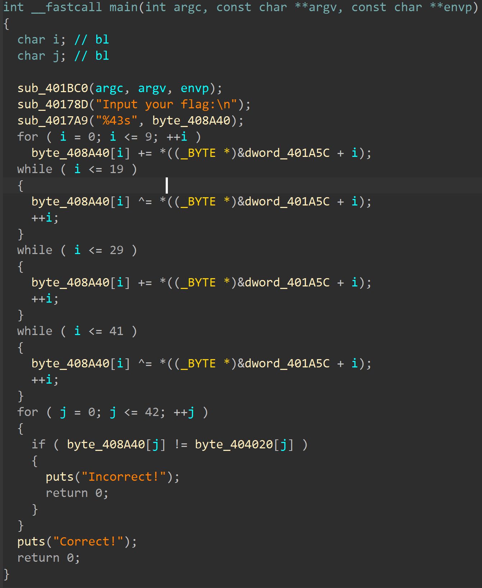
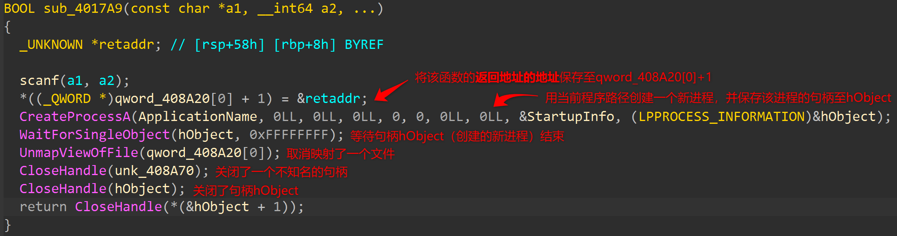
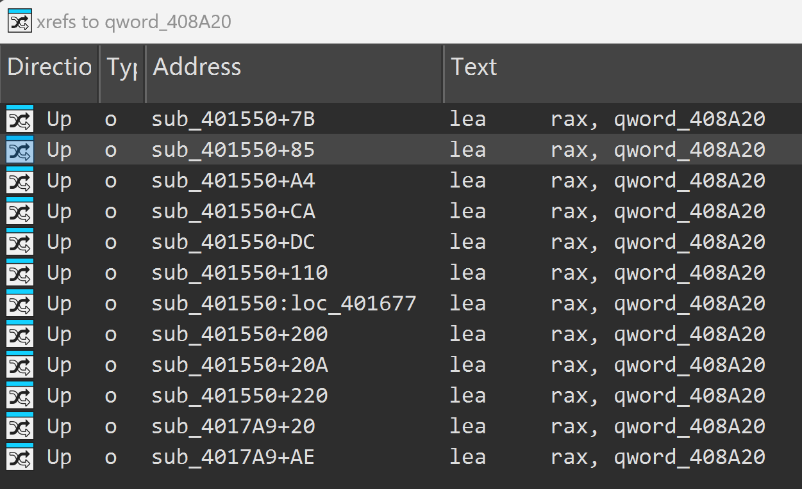
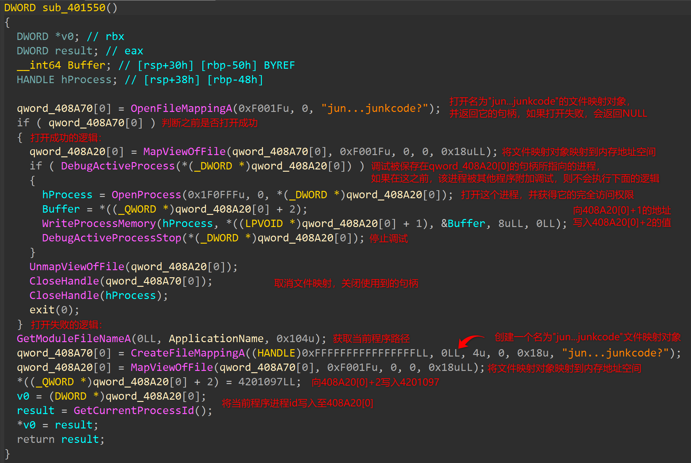
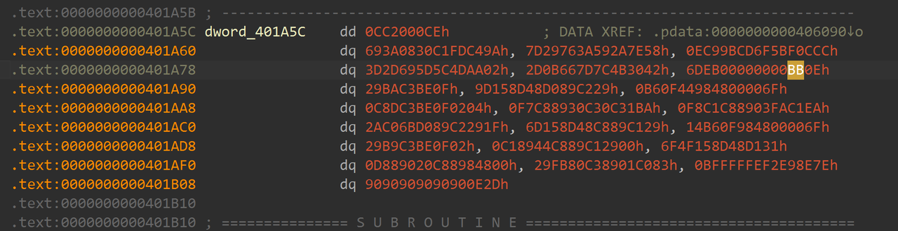
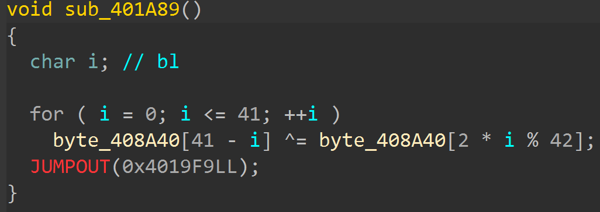
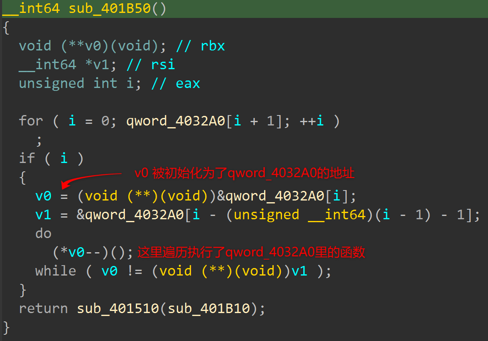
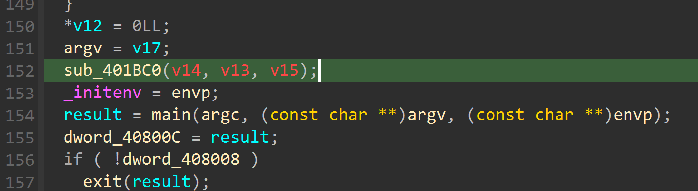

# NewStar CTF 2024 / jun...junkcode?

> 本文由授权中文赛事 WP 正文导入（阶段 1，仅散文，代码段未导入）。
>
> - 来源：https://github.com/pj-newstar/wiki-docs/blob/1a0f2ba21a30f950276396118b315eef0328371c/docs/wp/2024/week5/reverse/junkcode.md
> - 许可：MIT
> - 署名：（未提供）
> - 文档族：official_event_archive
> - 赛事：NewStar CTF 2024
> - 年份：2024
> - 核验状态：official_source_not_reproduced
> - 正文 sha256：687ddfdc3694b402f715820434f8e446bf5ed236864a3bc5e611205e528a6a5d
> - 导入 ID：official-36b4f160a80a65085268b3
> - 原 domain：reverse
> - 本地快照：62_官方赛事题库/objects/e5eec474862690e09b97861de64f3f765949958974e169d1847508b3934d46d3.blob
> - 源修订：1a0f2ba21a30f950276396118b315eef0328371c
> - 收录说明：官方发布来源的说明正文；代码单独索引，未运行或分析。按文件收录，不把多份文件算作多道题。图片及附件下载状态见清单；仅按路径/原题分类标方向，binary 等跨方向资料留待分类。
> - 判定依据：original_prose_not_runtime_verified
> - 附件引用：[{"owner_id": "official-36b4f160a80a65085268b3", "relative_path": "docs/assets/images/wp/2024/week5/junkcode_1.png", "local_path": "62_官方赛事题库/objects/2f943827f603185664f08a90ab454db0b598a06339bdc55c4bcff4dc7459605e.blob", "downloaded_bytes": 173526, "source_url": "https://github.com/pj-newstar/wiki-docs/blob/1a0f2ba21a30f950276396118b315eef0328371c/docs/assets/images/wp/2024/week5/junkcode_1.png", "sha256": "2f943827f603185664f08a90ab454db0b598a06339bdc55c4bcff4dc7459605e", "kind": "image", "policy": "reference_only_no_execution"}, {"owner_id": "official-36b4f160a80a65085268b3", "relative_path": "docs/assets/images/wp/2024/week5/junkcode_2.png", "local_path": "62_官方赛事题库/objects/662abb21c0a8ba221ebe927e461402627876cd60ac000ec957755e22ff4e62a7.blob", "downloaded_bytes": 93488, "source_url": "https://github.com/pj-newstar/wiki-docs/blob/1a0f2ba21a30f950276396118b315eef0328371c/docs/assets/images/wp/2024/week5/junkcode_2.png", "sha256": "662abb21c0a8ba221ebe927e461402627876cd60ac000ec957755e22ff4e62a7", "kind": "image", "policy": "reference_only_no_execution"}, {"owner_id": "official-36b4f160a80a65085268b3", "relative_path": "docs/assets/images/wp/2024/week5/junkcode_3.png", "local_path": "62_官方赛事题库/objects/db25f4a470e11d6539dbaa06b71eb79d1d41818c741f8089877507cf1b7ca103.blob", "downloaded_bytes": 171444, "source_url": "https://github.com/pj-newstar/wiki-docs/blob/1a0f2ba21a30f950276396118b315eef0328371c/docs/assets/images/wp/2024/week5/junkcode_3.png", "sha256": "db25f4a470e11d6539dbaa06b71eb79d1d41818c741f8089877507cf1b7ca103", "kind": "image", "policy": "reference_only_no_execution"}, {"owner_id": "official-36b4f160a80a65085268b3", "relative_path": "docs/assets/images/wp/2024/week5/junkcode_4.png", "local_path": "62_官方赛事题库/objects/351fbac189ac0f94cce809598faf63256762a88451ad811420f1f35a89147f82.blob", "downloaded_bytes": 80110, "source_url": "https://github.com/pj-newstar/wiki-docs/blob/1a0f2ba21a30f950276396118b315eef0328371c/docs/assets/images/wp/2024/week5/junkcode_4.png", "sha256": "351fbac189ac0f94cce809598faf63256762a88451ad811420f1f35a89147f82", "kind": "image", "policy": "reference_only_no_execution"}, {"owner_id": "official-36b4f160a80a65085268b3", "relative_path": "docs/assets/images/wp/2024/week5/junkcode_5.png", "local_path": "62_官方赛事题库/objects/feca77e2a0566ec6fafa3380f7161cc449655d03b7301c58f5c264b82d08a37d.blob", "downloaded_bytes": 439885, "source_url": "https://github.com/pj-newstar/wiki-docs/blob/1a0f2ba21a30f950276396118b315eef0328371c/docs/assets/images/wp/2024/week5/junkcode_5.png", "sha256": "feca77e2a0566ec6fafa3380f7161cc449655d03b7301c58f5c264b82d08a37d", "kind": "image", "policy": "reference_only_no_execution"}, {"owner_id": "official-36b4f160a80a65085268b3", "relative_path": "docs/assets/images/wp/2024/week5/junkcode_6.png", "local_path": "62_官方赛事题库/objects/bb64c8dcaa12db2471b5a00d2fcf03b45b329bd7740929d976a3774647ee471f.blob", "downloaded_bytes": 288828, "source_url": "https://github.com/pj-newstar/wiki-docs/blob/1a0f2ba21a30f950276396118b315eef0328371c/docs/assets/images/wp/2024/week5/junkcode_6.png", "sha256": "bb64c8dcaa12db2471b5a00d2fcf03b45b329bd7740929d976a3774647ee471f", "kind": "image", "policy": "reference_only_no_execution"}, {"owner_id": "official-36b4f160a80a65085268b3", "relative_path": "docs/assets/images/wp/2024/week5/junkcode_7.png", "local_path": "62_官方赛事题库/objects/e62b0029e23dac12ec5eee70697f6f37fd66ea6b95de6b6856e706aba16fa433.blob", "downloaded_bytes": 18268, "source_url": "https://github.com/pj-newstar/wiki-docs/blob/1a0f2ba21a30f950276396118b315eef0328371c/docs/assets/images/wp/2024/week5/junkcode_7.png", "sha256": "e62b0029e23dac12ec5eee70697f6f37fd66ea6b95de6b6856e706aba16fa433", "kind": "image", "policy": "reference_only_no_execution"}, {"owner_id": "official-36b4f160a80a65085268b3", "relative_path": "docs/assets/images/wp/2024/week5/junkcode_8.png", "local_path": "62_官方赛事题库/objects/291afad52b8ddcc2f53e1750b568efcb5df622e712a1cb4fc6b60d4cba7d710d.blob", "downloaded_bytes": 91302, "source_url": "https://github.com/pj-newstar/wiki-docs/blob/1a0f2ba21a30f950276396118b315eef0328371c/docs/assets/images/wp/2024/week5/junkcode_8.png", "sha256": "291afad52b8ddcc2f53e1750b568efcb5df622e712a1cb4fc6b60d4cba7d710d", "kind": "image", "policy": "reference_only_no_execution"}, {"owner_id": "official-36b4f160a80a65085268b3", "relative_path": "docs/assets/images/wp/2024/week5/junkcode_9.png", "local_path": "62_官方赛事题库/objects/47753d2ca74f0135e33061213378a0e6a4abacc8d6d6c1824822647f240c6f01.blob", "downloaded_bytes": 36485, "source_url": "https://github.com/pj-newstar/wiki-docs/blob/1a0f2ba21a30f950276396118b315eef0328371c/docs/assets/images/wp/2024/week5/junkcode_9.png", "sha256": "47753d2ca74f0135e33061213378a0e6a4abacc8d6d6c1824822647f240c6f01", "kind": "image", "policy": "reference_only_no_execution"}]

> 原文：https://github.com/pj-newstar/wiki-docs/blob/1a0f2ba21a30f950276396118b315eef0328371c/docs/wp/2024/week5/reverse/junkcode.md

## 正文

---
titleTemplate: ":title | WriteUp - NewStar CTF 2024"
---

## jun...junkcode?

打开题目，在这里发现了明显的花指令（`jz` - `jnz`）：

「去花」后：

恍然大悟！（然后发现这整段加密逻辑都是假的 QAQ）

关注 `sub_4017A9` 这个函数（这些 API 均能在微软官方文档找到用法）：

这里就能发现一些问题：比如在之前的代码中，还没有映射过任何文件，这里怎么就取消映射了？

查看一下反复出现的 `qword_408A20` 的交叉引用：

可以看到它在 `sub_401550` 这个函数中反复出现，检查一下这个函数：

根据之前的分析，已经能推测出 `sub_401550` 肯定早在 `sub_4017A9` 之前就已经执行了，并且不难看出，`sub_401550` 中文件映射对象打开失败的逻辑对应父进程，打开成功的对应子进程

父进程向 `qword_408A20` 写入了如下内容：

| 地址/偏移       | 含义                                   |
| --------------- | -------------------------------------- |
| `408A20[0]`     | 父进程的进程 ID                        |
| `408A20[0] + 1` | 父进程 `sub_4017A9` 函数返回地址的地址 |
| `408A20[0] + 2` | `4201097`                              |

子进程根据这个文件映射修改父进程 `sub_4017A9` 的返回地址为 `4201097`（对应 `401A89h`）

::: info 关于反调试
这里要子进程调试父进程，如果在这之前父进程被其他进程调试了，子进程就无法附加调试，那自然无法执行正确的逻辑。
:::

可知，父进程在执行完 `sub_4017A9` 获取输入后，就跳转至 `401A89` 处继续执行

从这里重新让 IDA 识别为代码，并反编译：

看到了真正的加密逻辑，这段加密执行完后，跳转到了 `main` 函数里的判断部分

据此写出解密代码：

到这里，还剩下最后一个问题：`sub_401550` 是怎么被执行的？

查看一下 `sub_401550` 的交叉引用：

再往前跟踪几个函数（篇幅有限，不列出来了），能发现上面的函数最终在程序初始化阶段被 `sub_401BC0` 调用，然后才执行的 `main` 函数（所以要是你比较闲，从程序入口节点步进也是能调出来的）

## 原文配图

