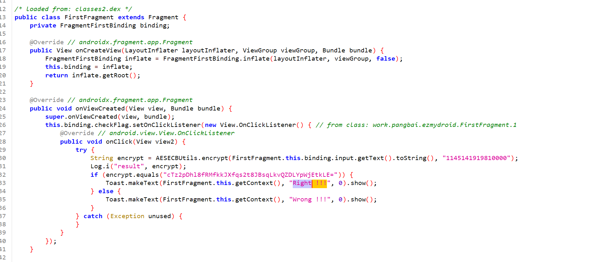
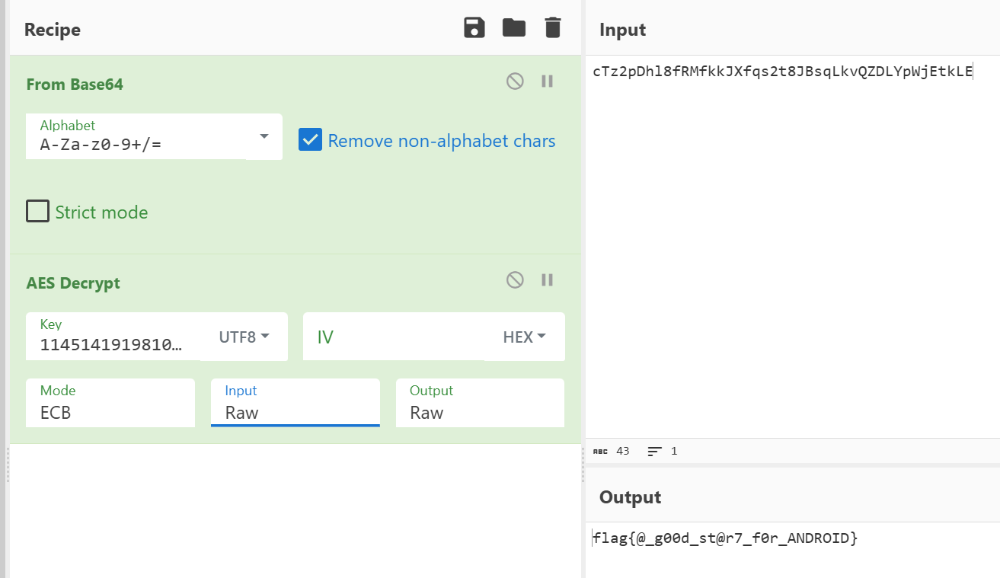

# NewStar CTF 2025 / EzMyDroid

> 本文由授权中文赛事 WP 正文导入（阶段 1，仅散文，代码段未导入）。
>
> - 来源：https://github.com/pj-newstar/wiki-docs/blob/1a0f2ba21a30f950276396118b315eef0328371c/docs/wp/2025/week1/reverse/ezmydroid.md
> - 许可：MIT
> - 署名：（未提供）
> - 文档族：official_event_archive
> - 赛事：NewStar CTF 2025
> - 年份：2025
> - 核验状态：official_source_not_reproduced
> - 正文 sha256：3505c69bd87af33f36578bb0699417dda5647a640603bba828608be30f9ca761
> - 导入 ID：official-879606efa9405f86de3f1f
> - 原 domain：reverse
> - 本地快照：62_官方赛事题库/objects/a704c4ddf2a065abec8ba0feed89d8321a8c9b99eda130614db01438e5b7ba25.blob
> - 源修订：1a0f2ba21a30f950276396118b315eef0328371c
> - 收录说明：官方发布来源的说明正文；代码单独索引，未运行或分析。按文件收录，不把多份文件算作多道题。图片及附件下载状态见清单；仅按路径/原题分类标方向，binary 等跨方向资料留待分类。
> - 判定依据：original_prose_not_runtime_verified
> - 附件引用：[{"owner_id": "official-879606efa9405f86de3f1f", "relative_path": "docs/assets/images/wp/2025/week1/ezmydroid_1.png", "local_path": "62_官方赛事题库/objects/19ef2c131d72c68d8b3510b676a7f33decfb2ae6c75291b0dc7295dc8b549378.blob", "downloaded_bytes": 102458, "source_url": "https://github.com/pj-newstar/wiki-docs/blob/1a0f2ba21a30f950276396118b315eef0328371c/docs/assets/images/wp/2025/week1/ezmydroid_1.png", "sha256": "19ef2c131d72c68d8b3510b676a7f33decfb2ae6c75291b0dc7295dc8b549378", "kind": "image", "policy": "reference_only_no_execution"}, {"owner_id": "official-879606efa9405f86de3f1f", "relative_path": "docs/assets/images/wp/2025/week1/ezmydroid_2.png", "local_path": "62_官方赛事题库/objects/58b0bbc52f43f059650d835f75b68f847355e2c2854e3ac403544239a6b5b6ec.blob", "downloaded_bytes": 54322, "source_url": "https://github.com/pj-newstar/wiki-docs/blob/1a0f2ba21a30f950276396118b315eef0328371c/docs/assets/images/wp/2025/week1/ezmydroid_2.png", "sha256": "58b0bbc52f43f059650d835f75b68f847355e2c2854e3ac403544239a6b5b6ec", "kind": "image", "policy": "reference_only_no_execution"}]

> 原文：https://github.com/pj-newstar/wiki-docs/blob/1a0f2ba21a30f950276396118b315eef0328371c/docs/wp/2025/week1/reverse/ezmydroid.md

## 正文

---
titleTemplate: ":title | WriteUp - NewStar CTF 2025"
---

import Container from '@/components/docs/Container.vue'

## EzMyDroid

本题考查 Java 层安卓逆向中 AES 加密的分析与破解。

`Jadx-gui` 打开搜索字符串 `Wrong`，定位代码

可以看到一个加密调用，和密文比较。

可以看到一个加密调用，和密文比较。

加密如下，看类名可以知道是 `AES` 的 `ECB` 模式，第一个参数是输入的 `flag` 第二个参数是密钥。

密文肯定就是，被 base64 编码过。

进入解密网站 [赛博厨子](https://cyberchef.org/)

## 原文配图

