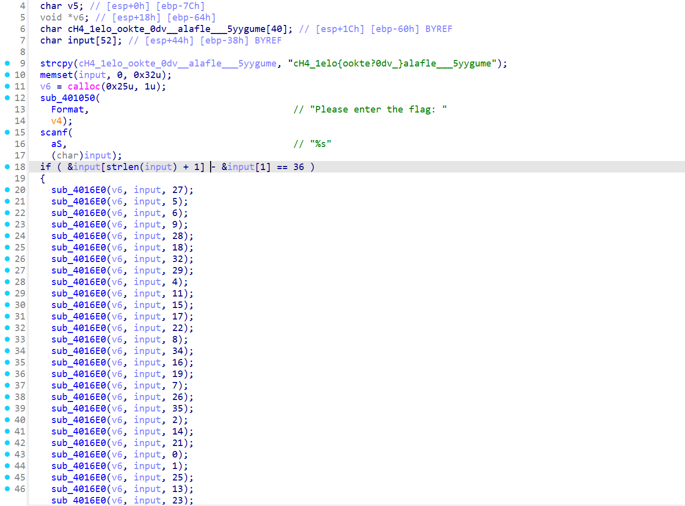
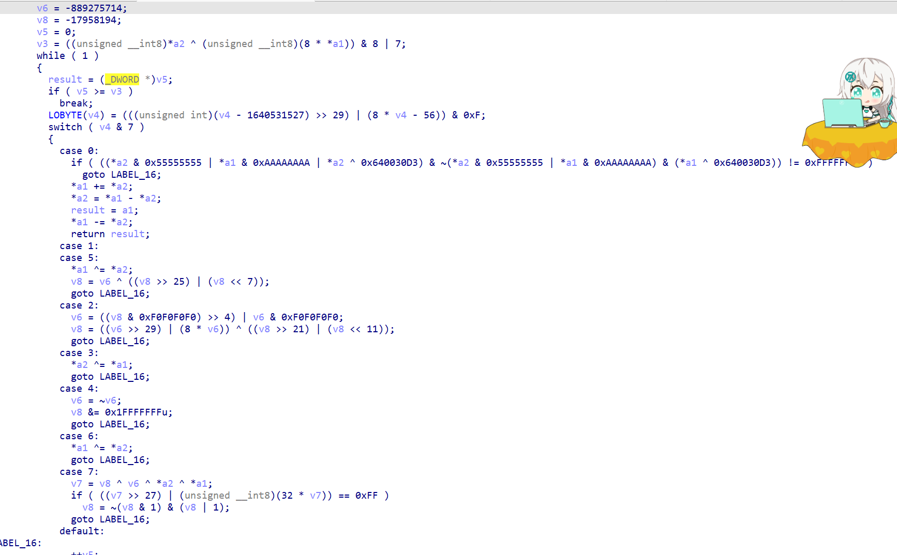
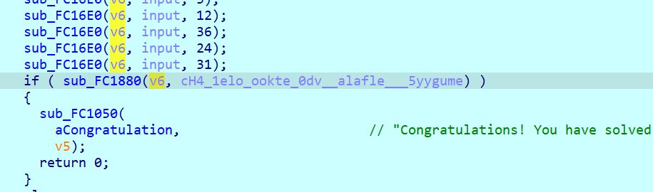
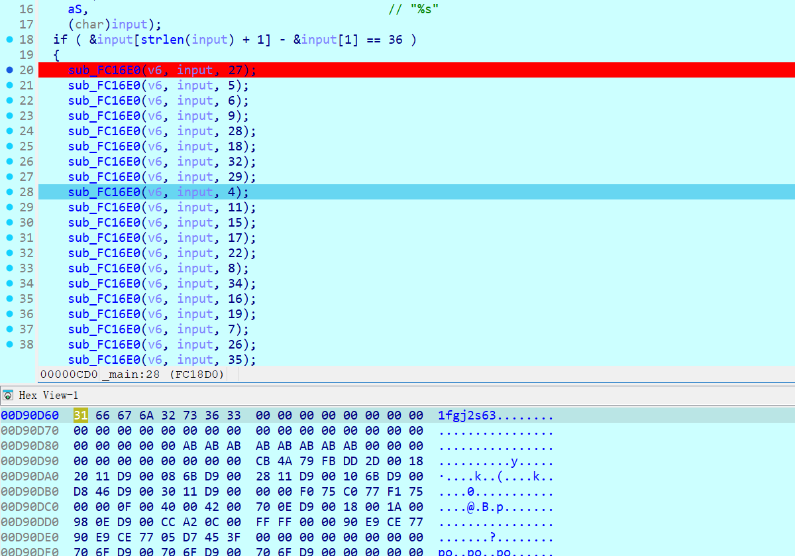

# NewStar CTF 2025 / Look at me carefully

> 本文由授权中文赛事 WP 正文导入（阶段 1，仅散文，代码段未导入）。
>
> - 来源：https://github.com/pj-newstar/wiki-docs/blob/1a0f2ba21a30f950276396118b315eef0328371c/docs/wp/2025/week2/reverse/look-carefully.md
> - 许可：MIT
> - 署名：（未提供）
> - 文档族：official_event_archive
> - 赛事：NewStar CTF 2025
> - 年份：2025
> - 核验状态：official_source_not_reproduced
> - 正文 sha256：3505c69bd87af33f36578bb0699417dda5647a640603bba828608be30f9ca761
> - 导入 ID：official-d3a3e34d0b2915c7640536
> - 原 domain：reverse
> - 本地快照：62_官方赛事题库/objects/60112970662704a414348d570667300e591ea68949f19c65825b0a1001fa55e7.blob
> - 源修订：1a0f2ba21a30f950276396118b315eef0328371c
> - 收录说明：官方发布来源的说明正文；代码单独索引，未运行或分析。按文件收录，不把多份文件算作多道题。图片及附件下载状态见清单；仅按路径/原题分类标方向，binary 等跨方向资料留待分类。
> - 判定依据：original_prose_not_runtime_verified
> - 附件引用：[{"owner_id": "official-d3a3e34d0b2915c7640536", "relative_path": "docs/assets/images/wp/2025/week2/look-carefully_1.png", "local_path": "62_官方赛事题库/objects/9a10762b0cccbf6d4677a92978ca59f70da473ba189ba4e930fcb1c218f9541a.blob", "downloaded_bytes": 121704, "source_url": "https://github.com/pj-newstar/wiki-docs/blob/1a0f2ba21a30f950276396118b315eef0328371c/docs/assets/images/wp/2025/week2/look-carefully_1.png", "sha256": "9a10762b0cccbf6d4677a92978ca59f70da473ba189ba4e930fcb1c218f9541a", "kind": "image", "policy": "reference_only_no_execution"}, {"owner_id": "official-d3a3e34d0b2915c7640536", "relative_path": "docs/assets/images/wp/2025/week2/look-carefully_2.png", "local_path": "62_官方赛事题库/objects/723fc067f31fc9eea78cac51fca074db7bb0b8555570e14b158993daaaafe633.blob", "downloaded_bytes": 101531, "source_url": "https://github.com/pj-newstar/wiki-docs/blob/1a0f2ba21a30f950276396118b315eef0328371c/docs/assets/images/wp/2025/week2/look-carefully_2.png", "sha256": "723fc067f31fc9eea78cac51fca074db7bb0b8555570e14b158993daaaafe633", "kind": "image", "policy": "reference_only_no_execution"}, {"owner_id": "official-d3a3e34d0b2915c7640536", "relative_path": "docs/assets/images/wp/2025/week2/look-carefully_3.png", "local_path": "62_官方赛事题库/objects/9c6dbe1f2902cda6de7a86a0495619954470b6f1940f9d2c65d7e3b2741893aa.blob", "downloaded_bytes": 24776, "source_url": "https://github.com/pj-newstar/wiki-docs/blob/1a0f2ba21a30f950276396118b315eef0328371c/docs/assets/images/wp/2025/week2/look-carefully_3.png", "sha256": "9c6dbe1f2902cda6de7a86a0495619954470b6f1940f9d2c65d7e3b2741893aa", "kind": "image", "policy": "reference_only_no_execution"}, {"owner_id": "official-d3a3e34d0b2915c7640536", "relative_path": "docs/assets/images/wp/2025/week2/look-carefully_4.png", "local_path": "62_官方赛事题库/objects/9c6b96b00beb35779f50a3417963a0aa2d2199fdf64ea5547c4e4739605a852e.blob", "downloaded_bytes": 102285, "source_url": "https://github.com/pj-newstar/wiki-docs/blob/1a0f2ba21a30f950276396118b315eef0328371c/docs/assets/images/wp/2025/week2/look-carefully_4.png", "sha256": "9c6b96b00beb35779f50a3417963a0aa2d2199fdf64ea5547c4e4739605a852e", "kind": "image", "policy": "reference_only_no_execution"}]

> 原文：https://github.com/pj-newstar/wiki-docs/blob/1a0f2ba21a30f950276396118b315eef0328371c/docs/wp/2025/week2/reverse/look-carefully.md

## 正文

---
titleTemplate: ":title | WriteUp - NewStar CTF 2025"
---

import Container from '@/components/docs/Container.vue'

## Look at me carefully

本题考查对经过混淆后的代码的理解。

首先打开 `main` 函数分析，发现 `sub_4016E0` 这个函数的调用似乎很多

函数内部插入了大量的无意义的混淆代码，静态很难分析。

其实我们可以动态调试观察函数的两个参数指针的变化。~~根据题目提示其实这道题是不需要仔细看其中的逻辑的~~

首先我们输入 `abcdefghijklmnopqrstuvwxyz0123456789`，用于比较的是我们函数的第一个参数，我们在下方内存窗口跳转过去，然后观察内存变化。

我们执行了几个函数，观察内存窗口，发现该内存多了如下输入 `1fgj2s63`，根据和输入的观察发现是从输入中按照一定的顺序取出字符放到新的一片内存中，而顺序就是函数的第三个参数，而数组下标超出输入的长度的函数是不会进行取输入操作的。

所以我们可以根据这个规则逆推出 flag

得到flag：`flag{H4ve_you_lo0ked_at_me_c1o5ely?}`。

## 原文配图

