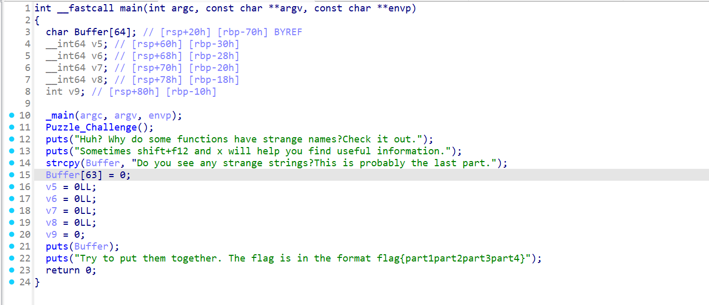
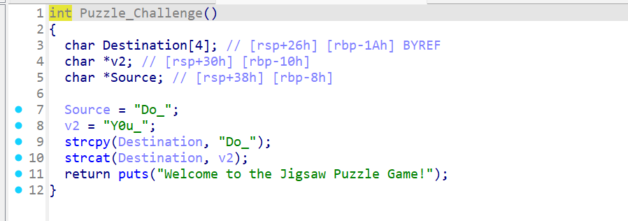
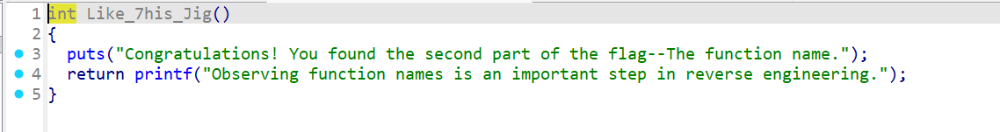
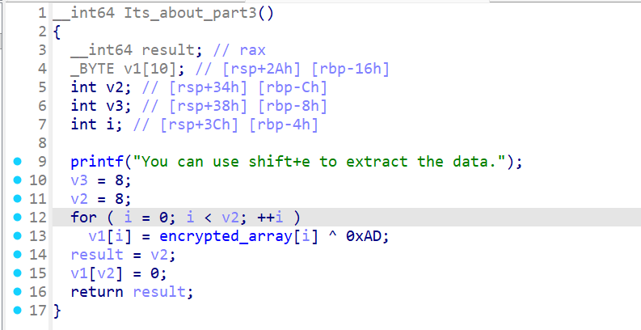
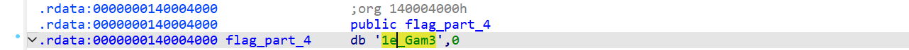

# NewStar CTF 2025 / Puzzle

> 本文由授权中文赛事 WP 正文导入（阶段 1，仅散文，代码段未导入）。
>
> - 来源：https://github.com/pj-newstar/wiki-docs/blob/1a0f2ba21a30f950276396118b315eef0328371c/docs/wp/2025/week1/reverse/puzzle.md
> - 许可：MIT
> - 署名：（未提供）
> - 文档族：official_event_archive
> - 赛事：NewStar CTF 2025
> - 年份：2025
> - 核验状态：official_source_not_reproduced
> - 正文 sha256：3505c69bd87af33f36578bb0699417dda5647a640603bba828608be30f9ca761
> - 导入 ID：official-f0540de71a72ea4e7366c8
> - 原 domain：reverse
> - 本地快照：62_官方赛事题库/objects/7bba872efb72538ae32207fbb12748dde90d5d3ecc98bf0c5c7a7853779724ca.blob
> - 源修订：1a0f2ba21a30f950276396118b315eef0328371c
> - 收录说明：官方发布来源的说明正文；代码单独索引，未运行或分析。按文件收录，不把多份文件算作多道题。图片及附件下载状态见清单；仅按路径/原题分类标方向，binary 等跨方向资料留待分类。
> - 判定依据：original_prose_not_runtime_verified
> - 附件引用：[{"owner_id": "official-f0540de71a72ea4e7366c8", "relative_path": "docs/assets/images/wp/2025/week1/puzzle_1.png", "local_path": "62_官方赛事题库/objects/4012a124e14525d7ebea251bd4af3b801f55506874c06f2137013fd9b45e21c9.blob", "downloaded_bytes": 64606, "source_url": "https://github.com/pj-newstar/wiki-docs/blob/1a0f2ba21a30f950276396118b315eef0328371c/docs/assets/images/wp/2025/week1/puzzle_1.png", "sha256": "4012a124e14525d7ebea251bd4af3b801f55506874c06f2137013fd9b45e21c9", "kind": "image", "policy": "reference_only_no_execution"}, {"owner_id": "official-f0540de71a72ea4e7366c8", "relative_path": "docs/assets/images/wp/2025/week1/puzzle_2.png", "local_path": "62_官方赛事题库/objects/d7470d304b4fb269db8ef616aa0e1eacf628aac571eabf87adbea9476d02486b.blob", "downloaded_bytes": 27746, "source_url": "https://github.com/pj-newstar/wiki-docs/blob/1a0f2ba21a30f950276396118b315eef0328371c/docs/assets/images/wp/2025/week1/puzzle_2.png", "sha256": "d7470d304b4fb269db8ef616aa0e1eacf628aac571eabf87adbea9476d02486b", "kind": "image", "policy": "reference_only_no_execution"}, {"owner_id": "official-f0540de71a72ea4e7366c8", "relative_path": "docs/assets/images/wp/2025/week1/puzzle_3.png", "local_path": "62_官方赛事题库/objects/5b17aed50b759b24ce53c725c4fd73eba86f950e5dc18097f5e3eab2f96db163.blob", "downloaded_bytes": 14138, "source_url": "https://github.com/pj-newstar/wiki-docs/blob/1a0f2ba21a30f950276396118b315eef0328371c/docs/assets/images/wp/2025/week1/puzzle_3.png", "sha256": "5b17aed50b759b24ce53c725c4fd73eba86f950e5dc18097f5e3eab2f96db163", "kind": "image", "policy": "reference_only_no_execution"}, {"owner_id": "official-f0540de71a72ea4e7366c8", "relative_path": "docs/assets/images/wp/2025/week1/puzzle_4.png", "local_path": "62_官方赛事题库/objects/b8d36e1ddda2f6c6bc3b15a1926331ead4dfc89f2d3d649b118a250e57352d38.blob", "downloaded_bytes": 33525, "source_url": "https://github.com/pj-newstar/wiki-docs/blob/1a0f2ba21a30f950276396118b315eef0328371c/docs/assets/images/wp/2025/week1/puzzle_4.png", "sha256": "b8d36e1ddda2f6c6bc3b15a1926331ead4dfc89f2d3d649b118a250e57352d38", "kind": "image", "policy": "reference_only_no_execution"}, {"owner_id": "official-f0540de71a72ea4e7366c8", "relative_path": "docs/assets/images/wp/2025/week1/puzzle_5.png", "local_path": "62_官方赛事题库/objects/f3f270cd16feb43fe6098f034b2367c124e762bff4e12a1f9011b8d09be973e1.blob", "downloaded_bytes": 9517, "source_url": "https://github.com/pj-newstar/wiki-docs/blob/1a0f2ba21a30f950276396118b315eef0328371c/docs/assets/images/wp/2025/week1/puzzle_5.png", "sha256": "f3f270cd16feb43fe6098f034b2367c124e762bff4e12a1f9011b8d09be973e1", "kind": "image", "policy": "reference_only_no_execution"}]

> 原文：https://github.com/pj-newstar/wiki-docs/blob/1a0f2ba21a30f950276396118b315eef0328371c/docs/wp/2025/week1/reverse/puzzle.md

## 正文

---
titleTemplate: ":title | WriteUp - NewStar CTF 2025"
---

import Container from '@/components/docs/Container.vue'

## Puzzle

本题考查 IDA 软件中字符串搜索的使用。

> [!INFO]
> 这道题主要目的是让新生知道 IDA 的一些常见操作。

用 IDA 打开附件之后，单击键盘 <kbd>F5</kbd> 反编译出 main 函数

首先观察到有一个函数 `Puzzle_Challenge`，点进去可以看到：

这里面是 flag 的第一部分即`Do_Y0u_`

接着继续往后看，根据提示 `functions have strange names`，在 `function` 列表中可以看到一个 `Like_7his_Jig` 函数和一个 `Its_about_part3` 函数。

点进 `Like_7his_Jig` 函数 ：

可以知道函数名字即为 flag 的第二部分 `Like_7his_Jig`

点进 `Its_about_part3` 函数：

有一个异或 `0xad`，密文在 `encrypted_array` 中，<kbd>⇧ Shift</kbd><kbd>e</kbd> 提取出来为：`0xDE, 0xED, 0xDA, 0xF2, 0xDD, 0xD8, 0xD7, 0xD7`

解密：

得到 flag 的第三部分即 `s@w_puzz`

所以 flag 的第四部分即 `1e_Gam3`

最后将四个部分拼接起来再包裹上 `flag{}`，最终的 flag 即为 `flag{Do_Y0u_Like_7his_Jigs@w_puzz1e_Gam3}`

## 原文配图

