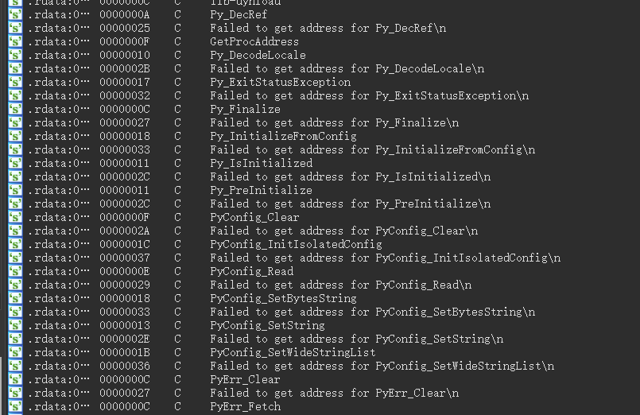

# r00t CTF 2024 / Zzz3

> 本文由授权中文赛事 WP 正文导入（阶段 1，仅散文，代码段未导入）。
>
> - 来源：https://github.com/r00t-security-lab/rtctf2024/blob/a273041a04a5dd1eed3e5f49c9345719923a8e9f/Rev/Zzz3/wp.md
> - 许可：not_declared
> - 署名：（未提供）
> - 文档族：official_event_archive
> - 赛事：r00t CTF 2024
> - 年份：2024
> - 核验状态：official_source_not_reproduced
> - 正文 sha256：cf045d0e07cf70cf645155801b188fa7e805f0c37a985a72830a54cafd0d4b75
> - 导入 ID：official-7e3aecb2ae86c0bf682e11
> - 原 domain：reverse
> - 本地快照：62_官方赛事题库/objects/a8087e0c9850e2e9d71a2cd447e805524bf18d52b5060eab94996411a5593160.blob
> - 源修订：a273041a04a5dd1eed3e5f49c9345719923a8e9f
> - 收录说明：官方发布来源的说明正文；代码单独索引，未运行或分析。按文件收录，不把多份文件算作多道题。图片及附件下载状态见清单；仅按路径/原题分类标方向，binary 等跨方向资料留待分类。
> - 判定依据：original_prose_not_runtime_verified
> - 附件引用：[{"owner_id": "official-7e3aecb2ae86c0bf682e11", "relative_path": "Rev/Zzz3/wp.assets/image-20240521142206671.png", "local_path": "62_官方赛事题库/objects/ae6f72525193e3001da6163b049e4ab726885b45704dc046be60e19a5deaf994.blob", "downloaded_bytes": 50141, "source_url": "https://github.com/r00t-security-lab/rtctf2024/blob/a273041a04a5dd1eed3e5f49c9345719923a8e9f/Rev/Zzz3/wp.assets/image-20240521142206671.png", "sha256": "ae6f72525193e3001da6163b049e4ab726885b45704dc046be60e19a5deaf994", "kind": "image", "policy": "reference_only_no_execution"}]

> 原文：https://github.com/r00t-security-lab/rtctf2024/blob/a273041a04a5dd1eed3e5f49c9345719923a8e9f/Rev/Zzz3/wp.md

## Zzz3

拖进ida发现分析不动，shift+f12找线索可以看到有很多的python痕迹，这题知识点是py打包成exe

于是使用解包工具https://github.com/extremecoders-re/pyinstxtractor

解包完成后在同级目录下可以找到 `Zzz.exe_extracted`，在里面找到`Zzz.pyc`，该文件就是python文件的字节码文件，而字节码我们不好分析，需要反编译为python语言来分析，这时候可以使用在线网站或者`pycdc`，`uncompyle6`等工具来反编译。（但是uncomply6只支持到py3.8）

使用pycdc可以反编译得到

阅读代码可以发现是一个21元的方程组。题目提示了使用z3来解方程组，可以自行学习z3的使用方法。 在提取表达式时，VSCode的多光标操作可以帮助提高一些效率。

> 按住alt+shift拖动光标可以在同一列添加多个光标 选中一部分字符，按ctrl+f2可以选中所有相同的字符

解题脚本

## 原文配图

