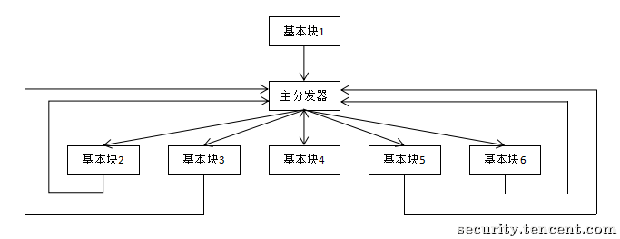
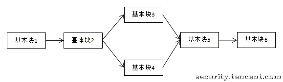

# 控制流平坦化

> 本文由授权中文赛事 WP 正文导入（阶段 1，仅散文，代码段未导入）。
>
> - 来源：https://github.com/ctf-wiki/ctf-wiki/blob/e225ddfcd420a7f54a5940f47336ebdf8c29b875/docs/zh-tw/docs/reverse/obfuscate/control-flow-flatten.md
> - 许可：CC-BY-NC-SA-4.0
> - 署名：ctf-wiki/ctf-wiki contributors; original at https://github.com/ctf-wiki/ctf-wiki/blob/e225ddfcd420a7f54a5940f47336ebdf8c29b875/docs/zh-tw/docs/reverse/obfuscate/control-flow-flatten.md
> - 文档族：ctf-wiki
> - 赛事：（无）
> - 年份：（无）
> - 核验状态：source_document_not_reproduced
> - 正文 sha256：1f162177f4355b3b66ee7ff982d7a49fa2c3e66f24b9c443b8a8d679a3ddae44
> - 导入 ID：ctf-wiki-6b34dde0b51545
> - 原 domain：reverse
> - 许可文件：61_中文赛事资料/来源与许可/ctf-wiki/LICENSE.txt
> - 本地快照：61_中文赛事资料/开源正文快照/ctf-wiki/docs/zh-tw/docs/reverse/obfuscate/control-flow-flatten.md
> - 源修订：e225ddfcd420a7f54a5940f47336ebdf8c29b875
> - 抓取时间：2026-10-22T17:53:54.034332+00:00
> - 收录说明：开源中文文档正文。原作者与版本已保留；检索正文省略代码块、缩进代码和图片，完整 Markdown 另存；未复现。
> - 判定依据：original_prose_not_runtime_verified

> 原文：https://github.com/ctf-wiki/ctf-wiki/blob/e225ddfcd420a7f54a5940f47336ebdf8c29b875/docs/zh-tw/docs/reverse/obfuscate/control-flow-flatten.md

## 簡介

控制流平坦化（control flow flattening）是作用於控制流圖的代碼混淆技術，其基本思想是重新組織函數的控制流圖中的基本塊關係，通過插入一個“主分發器”來控制基本塊的執行流程，例如下圖是正常的執行流程：

經過控制流平坦化處理之後便變成了這個樣子，由一個“主分發器”負責控制程序執行流：

通過控制流平坦化，基本塊間的前後關係將被混淆，從而加大了程序逆向分析的難度。更多關於控制流平坦化的實現細節可以參考[這篇論文](http://ac.inf.elte.hu/Vol_030_2009/003.pdf).

## 利用符號執行去除控制流平坦化

> 待施工。

## Reference

[騰訊安全應急響應中心 - 利用符號執行去除控制流平坦化](https://security.tencent.com/index.php/blog/msg/112)

[OBFUSCATING C++ PROGRAMS VIA CONTROL FLOW FLATTENING](http://ac.inf.elte.hu/Vol_030_2009/003.pdf)

## 原文配图

