# GeekGame 2024 / [Web] 验证码

> 本文由授权中文赛事 WP 正文导入（阶段 1，仅散文，代码段未导入）。
>
> - 来源：https://github.com/PKU-GeekGame/geekgame-4th/blob/a21d7f7387512ec7ef77720e998d60efa16f2353/official_writeup/web-copy/README.md
> - 许可：not_declared
> - 署名：（未提供）
> - 文档族：official_event_archive
> - 赛事：GeekGame 2024
> - 年份：2024
> - 核验状态：official_source_not_reproduced
> - 正文 sha256：69c2fa87be70ca5637c38052dd13d750c67ca7a20155bbab8cbbe2069c71a58b
> - 导入 ID：official-2322692a594494deb8bcc1
> - 原 domain：web
> - 本地快照：62_官方赛事题库/objects/f3ef49235272b3a6fe937bfc640974be4c51206b038cf590daf9ed8ce1e67f6f.blob
> - 源修订：a21d7f7387512ec7ef77720e998d60efa16f2353
> - 收录说明：官方发布来源的说明正文；代码单独索引，未运行或分析。按文件收录，不把多份文件算作多道题。图片及附件下载状态见清单；仅按路径/原题分类标方向，binary 等跨方向资料留待分类。
> - 判定依据：original_prose_not_runtime_verified
> - 附件引用：[{"owner_id": "official-2322692a594494deb8bcc1", "relative_path": "official_writeup/web-copy/assets/image-20241019221321717.png", "local_path": "62_官方赛事题库/objects/be50c14950218450bbbd957bb077e3aec2fd2e433f92b953543a5bd56da98b77.blob", "downloaded_bytes": 125644, "source_url": "https://github.com/PKU-GeekGame/geekgame-4th/blob/a21d7f7387512ec7ef77720e998d60efa16f2353/official_writeup/web-copy/assets/image-20241019221321717.png", "sha256": "be50c14950218450bbbd957bb077e3aec2fd2e433f92b953543a5bd56da98b77", "kind": "image", "policy": "reference_only_no_execution"}, {"owner_id": "official-2322692a594494deb8bcc1", "relative_path": "official_writeup/web-copy/assets/image-20241019221411444.png", "local_path": "62_官方赛事题库/objects/ef59309a6daa3f013ac33cf1c31ec6de5729f211de9edd5512daee657f7c214d.blob", "downloaded_bytes": 149182, "source_url": "https://github.com/PKU-GeekGame/geekgame-4th/blob/a21d7f7387512ec7ef77720e998d60efa16f2353/official_writeup/web-copy/assets/image-20241019221411444.png", "sha256": "ef59309a6daa3f013ac33cf1c31ec6de5729f211de9edd5512daee657f7c214d", "kind": "image", "policy": "reference_only_no_execution"}, {"owner_id": "official-2322692a594494deb8bcc1", "relative_path": "official_writeup/web-copy/assets/image-20241019221515543.png", "local_path": "62_官方赛事题库/objects/6905a18befbe40820a78d9d5b8920ca5fc7d8f4bff5972c622658e4d51d2e7e8.blob", "downloaded_bytes": 114762, "source_url": "https://github.com/PKU-GeekGame/geekgame-4th/blob/a21d7f7387512ec7ef77720e998d60efa16f2353/official_writeup/web-copy/assets/image-20241019221515543.png", "sha256": "6905a18befbe40820a78d9d5b8920ca5fc7d8f4bff5972c622658e4d51d2e7e8", "kind": "image", "policy": "reference_only_no_execution"}, {"owner_id": "official-2322692a594494deb8bcc1", "relative_path": "official_writeup/web-copy/assets/image-20241019221642070.png", "local_path": "62_官方赛事题库/objects/c38665aed1936c1b6d2bc343b01429e67fd7269d16ee6db38531a0332c7abdc2.blob", "downloaded_bytes": 55058, "source_url": "https://github.com/PKU-GeekGame/geekgame-4th/blob/a21d7f7387512ec7ef77720e998d60efa16f2353/official_writeup/web-copy/assets/image-20241019221642070.png", "sha256": "c38665aed1936c1b6d2bc343b01429e67fd7269d16ee6db38531a0332c7abdc2", "kind": "image", "policy": "reference_only_no_execution"}, {"owner_id": "official-2322692a594494deb8bcc1", "relative_path": "official_writeup/web-copy/assets/image-20241019222600214.png", "local_path": "62_官方赛事题库/objects/10cf2e39474410cf9057e5a288236e72a0cfe6b3f027c8a28ff7366a9a48767a.blob", "downloaded_bytes": 27100, "source_url": "https://github.com/PKU-GeekGame/geekgame-4th/blob/a21d7f7387512ec7ef77720e998d60efa16f2353/official_writeup/web-copy/assets/image-20241019222600214.png", "sha256": "10cf2e39474410cf9057e5a288236e72a0cfe6b3f027c8a28ff7366a9a48767a", "kind": "image", "policy": "reference_only_no_execution"}, {"owner_id": "official-2322692a594494deb8bcc1", "relative_path": "official_writeup/web-copy/assets/image-20241019222720560.png", "local_path": "62_官方赛事题库/objects/afbf2271fa743cf0587ea73b9d337c87d6ec92646d1d38900fe4553ff44d7031.blob", "downloaded_bytes": 34117, "source_url": "https://github.com/PKU-GeekGame/geekgame-4th/blob/a21d7f7387512ec7ef77720e998d60efa16f2353/official_writeup/web-copy/assets/image-20241019222720560.png", "sha256": "afbf2271fa743cf0587ea73b9d337c87d6ec92646d1d38900fe4553ff44d7031", "kind": "image", "policy": "reference_only_no_execution"}, {"owner_id": "official-2322692a594494deb8bcc1", "relative_path": "official_writeup/web-copy/assets/image-20241019223047937.png", "local_path": "62_官方赛事题库/objects/a62e702f9e05827099ed5b0515c49d9c7f08064e4e4d6c93cd808849b8c3b463.blob", "downloaded_bytes": 9998, "source_url": "https://github.com/PKU-GeekGame/geekgame-4th/blob/a21d7f7387512ec7ef77720e998d60efa16f2353/official_writeup/web-copy/assets/image-20241019223047937.png", "sha256": "a62e702f9e05827099ed5b0515c49d9c7f08064e4e4d6c93cd808849b8c3b463", "kind": "image", "policy": "reference_only_no_execution"}, {"owner_id": "official-2322692a594494deb8bcc1", "relative_path": "official_writeup/web-copy/assets/image-20241019223205859.png", "local_path": "62_官方赛事题库/objects/840827f9c580735f69221d531c2333ec307981f58965ce7eadcdabf305e0aa33.blob", "downloaded_bytes": 505206, "source_url": "https://github.com/PKU-GeekGame/geekgame-4th/blob/a21d7f7387512ec7ef77720e998d60efa16f2353/official_writeup/web-copy/assets/image-20241019223205859.png", "sha256": "840827f9c580735f69221d531c2333ec307981f58965ce7eadcdabf305e0aa33", "kind": "image", "policy": "reference_only_no_execution"}, {"owner_id": "official-2322692a594494deb8bcc1", "relative_path": "official_writeup/web-copy/assets/image-20241019223527787.png", "local_path": "62_官方赛事题库/objects/cb40cad0e0ea03149b90cb796cdac364674cc8f2280c2fc919204e5fef4862de.blob", "downloaded_bytes": 62284, "source_url": "https://github.com/PKU-GeekGame/geekgame-4th/blob/a21d7f7387512ec7ef77720e998d60efa16f2353/official_writeup/web-copy/assets/image-20241019223527787.png", "sha256": "cb40cad0e0ea03149b90cb796cdac364674cc8f2280c2fc919204e5fef4862de", "kind": "image", "policy": "reference_only_no_execution"}, {"owner_id": "official-2322692a594494deb8bcc1", "relative_path": "official_writeup/web-copy/assets/image-20241019223608751.png", "local_path": "62_官方赛事题库/objects/cd7cf5323cfd71a33b7fa2f00c5357e1a40cd43d46d15c77a857c4807017e1c4.blob", "downloaded_bytes": 78224, "source_url": "https://github.com/PKU-GeekGame/geekgame-4th/blob/a21d7f7387512ec7ef77720e998d60efa16f2353/official_writeup/web-copy/assets/image-20241019223608751.png", "sha256": "cd7cf5323cfd71a33b7fa2f00c5357e1a40cd43d46d15c77a857c4807017e1c4", "kind": "image", "policy": "reference_only_no_execution"}, {"owner_id": "official-2322692a594494deb8bcc1", "relative_path": "official_writeup/web-copy/assets/image-20241019223715554.png", "local_path": "62_官方赛事题库/objects/62070f2e30030ca8c073689725d9bf9a52849fe3ce8e65a38adcd157898eda07.blob", "downloaded_bytes": 34794, "source_url": "https://github.com/PKU-GeekGame/geekgame-4th/blob/a21d7f7387512ec7ef77720e998d60efa16f2353/official_writeup/web-copy/assets/image-20241019223715554.png", "sha256": "62070f2e30030ca8c073689725d9bf9a52849fe3ce8e65a38adcd157898eda07", "kind": "image", "policy": "reference_only_no_execution"}, {"owner_id": "official-2322692a594494deb8bcc1", "relative_path": "official_writeup/web-copy/assets/image-20241019223709104.png", "local_path": "62_官方赛事题库/objects/2010be79d3abb5f95c7fad729d27dac906c8c9477fb23a85cc16f5499d514974.blob", "downloaded_bytes": 34721, "source_url": "https://github.com/PKU-GeekGame/geekgame-4th/blob/a21d7f7387512ec7ef77720e998d60efa16f2353/official_writeup/web-copy/assets/image-20241019223709104.png", "sha256": "2010be79d3abb5f95c7fad729d27dac906c8c9477fb23a85cc16f5499d514974", "kind": "image", "policy": "reference_only_no_execution"}, {"owner_id": "official-2322692a594494deb8bcc1", "relative_path": "official_writeup/web-copy/assets/image-20241019224004241.png", "local_path": "62_官方赛事题库/objects/ecb3da2f78ad3040d3e9e04ce647c003e7fcbba4775c56163b0b5ae75a02d413.blob", "downloaded_bytes": 240288, "source_url": "https://github.com/PKU-GeekGame/geekgame-4th/blob/a21d7f7387512ec7ef77720e998d60efa16f2353/official_writeup/web-copy/assets/image-20241019224004241.png", "sha256": "ecb3da2f78ad3040d3e9e04ce647c003e7fcbba4775c56163b0b5ae75a02d413", "kind": "image", "policy": "reference_only_no_execution"}, {"owner_id": "official-2322692a594494deb8bcc1", "relative_path": "official_writeup/web-copy/assets/image-20241019230217150.png", "local_path": "62_官方赛事题库/objects/5add9e56f319b0b885626919026b5990aa25f59d350b46536583b985f1a1397e.blob", "downloaded_bytes": 158069, "source_url": "https://github.com/PKU-GeekGame/geekgame-4th/blob/a21d7f7387512ec7ef77720e998d60efa16f2353/official_writeup/web-copy/assets/image-20241019230217150.png", "sha256": "5add9e56f319b0b885626919026b5990aa25f59d350b46536583b985f1a1397e", "kind": "image", "policy": "reference_only_no_execution"}, {"owner_id": "official-2322692a594494deb8bcc1", "relative_path": "official_writeup/web-copy/assets/image-20241019232051752.png", "local_path": "62_官方赛事题库/objects/fbec9d78d9cab90759d5968a0ea660342061bb44c719aba011f4a5f408a8d18e.blob", "downloaded_bytes": 96105, "source_url": "https://github.com/PKU-GeekGame/geekgame-4th/blob/a21d7f7387512ec7ef77720e998d60efa16f2353/official_writeup/web-copy/assets/image-20241019232051752.png", "sha256": "fbec9d78d9cab90759d5968a0ea660342061bb44c719aba011f4a5f408a8d18e", "kind": "image", "policy": "reference_only_no_execution"}, {"owner_id": "official-2322692a594494deb8bcc1", "relative_path": "official_writeup/web-copy/assets/image-20241019224225167.png", "local_path": "62_官方赛事题库/objects/a4cb26bd681cdd821d6140f37794e0d3fd432925bd1b20973f2c9bf9cf4f941c.blob", "downloaded_bytes": 75670, "source_url": "https://github.com/PKU-GeekGame/geekgame-4th/blob/a21d7f7387512ec7ef77720e998d60efa16f2353/official_writeup/web-copy/assets/image-20241019224225167.png", "sha256": "a4cb26bd681cdd821d6140f37794e0d3fd432925bd1b20973f2c9bf9cf4f941c", "kind": "image", "policy": "reference_only_no_execution"}, {"owner_id": "official-2322692a594494deb8bcc1", "relative_path": "official_writeup/web-copy/assets/image-20241019224421082.png", "local_path": "62_官方赛事题库/objects/fbfe929b0c93e384db5e699aabd5682c12239c9b2ff3cd9958178bf832d0ad62.blob", "downloaded_bytes": 75229, "source_url": "https://github.com/PKU-GeekGame/geekgame-4th/blob/a21d7f7387512ec7ef77720e998d60efa16f2353/official_writeup/web-copy/assets/image-20241019224421082.png", "sha256": "fbfe929b0c93e384db5e699aabd5682c12239c9b2ff3cd9958178bf832d0ad62", "kind": "image", "policy": "reference_only_no_execution"}, {"owner_id": "official-2322692a594494deb8bcc1", "relative_path": "official_writeup/web-copy/assets/image-20241019225659723.png", "local_path": "62_官方赛事题库/objects/65f39ce53972f38e45198b603fa8441615f30db20aa0318a6def51b66b2ccff3.blob", "downloaded_bytes": 242995, "source_url": "https://github.com/PKU-GeekGame/geekgame-4th/blob/a21d7f7387512ec7ef77720e998d60efa16f2353/official_writeup/web-copy/assets/image-20241019225659723.png", "sha256": "65f39ce53972f38e45198b603fa8441615f30db20aa0318a6def51b66b2ccff3", "kind": "image", "policy": "reference_only_no_execution"}, {"owner_id": "official-2322692a594494deb8bcc1", "relative_path": "official_writeup/web-copy/assets/image-20241019230008731.png", "local_path": "62_官方赛事题库/objects/7665d4b0fca730fb72767e4f03609277003bef6235b5de824b7d3458822c508e.blob", "downloaded_bytes": 129005, "source_url": "https://github.com/PKU-GeekGame/geekgame-4th/blob/a21d7f7387512ec7ef77720e998d60efa16f2353/official_writeup/web-copy/assets/image-20241019230008731.png", "sha256": "7665d4b0fca730fb72767e4f03609277003bef6235b5de824b7d3458822c508e", "kind": "image", "policy": "reference_only_no_execution"}, {"owner_id": "official-2322692a594494deb8bcc1", "relative_path": "official_writeup/web-copy/assets/image-20241020175512976.png", "local_path": "62_官方赛事题库/objects/5a85bf18844297a524371edad645ca9fa3124276215c82d4c37a40739b14ed5d.blob", "downloaded_bytes": 235476, "source_url": "https://github.com/PKU-GeekGame/geekgame-4th/blob/a21d7f7387512ec7ef77720e998d60efa16f2353/official_writeup/web-copy/assets/image-20241020175512976.png", "sha256": "5a85bf18844297a524371edad645ca9fa3124276215c82d4c37a40739b14ed5d", "kind": "image", "policy": "reference_only_no_execution"}, {"owner_id": "official-2322692a594494deb8bcc1", "relative_path": "official_writeup/web-copy/assets/76d8903e404e4fd02019e4e0f44054a.png", "local_path": "62_官方赛事题库/objects/1011ac02b04982a38cb2e33aa525a8183083c1a68d0926511a0c0155f8c0856c.blob", "downloaded_bytes": 10337, "source_url": "https://github.com/PKU-GeekGame/geekgame-4th/blob/a21d7f7387512ec7ef77720e998d60efa16f2353/official_writeup/web-copy/assets/76d8903e404e4fd02019e4e0f44054a.png", "sha256": "1011ac02b04982a38cb2e33aa525a8183083c1a68d0926511a0c0155f8c0856c", "kind": "image", "policy": "reference_only_no_execution"}]

> 原文：https://github.com/PKU-GeekGame/geekgame-4th/blob/a21d7f7387512ec7ef77720e998d60efa16f2353/official_writeup/web-copy/README.md

## [Web] 验证码

- 命题人：xmcp、crazyman
- Hard：150 分
- Expert：250 分

## 题目描述

**【网页链接：访问题目网页】**

## 预期解法

通过此题需要在60秒钟之内粘贴一段240字符（Flag 1）或2000字符（Flag 2）长的 Comic Sans 字体的验证码，正确提交即可获得 Flag。

## Flag 1

网上随便找一个能破解复制的浏览器插件，比如[这个](https://chromewebstore.google.com/detail/supreme-super-copy%E8%B6%85%E7%BA%A7%E5%A4%8D%E5%88%B6/cbfimnpbnbgjbpcnaablibnekhfghbac)：

然后就是简简单单的选中、复制、粘贴、提交一把梭。

另外，**使用 Chrome 扩展程序时需要特别注意安全，**此事在 [web-crx](../web-crx) 题目中亦有记载。比如在我出题的时候找到了[这个扩展](https://chromewebstore.google.com/detail/supercopy-%E8%B6%85%E7%BA%A7%E5%A4%8D%E5%88%B6/onepmapfbjohnegdmfhndpefjkppbjkm)：

它当时还实现得比较干净，但是在10月17日更新了0.1.15版本，里面新增了恶意脚本 `ct.bundle.js`：

目前已经向 Chrome Web Store 举报，尚未下架。顺便一提大家如果经常举报 (?) 的话，建议使用 [Chrome Web Store One Stop Support](https://support.google.com/chrome_webstore/contact/one_stop_support?hl=en) 这个面向开发者的表单。相比于商店页面里的那个跟摆设差不多的举报按钮，这个表单可以写一段小作文并确保被技术人员看到。

本题前端源码在 `src/page1.js`，可以具体看看这几种简单防复制方法的实现。

## Flag 2

此题的网页经过重磅升级，所有浏览器插件都不管用了。不要怕，我们直接按 F12 打开开发者工具……等下，按了没反应？不要怕，这说明网页劫持了键盘事件。我们只需要在外面提前按 F12，准备好之后再进入页面……等下，“有黑客”？

在页面跳转到 “有黑客” 的几百毫秒前，我们可以看到调试器里面一个断点一闪而过：

这是最近比较常见的反调试技术，在 [文心一言](https://yiyan.baidu.com/) 等网站里都有运用。大概原理是：当浏览器的开发者工具打开时，JS 执行 `debugger;` 语句会触发断点。因此 JS 代码可以周期性 `debugger;` 一下，然后检测执行前后的时间差，如果大于一个阈值则说明用户使用了开发者工具导致断点触发。

解决它的方法也很简单，我们只需点击：

然后就可以带着开发者工具正常浏览页面。在开发者工具里可以按 ctrl+shift+C 选择页面上的元素，并看看它的具体 HTML 代码。

我去，这什么玩意？

我去，这什么玩意？

当然你可以写一段代码硬搞，不过在开发者工具里面有更优雅的做法。首先，把中间那个框的宽度和高度都改掉，使得它不需要滚动就能显示所有文字。

然后，把到处乱飘干扰视线的那堆东西隐藏掉：

最后，我们只需要按 ctrl+P 打印页面，就可以从容地在框里选中……等下，我框呢？

不要怕，这是网页为打印模式（`@media print`）增加了专门的 CSS 样式。通过开发者工具，我们可以直接强制固定为屏幕显示模式（`@media screen`）。

现在再按 ctrl+P，就可以从容复制框里面的所有文字了。这框真帅吧！

本题前端源码在 `src/page2.js`。不要被代码量吓到，事实上前 9869 行都是 [Fernet](https://www.npmjs.com/package/fernet)。只有 `// ----- XMCP: above are fernet` 以下的才是真正的源码。

## 其他解法

上面介绍了我觉得比较优雅、代码量最少的解法。但很显然，此题（尤其是 Flag2）有非常多种的其他可能解法。比如：

## 试图解码 DOM · 其一

我们直接复制整个 DOM：

或者直接把网页 ctrl+S 保存下来（注意你的浏览器版本需要[比较新](https://web.dev/articles/declarative-shadow-dom)，才能把 Shadow DOM 里面的内容也存下来）。

然后拿 Python 写个脚本把所有的 `::before` 和 `::after` 的值都计算出来，拼在一起得到验证码。这样写比较繁琐，但至少是一个思路上非常直接的做法，推荐不了解上面那个 ctrl+P 打印的套路的选手使用。虽然写脚本有点累，但至少能在合理的时间内稳定把这题过了。

## 试图解码 DOM · 其二

可以利用 `getComputedStyle` 函数直接计算出每个伪元素的文本。于是也不用 Python 硬搞了，写个 JS 获取一下就好了。

什么，你说终端上的内容总是自动清空，根本用不了？运行一下 `console.clear = ()=>{}` 就瞬间老实，或者勾上 Console 设置里的 “Preserve log” 也可以。

需要注意所有 DOM 内容都被包在一层 Shadow DOM 里，你可以弄个油猴脚本在页面 JS 运行之前先 hook 掉 `attachShadow` 使得能拿到 Shadow DOM（参见 [选手 Writeup](../../players_writeup/2042)），也可以直接在开发者工具里（如果你能成功打开的话）点进里面的元素然后用 `$0` 变量。

## 直接逆向 JS 程序

首先**注意到**前端的巨大 JS 程序长得特别像 [obfuscator.io](https://obfuscator.io/) 混淆出来的。

然后在这个混淆器的 issue 里面可以**注意到**有人[提供了一个反混淆的工具](https://github.com/javascript-obfuscator/javascript-obfuscator/issues/1286)：

使用这个工具，可以把代码还原为相对比较能看的形式。其中可以**注意到** Flag1 的前端代码是把 HTML 里的字符串做了一些异或解密：

接下来**注意到** Flag2 的前端代码除了异或以外还有一套 Fernet 解密：

你问我是怎么注意到的？因为我是出题人，当然知道这段代码是怎么解的密（x

于是仅需把这些逻辑都逆向出来，即可直接算出验证码。或者直接修改这段JS，让它解密完之后敲到文本框里。这样做当然是可以的，但感觉难度比预期解要高了。注意力惊人或者觉得 Web 太难的 Reverse 高手或许可以这样做（x

## 花絮

题面第四个截图取自新燕园校区的电费充值系统。这个系统现在已经亖掉了：

你说这个问题至于它亖掉吗？其实不至于，但可惜这个系统还有一堆更严重的漏洞。比如：

## 原文配图

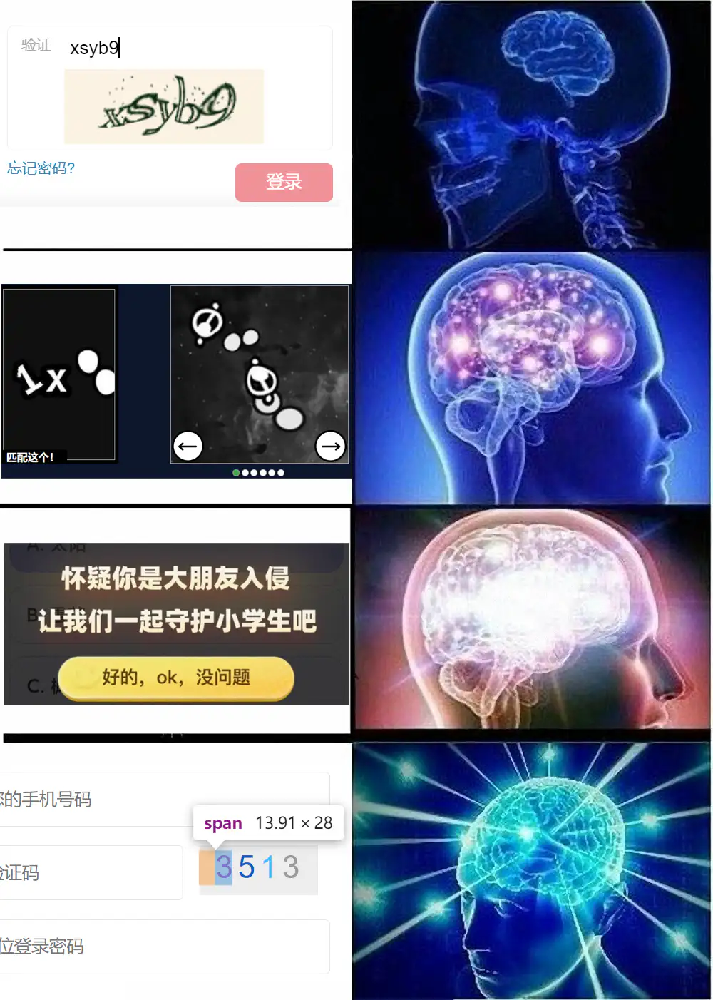

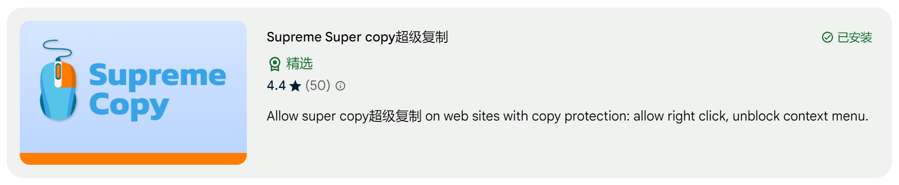

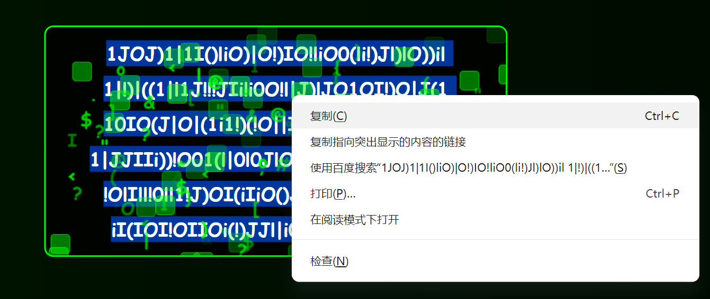

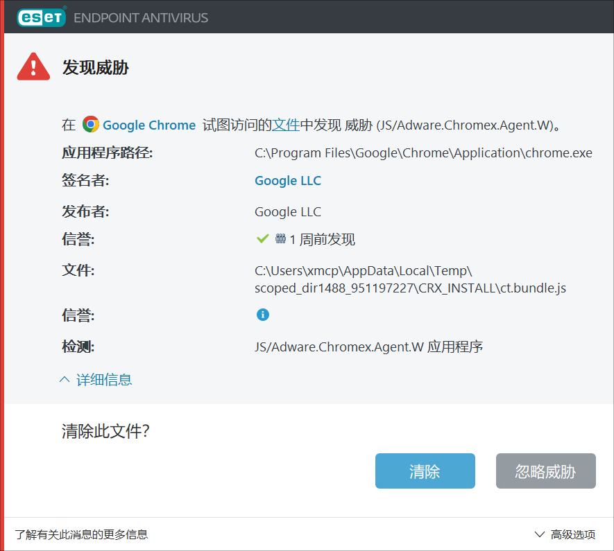

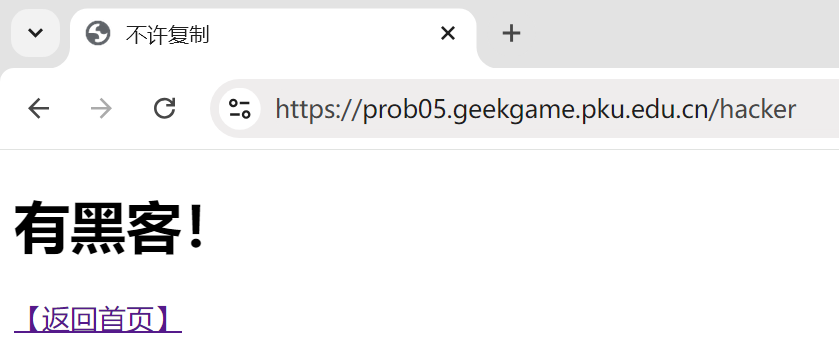

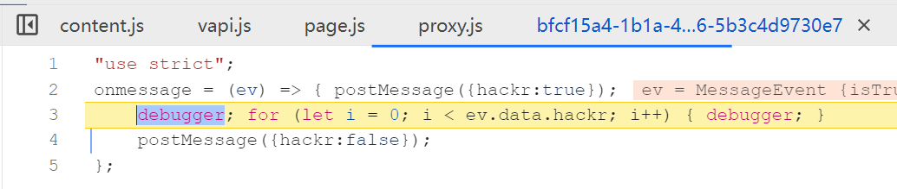

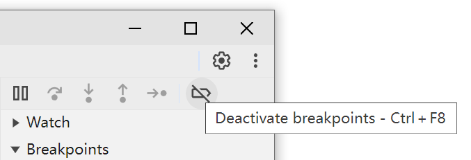

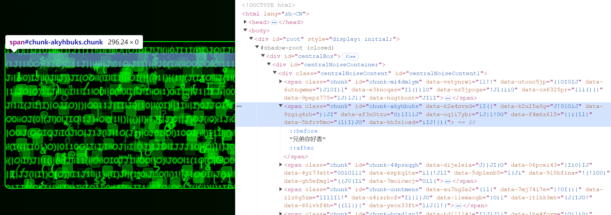

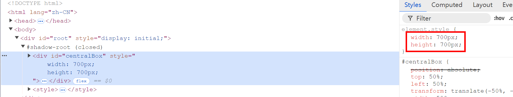

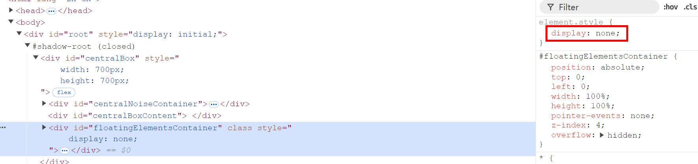

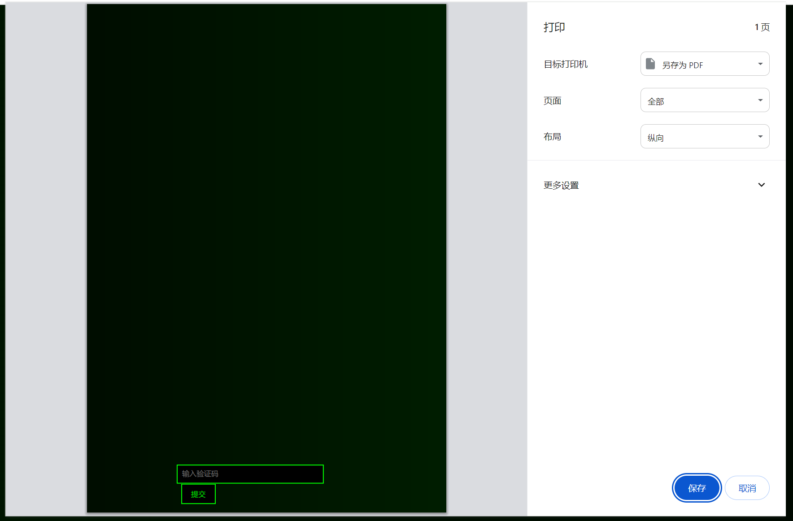

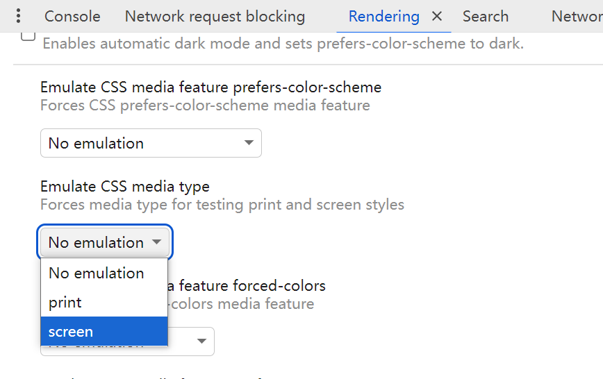

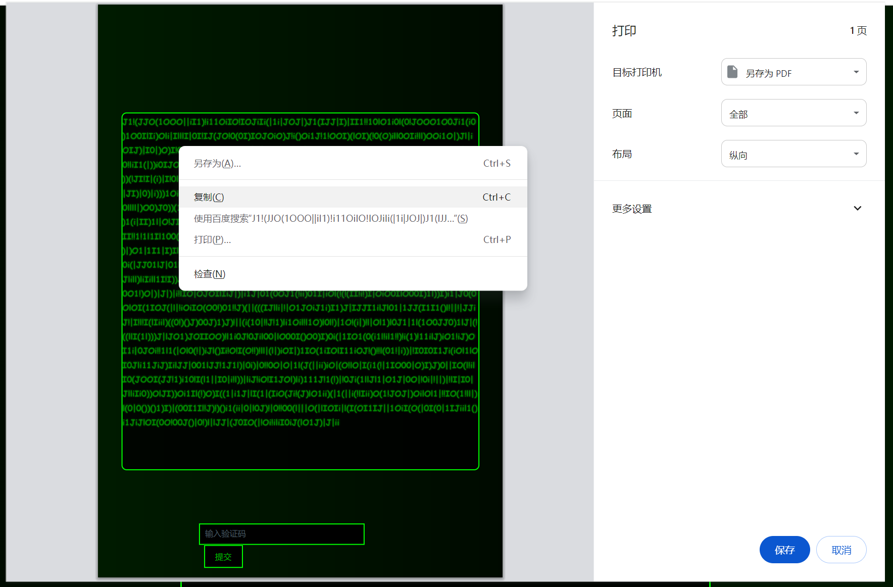

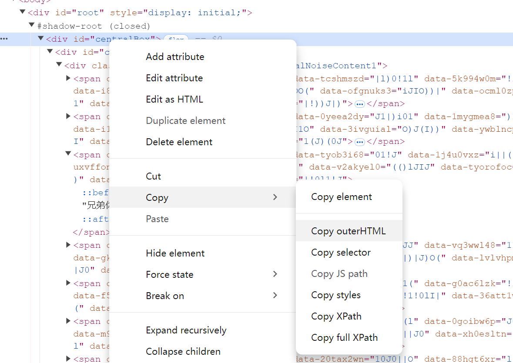

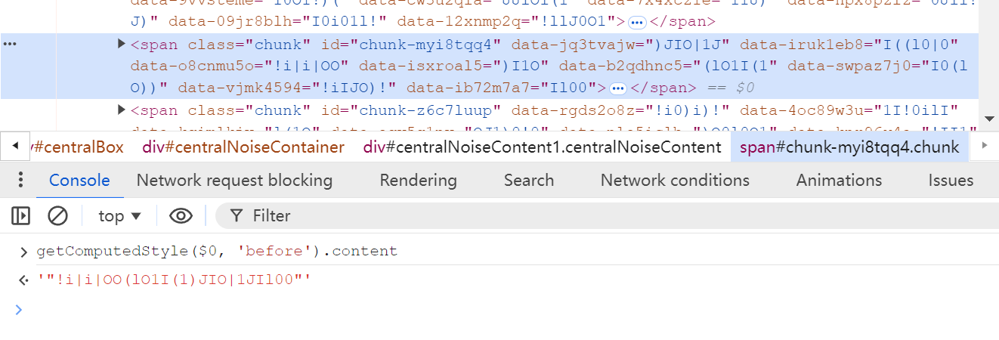

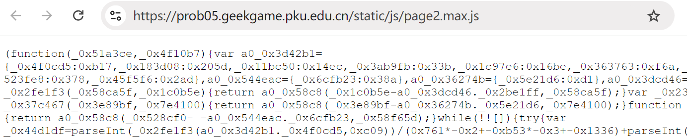

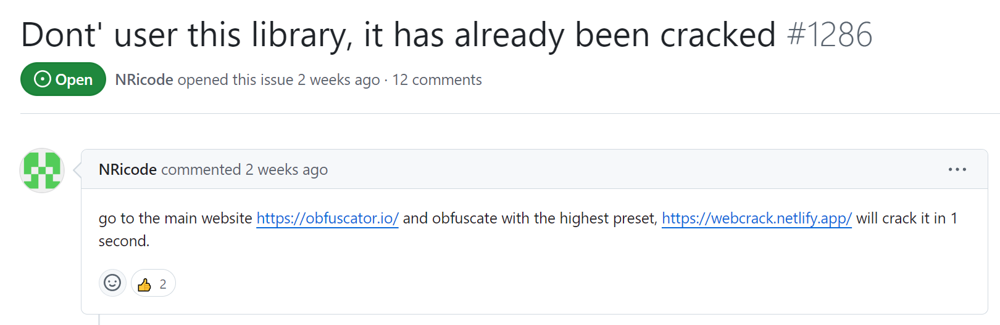

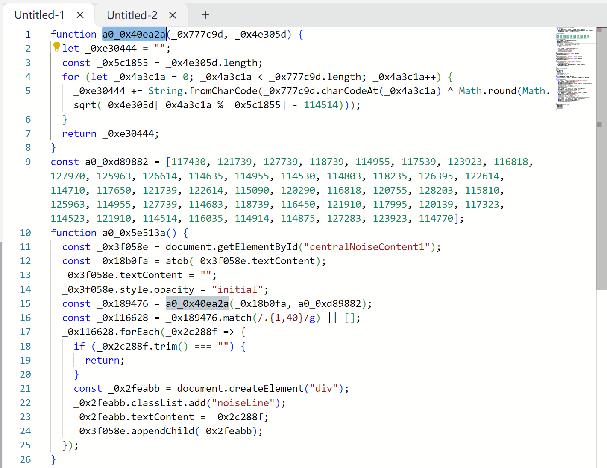

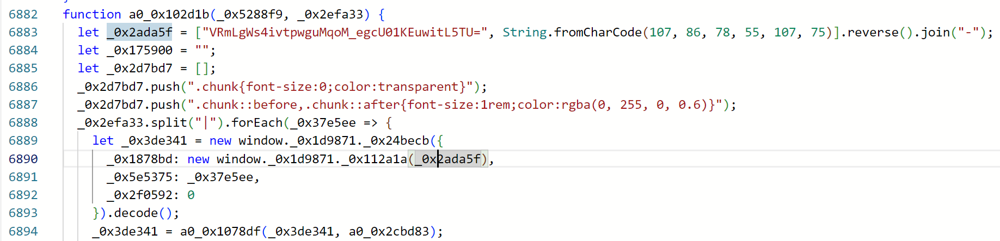

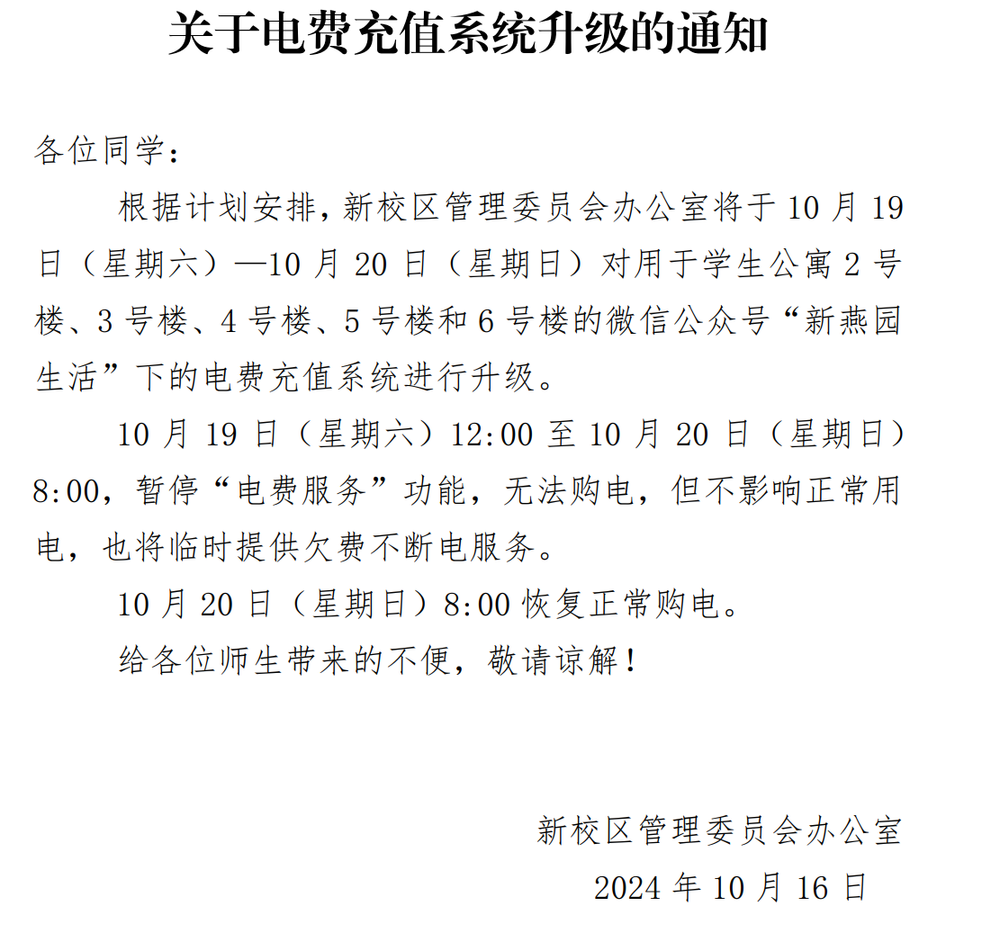

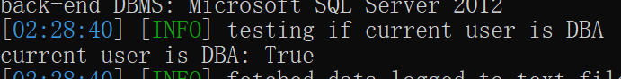
