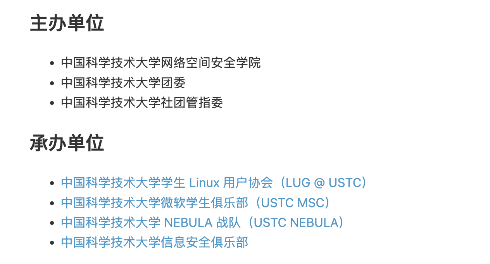

# Hackergame 2024 / 喜欢做签到的 CTFer 你们好呀

> 本文由授权中文赛事 WP 正文导入（阶段 1，仅散文，代码段未导入）。
>
> - 来源：https://github.com/USTC-Hackergame/hackergame2024-writeups/blob/deb6fa3f906e2d0e905f5de5b12757d89f54f812/official/%E5%96%9C%E6%AC%A2%E5%81%9A%E7%AD%BE%E5%88%B0%E7%9A%84%20CTFer%20%E4%BD%A0%E4%BB%AC%E5%A5%BD%E5%91%80/README.md
> - 许可：NOASSERTION
> - 署名：（未提供）
> - 文档族：official_event_archive
> - 赛事：Hackergame 2024
> - 年份：2024
> - 核验状态：official_source_not_reproduced
> - 正文 sha256：be2dc7d5b5e85d1436db244bfc8fdeb7e80563cc3193853842229b1bae31dc7a
> - 导入 ID：official-896d277c403aa61f178af9
> - 原 domain：web
> - 本地快照：62_官方赛事题库/objects/19f88b5b7241e6dd9eb73ddd510c5589994811f8df1f0227043a48b36ea1429e.blob
> - 源修订：deb6fa3f906e2d0e905f5de5b12757d89f54f812
> - 收录说明：官方发布来源的说明正文；代码单独索引，未运行或分析。按文件收录，不把多份文件算作多道题。图片及附件下载状态见清单；仅按路径/原题分类标方向，binary 等跨方向资料留待分类。
> - 判定依据：original_prose_not_runtime_verified
> - 附件引用：[{"owner_id": "official-896d277c403aa61f178af9", "relative_path": "official/喜欢做签到的 CTFer 你们好呀/files/checkin.jpg", "local_path": "62_官方赛事题库/objects/b8e4703d0d682217db471b2486cf61caf1b2a77f5214512d66a87f0c55d57672.blob", "downloaded_bytes": 33930, "source_url": "https://github.com/USTC-Hackergame/hackergame2024-writeups/blob/deb6fa3f906e2d0e905f5de5b12757d89f54f812/official/%E5%96%9C%E6%AC%A2%E5%81%9A%E7%AD%BE%E5%88%B0%E7%9A%84%20CTFer%20%E4%BD%A0%E4%BB%AC%E5%A5%BD%E5%91%80/files/checkin.jpg", "sha256": "b8e4703d0d682217db471b2486cf61caf1b2a77f5214512d66a87f0c55d57672", "kind": "image", "policy": "reference_only_no_execution"}, {"owner_id": "official-896d277c403aa61f178af9", "relative_path": "official/喜欢做签到的 CTFer 你们好呀/assets/homepage.png", "local_path": "62_官方赛事题库/objects/89881faa9bf79bc9d0ed7253369352ffe5e1784d7b98cd1ee8fa2d12dfbec015.blob", "downloaded_bytes": 118272, "source_url": "https://github.com/USTC-Hackergame/hackergame2024-writeups/blob/deb6fa3f906e2d0e905f5de5b12757d89f54f812/official/%E5%96%9C%E6%AC%A2%E5%81%9A%E7%AD%BE%E5%88%B0%E7%9A%84%20CTFer%20%E4%BD%A0%E4%BB%AC%E5%A5%BD%E5%91%80/assets/homepage.png", "sha256": "89881faa9bf79bc9d0ed7253369352ffe5e1784d7b98cd1ee8fa2d12dfbec015", "kind": "image", "policy": "reference_only_no_execution"}]

> 原文：https://github.com/USTC-Hackergame/hackergame2024-writeups/blob/deb6fa3f906e2d0e905f5de5b12757d89f54f812/official/%E5%96%9C%E6%AC%A2%E5%81%9A%E7%AD%BE%E5%88%B0%E7%9A%84%20CTFer%20%E4%BD%A0%E4%BB%AC%E5%A5%BD%E5%91%80/README.md

## 喜欢做签到的 CTFer 你们好呀

题解作者：[eastXueLian](https://github.com/AvavaAYA)

出题人、验题人、文案设计等：见 [Hackergame 2024 幕后工作人员](../../credits.pdf)。

## 题目描述

- 题目分类：web

- 题目分值：Checkin Again（50）+ Checkin Again & Again（50）

喜欢做签到的 CTFer 你们好呀，我是一道更**典型**的 checkin：有两个 flag 就藏在中国科学技术大学校内 CTF 战队的招新主页里！

## 题解

这是一道更**典型**的签到题，第一步要求选手从 [比赛主页](https://hack.lug.ustc.edu.cn/) 中找到关于中科大校内战队的 [链接](https://www.nebuu.la/)：

## 解法 1

使用 `Opt + Cmd + I` 打开开发者工具，在 Sources 板块中可以找到页面的 js 源码，可以注意到如下代码：

可以使用 base64 解码得到两个 flag：

## 解法 2

进入主页可以发现网站模拟了一个 Linux 终端，输入 `help` 指令可以列出所有命令，使用 `[TAB]` 键可以触发自动补全。

依次尝试 `help` 中列出的指令，可以发现列环境变量的命令 `env` 会输出第一个 flag：

接下来 ~~可以尝试 `sudo` 命令，可以获得系统管理员权限~~ 可以尝试 `ls` 命令列出当前目录，默认情况下 `ls` 不会输出以 `.` 开头的隐藏文件。使用 `-a` 参数可以列出当前目录下的所有文件，发现 `.flag`，于是可以用 `cat` 命令查看文件内容：

## 原文配图

