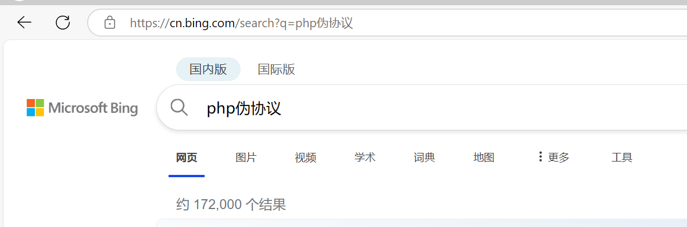
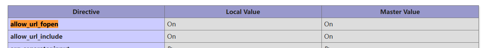

# NewStar CTF 2024 / Include Me

> 本文由授权中文赛事 WP 正文导入（阶段 1，仅散文，代码段未导入）。
>
> - 来源：https://github.com/pj-newstar/wiki-docs/blob/1a0f2ba21a30f950276396118b315eef0328371c/docs/wp/2024/week3/web/include-me.md
> - 许可：MIT
> - 署名：（未提供）
> - 文档族：official_event_archive
> - 赛事：NewStar CTF 2024
> - 年份：2024
> - 核验状态：official_source_not_reproduced
> - 正文 sha256：687ddfdc3694b402f715820434f8e446bf5ed236864a3bc5e611205e528a6a5d
> - 导入 ID：official-75b6b2fc791f8d5542d942
> - 原 domain：web
> - 本地快照：62_官方赛事题库/objects/ccfcc133f47e6aacaa2e72ec9778bcb0cd46e3b5db5965701e3e118ac1b2f51f.blob
> - 源修订：1a0f2ba21a30f950276396118b315eef0328371c
> - 收录说明：官方发布来源的说明正文；代码单独索引，未运行或分析。按文件收录，不把多份文件算作多道题。图片及附件下载状态见清单；仅按路径/原题分类标方向，binary 等跨方向资料留待分类。
> - 判定依据：original_prose_not_runtime_verified
> - 附件引用：[{"owner_id": "official-75b6b2fc791f8d5542d942", "relative_path": "docs/assets/images/wp/2024/week3/include-me_1.png", "local_path": "62_官方赛事题库/objects/5edd261f31b76815ab25fb7521c1105d76416dc444d3d036e8854c50807ee50b.blob", "downloaded_bytes": 35231, "source_url": "https://github.com/pj-newstar/wiki-docs/blob/1a0f2ba21a30f950276396118b315eef0328371c/docs/assets/images/wp/2024/week3/include-me_1.png", "sha256": "5edd261f31b76815ab25fb7521c1105d76416dc444d3d036e8854c50807ee50b", "kind": "image", "policy": "reference_only_no_execution"}, {"owner_id": "official-75b6b2fc791f8d5542d942", "relative_path": "docs/assets/images/wp/2024/week3/include-me_2.png", "local_path": "62_官方赛事题库/objects/a17536996ac04dc69edc08d1908d384a119580e2ca778254cb746f976fe47ebd.blob", "downloaded_bytes": 14382, "source_url": "https://github.com/pj-newstar/wiki-docs/blob/1a0f2ba21a30f950276396118b315eef0328371c/docs/assets/images/wp/2024/week3/include-me_2.png", "sha256": "a17536996ac04dc69edc08d1908d384a119580e2ca778254cb746f976fe47ebd", "kind": "image", "policy": "reference_only_no_execution"}]

> 原文：https://github.com/pj-newstar/wiki-docs/blob/1a0f2ba21a30f950276396118b315eef0328371c/docs/wp/2024/week3/web/include-me.md

## 正文

---
titleTemplate: ":title | WriteUp - NewStar CTF 2024"
---

## Include Me

打开题目 5s 后会自动跳转搜索 PHP 伪协议

要防止跳转，使用 GET 传入 `iknow` 即可

题目源码如下

题目源码如下

我们使用 GET 传入 `phpinfo` 后可验证远程文件包含漏洞的必要条件满足

接着就是绕 waf，这里使用的是 data 协议加 base64 加密

`<?php @eval($_POST[0])?>` 的 Base64 加密结果为 `PD9waHAgQGV2YWwoJF9QT1NUWzBdKT8+`，加号作转义

::: warning 注意

这里有几点需要注意：

- Base64 加密后的字符串不能带有 `=`，因为会被 waf，这时直接删掉结尾等号即可，后者在明文后面多加一些空格以使加密结果不带等号
- 若密文最后是 `+` 的话，我们在 GET 传参必须将其编码为 `%2B`，不然 `+` 会被视作空格

:::

## 原文配图

