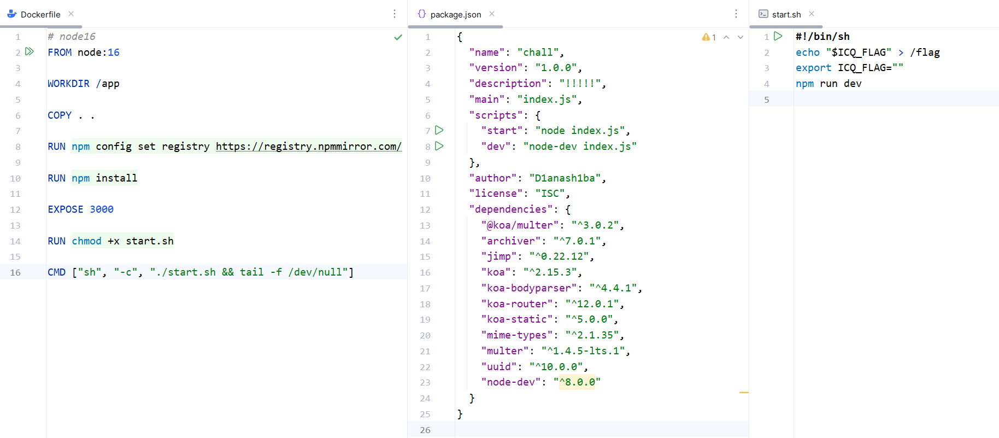

# NewStar CTF 2024 / ezpollute

> 本文由授权中文赛事 WP 正文导入（阶段 1，仅散文，代码段未导入）。
>
> - 来源：https://github.com/pj-newstar/wiki-docs/blob/1a0f2ba21a30f950276396118b315eef0328371c/docs/wp/2024/week4/web/ezpollute.md
> - 许可：MIT
> - 署名：（未提供）
> - 文档族：official_event_archive
> - 赛事：NewStar CTF 2024
> - 年份：2024
> - 核验状态：official_source_not_reproduced
> - 正文 sha256：687ddfdc3694b402f715820434f8e446bf5ed236864a3bc5e611205e528a6a5d
> - 导入 ID：official-fdad59ccb9d262763908ee
> - 原 domain：web
> - 本地快照：62_官方赛事题库/objects/f5ead27ac59b12ec29a57bdaec2cbd7fd70115af4e96822c6e6f43e7db43b91c.blob
> - 源修订：1a0f2ba21a30f950276396118b315eef0328371c
> - 收录说明：官方发布来源的说明正文；代码单独索引，未运行或分析。按文件收录，不把多份文件算作多道题。图片及附件下载状态见清单；仅按路径/原题分类标方向，binary 等跨方向资料留待分类。
> - 判定依据：original_prose_not_runtime_verified
> - 附件引用：[{"owner_id": "official-fdad59ccb9d262763908ee", "relative_path": "docs/assets/images/wp/2024/week4/ezpollute_1.png", "local_path": "62_官方赛事题库/objects/a39346b761c074ac3c18b8f5a484fc9e60add555f61b3bb8fcc38c6eb576bfdc.blob", "downloaded_bytes": 89364, "source_url": "https://github.com/pj-newstar/wiki-docs/blob/1a0f2ba21a30f950276396118b315eef0328371c/docs/assets/images/wp/2024/week4/ezpollute_1.png", "sha256": "a39346b761c074ac3c18b8f5a484fc9e60add555f61b3bb8fcc38c6eb576bfdc", "kind": "image", "policy": "reference_only_no_execution"}]

> 原文：https://github.com/pj-newstar/wiki-docs/blob/1a0f2ba21a30f950276396118b315eef0328371c/docs/wp/2024/week4/web/ezpollute.md

## 正文

---
titleTemplate: ":title | WriteUp - NewStar CTF 2024"
---

## ezpollute

根据题目名称可知，这是一道 JavaScript 的原型链污染题

查看部署文件，可以得知 Node.js 版本为 16，并且使用了 `node-dev` 热部署启动

审计 `index.js`，`/config` 路由下调用了 `merge` 函数，`merge` 函数意味着可能存在的原型链污染漏洞

`merge` 函数在 `/util/merge.js` 中，虽然过滤了 `proto`，但我们可以通过 `constructor.prototype` 来绕过限制

`/process` 路由调用了 `fork`，创建了一个 JavaScript 子进程用于水印添加

结合之前的原型链污染漏洞，我们污染 `NODE_OPTIONS` 和 `env`，在 `env` 中写入恶意代码，`fork` 在创建子进程时就会首先加载恶意代码，从而实现 RCE

考虑到新生可能没有云服务器来反弹 shell，因此在赛题设计时选择了热部署启动

除了弹 shell，还可以通过写 WebShell 覆盖 `index.js`，从而实现有回显 RCE，或者把 flag 输出到 `static` 目录下读也可以

比赛时题目环境并没有出网，弹不了 shell，只能通过后两种方式来做，这里给出写 WebShell 的做法

:::tip 热部署
就是在应用正在运行的时候升级软件，却不需要重新启动应用
:::

## 原文配图

