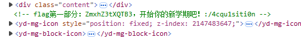
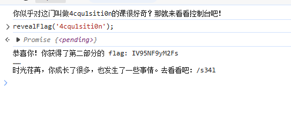
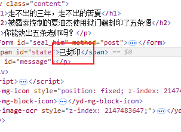
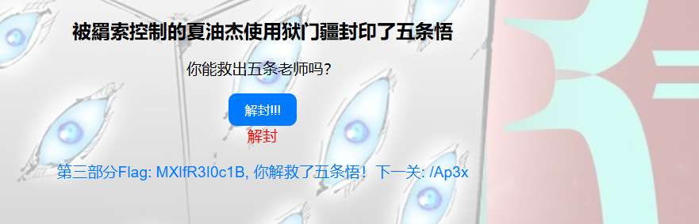
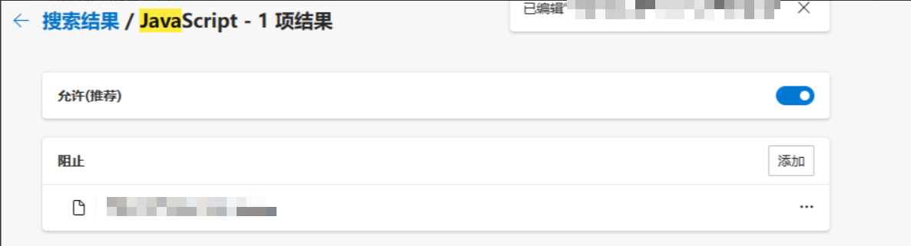
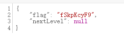

# NewStar CTF 2024 / 会赢吗？

> 本文由授权中文赛事 WP 正文导入（阶段 1，仅散文，代码段未导入）。
>
> - 来源：https://github.com/pj-newstar/wiki-docs/blob/1a0f2ba21a30f950276396118b315eef0328371c/docs/wp/2024/week1/web/huiyingma.md
> - 许可：MIT
> - 署名：（未提供）
> - 文档族：official_event_archive
> - 赛事：NewStar CTF 2024
> - 年份：2024
> - 核验状态：official_source_not_reproduced
> - 正文 sha256：e4948a0ac253ee177ae081b53b30755b98c1551de5c3ef7f429d62eb61a35750
> - 导入 ID：official-68b603be337fdb2b700ba2
> - 原 domain：web
> - 本地快照：62_官方赛事题库/objects/0aa5c4ce270b6886caae7ff17dfaafc13e542398b36ada7b593155456f9d08ab.blob
> - 源修订：1a0f2ba21a30f950276396118b315eef0328371c
> - 收录说明：官方发布来源的说明正文；代码单独索引，未运行或分析。按文件收录，不把多份文件算作多道题。图片及附件下载状态见清单；仅按路径/原题分类标方向，binary 等跨方向资料留待分类。
> - 判定依据：original_prose_not_runtime_verified
> - 附件引用：[{"owner_id": "official-68b603be337fdb2b700ba2", "relative_path": "docs/assets/images/wp/2024/week1/huiyingma_1.png", "local_path": "62_官方赛事题库/objects/8694c3f22ec49b19fb7ce3e9f89cc35c40a4ea3d56233fa2584f26ae19143cd6.blob", "downloaded_bytes": 7337, "source_url": "https://github.com/pj-newstar/wiki-docs/blob/1a0f2ba21a30f950276396118b315eef0328371c/docs/assets/images/wp/2024/week1/huiyingma_1.png", "sha256": "8694c3f22ec49b19fb7ce3e9f89cc35c40a4ea3d56233fa2584f26ae19143cd6", "kind": "image", "policy": "reference_only_no_execution"}, {"owner_id": "official-68b603be337fdb2b700ba2", "relative_path": "docs/assets/images/wp/2024/week1/huiyingma_2.png", "local_path": "62_官方赛事题库/objects/dab1365612e5f390f3efaa7fcbf5ff2e1ea9430ddf6cef8cf673e806d52b61eb.blob", "downloaded_bytes": 9391, "source_url": "https://github.com/pj-newstar/wiki-docs/blob/1a0f2ba21a30f950276396118b315eef0328371c/docs/assets/images/wp/2024/week1/huiyingma_2.png", "sha256": "dab1365612e5f390f3efaa7fcbf5ff2e1ea9430ddf6cef8cf673e806d52b61eb", "kind": "image", "policy": "reference_only_no_execution"}, {"owner_id": "official-68b603be337fdb2b700ba2", "relative_path": "docs/assets/images/wp/2024/week1/huiyingma_3.png", "local_path": "62_官方赛事题库/objects/0ea6fde8309fdfcf42a943d79aa6550c2caebc4d5e24ab53d88c8f476ab2c254.blob", "downloaded_bytes": 12781, "source_url": "https://github.com/pj-newstar/wiki-docs/blob/1a0f2ba21a30f950276396118b315eef0328371c/docs/assets/images/wp/2024/week1/huiyingma_3.png", "sha256": "0ea6fde8309fdfcf42a943d79aa6550c2caebc4d5e24ab53d88c8f476ab2c254", "kind": "image", "policy": "reference_only_no_execution"}, {"owner_id": "official-68b603be337fdb2b700ba2", "relative_path": "docs/assets/images/wp/2024/week1/huiyingma_4.png", "local_path": "62_官方赛事题库/objects/4efd9cd82f2b28427dd41d0b4d6692728d01eeebde214e51157586108da15f12.blob", "downloaded_bytes": 253629, "source_url": "https://github.com/pj-newstar/wiki-docs/blob/1a0f2ba21a30f950276396118b315eef0328371c/docs/assets/images/wp/2024/week1/huiyingma_4.png", "sha256": "4efd9cd82f2b28427dd41d0b4d6692728d01eeebde214e51157586108da15f12", "kind": "image", "policy": "reference_only_no_execution"}, {"owner_id": "official-68b603be337fdb2b700ba2", "relative_path": "docs/assets/images/wp/2024/week1/huiyingma_5.png", "local_path": "62_官方赛事题库/objects/88221bfa9e453fb228a171f0a55f1a180100d4475e26a8934f81c82a4839ded2.blob", "downloaded_bytes": 38694, "source_url": "https://github.com/pj-newstar/wiki-docs/blob/1a0f2ba21a30f950276396118b315eef0328371c/docs/assets/images/wp/2024/week1/huiyingma_5.png", "sha256": "88221bfa9e453fb228a171f0a55f1a180100d4475e26a8934f81c82a4839ded2", "kind": "image", "policy": "reference_only_no_execution"}, {"owner_id": "official-68b603be337fdb2b700ba2", "relative_path": "docs/assets/images/wp/2024/week1/huiyingma_6.png", "local_path": "62_官方赛事题库/objects/a7f6eb18c7d7c3a476cde3203feff2c96f89e6a05a78bf99eaa8acbb835a3a27.blob", "downloaded_bytes": 83629, "source_url": "https://github.com/pj-newstar/wiki-docs/blob/1a0f2ba21a30f950276396118b315eef0328371c/docs/assets/images/wp/2024/week1/huiyingma_6.png", "sha256": "a7f6eb18c7d7c3a476cde3203feff2c96f89e6a05a78bf99eaa8acbb835a3a27", "kind": "image", "policy": "reference_only_no_execution"}, {"owner_id": "official-68b603be337fdb2b700ba2", "relative_path": "docs/assets/images/wp/2024/week1/huiyingma_7.png", "local_path": "62_官方赛事题库/objects/47b0977ede6478c99c72e64417d5452f468a64d4989bf5979358838fd42cb62a.blob", "downloaded_bytes": 1797, "source_url": "https://github.com/pj-newstar/wiki-docs/blob/1a0f2ba21a30f950276396118b315eef0328371c/docs/assets/images/wp/2024/week1/huiyingma_7.png", "sha256": "47b0977ede6478c99c72e64417d5452f468a64d4989bf5979358838fd42cb62a", "kind": "image", "policy": "reference_only_no_execution"}]

> 原文：https://github.com/pj-newstar/wiki-docs/blob/1a0f2ba21a30f950276396118b315eef0328371c/docs/wp/2024/week1/web/huiyingma.md

## 正文

---
titleTemplate: ":title | WriteUp - NewStar CTF 2024"
---

import Container from '@/components/docs/Container.vue'

## 会赢吗？

本题考查的是网页和 JavaScript 的基础知识。

JavaScript 是现代网络开发中最重要的编程语言之一，它的历史充满了快速迭代、竞争、以及变革。它最早诞生于 1995 年，由 Brendan Eich 在短短 10 天内开发，并逐步演变成为如今的标准化、多功能的编程语言。

## 第一关

按下 <kbd>F12</kbd>，使用开发者工具查看源码

## 第二关

控制台是开发者调试 JavaScript 代码的利器，允许开发者在无需修改源代码的情况下，直接执行和测试代码。这种即时反馈机制使得开发者可以迅速验证假设、检查问题或尝试新的代码逻辑。

仔细看源代码：

根据控制台的提示，只需要执行 `revealFlag('4cqu1siti0n')`（`className` 的值为 `4cqu1siti0n`）即可获得第二关的 flag。

## 第三关

根据源代码：

修改前端，按下按钮得到一部分 flag.

## 第四关

源码中有 `<noscript>` 标签，可以使用浏览器插件或者浏览器设置禁用 JavaScript.

当然也可以直接根据前端逻辑去发送请求。

将 Flag 各个部分拼起来，随后 Base64 解密即可。

## 原文配图

