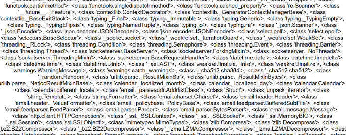
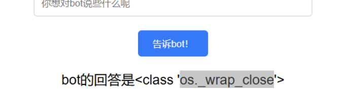

# NewStar CTF 2024 / 复读机

> 本文由授权中文赛事 WP 正文导入（阶段 1，仅散文，代码段未导入）。
>
> - 来源：https://github.com/pj-newstar/wiki-docs/blob/1a0f2ba21a30f950276396118b315eef0328371c/docs/wp/2024/week2/web/fuduji.md
> - 许可：MIT
> - 署名：（未提供）
> - 文档族：official_event_archive
> - 赛事：NewStar CTF 2024
> - 年份：2024
> - 核验状态：official_source_not_reproduced
> - 正文 sha256：687ddfdc3694b402f715820434f8e446bf5ed236864a3bc5e611205e528a6a5d
> - 导入 ID：official-7320fc600f74ff9ff5b034
> - 原 domain：web
> - 本地快照：62_官方赛事题库/objects/b7393a39fd666cd10155cd48a3bcfad5631a58d5bc403b368ca112a42c388004.blob
> - 源修订：1a0f2ba21a30f950276396118b315eef0328371c
> - 收录说明：官方发布来源的说明正文；代码单独索引，未运行或分析。按文件收录，不把多份文件算作多道题。图片及附件下载状态见清单；仅按路径/原题分类标方向，binary 等跨方向资料留待分类。
> - 判定依据：original_prose_not_runtime_verified
> - 附件引用：[{"owner_id": "official-7320fc600f74ff9ff5b034", "relative_path": "docs/assets/images/wp/2024/week2/fuduji_1.png", "local_path": "62_官方赛事题库/objects/64c5608719e4e18ce74037769a1db69deeb043dbaed9bb8f829a12e58f32350a.blob", "downloaded_bytes": 25686, "source_url": "https://github.com/pj-newstar/wiki-docs/blob/1a0f2ba21a30f950276396118b315eef0328371c/docs/assets/images/wp/2024/week2/fuduji_1.png", "sha256": "64c5608719e4e18ce74037769a1db69deeb043dbaed9bb8f829a12e58f32350a", "kind": "image", "policy": "reference_only_no_execution"}, {"owner_id": "official-7320fc600f74ff9ff5b034", "relative_path": "docs/assets/images/wp/2024/week2/fuduji_2.png", "local_path": "62_官方赛事题库/objects/d55ffa6762a9904e92a55d3da452bb8a2c0c4ff7f36e30230616df8131207d02.blob", "downloaded_bytes": 254891, "source_url": "https://github.com/pj-newstar/wiki-docs/blob/1a0f2ba21a30f950276396118b315eef0328371c/docs/assets/images/wp/2024/week2/fuduji_2.png", "sha256": "d55ffa6762a9904e92a55d3da452bb8a2c0c4ff7f36e30230616df8131207d02", "kind": "image", "policy": "reference_only_no_execution"}, {"owner_id": "official-7320fc600f74ff9ff5b034", "relative_path": "docs/assets/images/wp/2024/week2/fuduji_3.png", "local_path": "62_官方赛事题库/objects/c1d29c5bc1de84b003be481a9d3c559e6a58e0e5a48b1a1e96525f0727fe1ca7.blob", "downloaded_bytes": 24166, "source_url": "https://github.com/pj-newstar/wiki-docs/blob/1a0f2ba21a30f950276396118b315eef0328371c/docs/assets/images/wp/2024/week2/fuduji_3.png", "sha256": "c1d29c5bc1de84b003be481a9d3c559e6a58e0e5a48b1a1e96525f0727fe1ca7", "kind": "image", "policy": "reference_only_no_execution"}, {"owner_id": "official-7320fc600f74ff9ff5b034", "relative_path": "docs/assets/images/wp/2024/week2/fuduji_4.png", "local_path": "62_官方赛事题库/objects/9b52f9f293982eaae925e782be50e01bd9f96b1a044ab279fb1bbdd80faa1f3e.blob", "downloaded_bytes": 15513, "source_url": "https://github.com/pj-newstar/wiki-docs/blob/1a0f2ba21a30f950276396118b315eef0328371c/docs/assets/images/wp/2024/week2/fuduji_4.png", "sha256": "9b52f9f293982eaae925e782be50e01bd9f96b1a044ab279fb1bbdd80faa1f3e", "kind": "image", "policy": "reference_only_no_execution"}]

> 原文：https://github.com/pj-newstar/wiki-docs/blob/1a0f2ba21a30f950276396118b315eef0328371c/docs/wp/2024/week2/web/fuduji.md

## 正文

---
titleTemplate: ":title | WriteUp - NewStar CTF 2024"
---

## 复读机

可以看到，输入什么就输出什么

输入 `{{ '{'+'{ 7*7 }'+'}' }}` 的时候，输出的结果是 49，说明存在 SSTI 注入

输入 `{{ '{'+'{ [].__class__}'+'}' }}`，发现 bot 显示不喜欢上课,说明 `class` 被过滤了，可以使用简单的拼接绕过

得到 `list` 类

后面就是基本的注入方法了

获取 `object` 类

获取 `object` 类

找一个可以利用的类，这里选用 `os._wrap_close`

然后就是拿到 `eval` 方法，命令执行就行

方法很多，大家可以自己试试

## 原文配图

