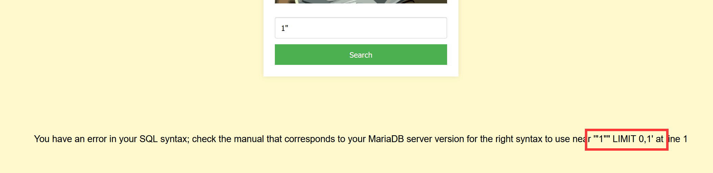

# NewStar CTF 2024 / 谢谢皮蛋 plus

> 本文由授权中文赛事 WP 正文导入（阶段 1，仅散文，代码段未导入）。
>
> - 来源：https://github.com/pj-newstar/wiki-docs/blob/1a0f2ba21a30f950276396118b315eef0328371c/docs/wp/2024/week2/web/pidan-plus.md
> - 许可：MIT
> - 署名：（未提供）
> - 文档族：official_event_archive
> - 赛事：NewStar CTF 2024
> - 年份：2024
> - 核验状态：official_source_not_reproduced
> - 正文 sha256：687ddfdc3694b402f715820434f8e446bf5ed236864a3bc5e611205e528a6a5d
> - 导入 ID：official-2b6b874e1a7c72734302e0
> - 原 domain：web
> - 本地快照：62_官方赛事题库/objects/074edb90e284e027365f71c6b46fd6c38d1dfd6efeee4e885ce7e646582d588b.blob
> - 源修订：1a0f2ba21a30f950276396118b315eef0328371c
> - 收录说明：官方发布来源的说明正文；代码单独索引，未运行或分析。按文件收录，不把多份文件算作多道题。图片及附件下载状态见清单；仅按路径/原题分类标方向，binary 等跨方向资料留待分类。
> - 判定依据：original_prose_not_runtime_verified
> - 附件引用：[{"owner_id": "official-2b6b874e1a7c72734302e0", "relative_path": "docs/assets/images/wp/2024/week2/pidan-plus_1.png", "local_path": "62_官方赛事题库/objects/e0653fe732a198eb467866dc36c774f56ebd736602db9bc8e3891ae85d0db77a.blob", "downloaded_bytes": 42958, "source_url": "https://github.com/pj-newstar/wiki-docs/blob/1a0f2ba21a30f950276396118b315eef0328371c/docs/assets/images/wp/2024/week2/pidan-plus_1.png", "sha256": "e0653fe732a198eb467866dc36c774f56ebd736602db9bc8e3891ae85d0db77a", "kind": "image", "policy": "reference_only_no_execution"}, {"owner_id": "official-2b6b874e1a7c72734302e0", "relative_path": "docs/assets/images/wp/2024/week2/pidan-plus_2.png", "local_path": "62_官方赛事题库/objects/a8d4855b22a53c9273b72f0383e2dcd27da64dfbe8f0d77c45d82e9abac85395.blob", "downloaded_bytes": 241208, "source_url": "https://github.com/pj-newstar/wiki-docs/blob/1a0f2ba21a30f950276396118b315eef0328371c/docs/assets/images/wp/2024/week2/pidan-plus_2.png", "sha256": "a8d4855b22a53c9273b72f0383e2dcd27da64dfbe8f0d77c45d82e9abac85395", "kind": "image", "policy": "reference_only_no_execution"}]

> 原文：https://github.com/pj-newstar/wiki-docs/blob/1a0f2ba21a30f950276396118b315eef0328371c/docs/wp/2024/week2/web/pidan-plus.md

## 正文

---
titleTemplate: ":title | WriteUp - NewStar CTF 2024"
---

## 谢谢皮蛋 plus

同样还是联合注入，意在考查空格和 `and` 的绕过，为了避免直接使用报错注入得到 flag，将报错注入 ban 了

值得注意的一个点是，这题是双引号闭合，如果没有细心的检查会误以为是单引号闭合

双引号中带有单引号也可以执行成功，属于 MySQL 的一种特性，可以自行尝试一下

`and` 使用 `&&` 替换，空格使用 `/**/` 替换，其他就是一样的操作了

查询当前数据库

查询所有表名

查询所有表名

查询所有列名

得到flag

## 原文配图

