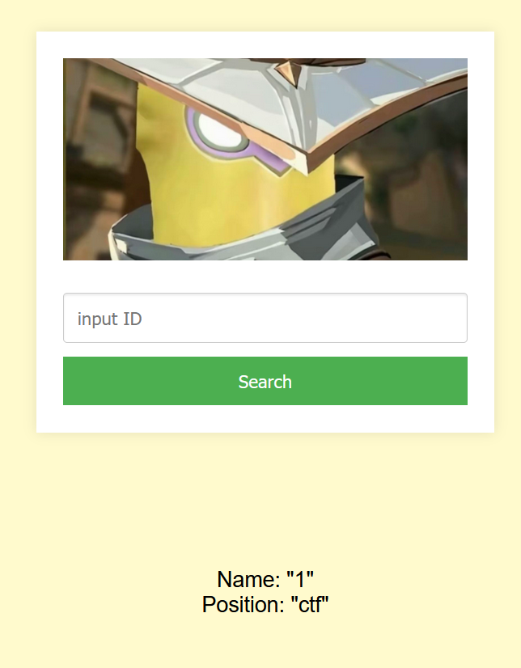
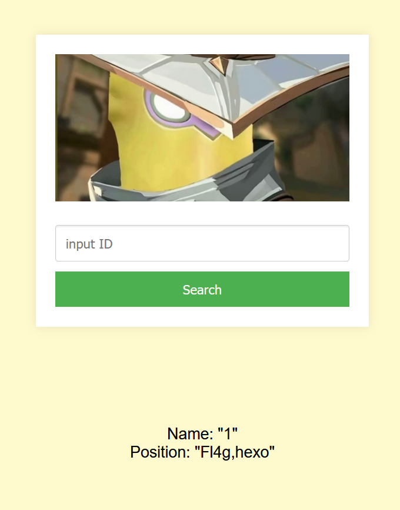
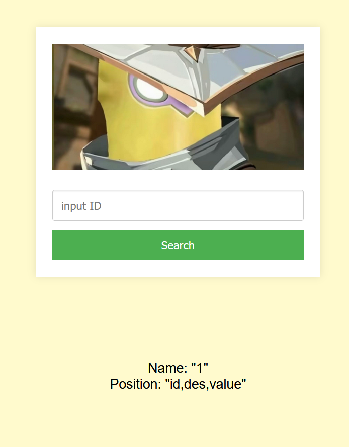

# NewStar CTF 2024 / 谢谢皮蛋

> 本文由授权中文赛事 WP 正文导入（阶段 1，仅散文，代码段未导入）。
>
> - 来源：https://github.com/pj-newstar/wiki-docs/blob/1a0f2ba21a30f950276396118b315eef0328371c/docs/wp/2024/week1/web/xiexiepidan.md
> - 许可：MIT
> - 署名：（未提供）
> - 文档族：official_event_archive
> - 赛事：NewStar CTF 2024
> - 年份：2024
> - 核验状态：official_source_not_reproduced
> - 正文 sha256：e4948a0ac253ee177ae081b53b30755b98c1551de5c3ef7f429d62eb61a35750
> - 导入 ID：official-8cda2e4693d8ed615f100e
> - 原 domain：web
> - 本地快照：62_官方赛事题库/objects/81436d7917b4d6a333ab04b7797c50331507db87564b173dce2b28ae644a5953.blob
> - 源修订：1a0f2ba21a30f950276396118b315eef0328371c
> - 收录说明：官方发布来源的说明正文；代码单独索引，未运行或分析。按文件收录，不把多份文件算作多道题。图片及附件下载状态见清单；仅按路径/原题分类标方向，binary 等跨方向资料留待分类。
> - 判定依据：original_prose_not_runtime_verified
> - 附件引用：[{"owner_id": "official-8cda2e4693d8ed615f100e", "relative_path": "docs/assets/images/wp/2024/week1/xiexiepidan_1.png", "local_path": "62_官方赛事题库/objects/a9ce4b6f31ceac5ad8a18a2424c9981aea8d482fda7b684f70dfd96883818bf1.blob", "downloaded_bytes": 234476, "source_url": "https://github.com/pj-newstar/wiki-docs/blob/1a0f2ba21a30f950276396118b315eef0328371c/docs/assets/images/wp/2024/week1/xiexiepidan_1.png", "sha256": "a9ce4b6f31ceac5ad8a18a2424c9981aea8d482fda7b684f70dfd96883818bf1", "kind": "image", "policy": "reference_only_no_execution"}, {"owner_id": "official-8cda2e4693d8ed615f100e", "relative_path": "docs/assets/images/wp/2024/week1/xiexiepidan_2.png", "local_path": "62_官方赛事题库/objects/5f18c39d0e3f0f5ad83c287cf6c1a9f158a8a08e669d8e69d52182814c09b89d.blob", "downloaded_bytes": 239220, "source_url": "https://github.com/pj-newstar/wiki-docs/blob/1a0f2ba21a30f950276396118b315eef0328371c/docs/assets/images/wp/2024/week1/xiexiepidan_2.png", "sha256": "5f18c39d0e3f0f5ad83c287cf6c1a9f158a8a08e669d8e69d52182814c09b89d", "kind": "image", "policy": "reference_only_no_execution"}, {"owner_id": "official-8cda2e4693d8ed615f100e", "relative_path": "docs/assets/images/wp/2024/week1/xiexiepidan_3.png", "local_path": "62_官方赛事题库/objects/f408b21e5d4b9d9d0249867278a1592086baf45cdda55ec3b8da944fd48ff8a5.blob", "downloaded_bytes": 176326, "source_url": "https://github.com/pj-newstar/wiki-docs/blob/1a0f2ba21a30f950276396118b315eef0328371c/docs/assets/images/wp/2024/week1/xiexiepidan_3.png", "sha256": "f408b21e5d4b9d9d0249867278a1592086baf45cdda55ec3b8da944fd48ff8a5", "kind": "image", "policy": "reference_only_no_execution"}]

> 原文：https://github.com/pj-newstar/wiki-docs/blob/1a0f2ba21a30f950276396118b315eef0328371c/docs/wp/2024/week1/web/xiexiepidan.md

## 正文

---
titleTemplate: ":title | WriteUp - NewStar CTF 2024"
---

import Container from '@/components/docs/Container.vue'

## 谢谢皮蛋

本题考查的是 SQL 注入的相关知识，如果你从未了解和接触过数据库和 SQL 语句，你可能需要花费一定的时间快速了解并尝试。

题目考查数字型注入、联合注入

判断列数和回显位，其实看页面上的格式也基本可以判断

查看当前数据库

查看当前数据库所有表名

查看 `Fl4g` 表所有列名

查看 `Fl4g` 表所有列名

查看值得到 flag

## 原文配图

