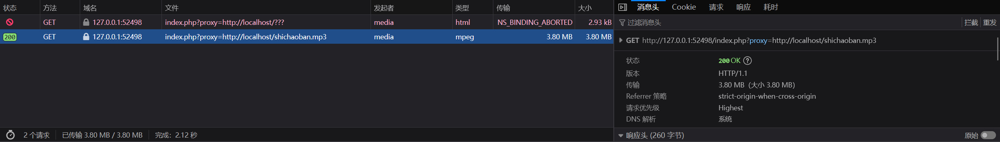
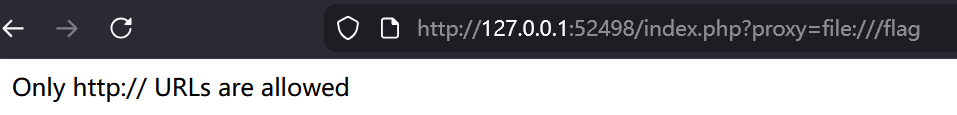

# NewStar CTF 2025 / MyGO!!!!!

> 本文由授权中文赛事 WP 正文导入（阶段 1，仅散文，代码段未导入）。
>
> - 来源：https://github.com/pj-newstar/wiki-docs/blob/1a0f2ba21a30f950276396118b315eef0328371c/docs/wp/2025/week3/web/mygo.md
> - 许可：MIT
> - 署名：（未提供）
> - 文档族：official_event_archive
> - 赛事：NewStar CTF 2025
> - 年份：2025
> - 核验状态：official_source_not_reproduced
> - 正文 sha256：46be4dee7413a0e557e883b20d933f502314ccca596eac91129f31092e378579
> - 导入 ID：official-ecca3b5ea0330cdbf47073
> - 原 domain：web
> - 本地快照：62_官方赛事题库/objects/3dc77ba1b7465e74e6d9c3ce17e7589eae7d258aca5dc8ba5a25f1300d50cfdb.blob
> - 源修订：1a0f2ba21a30f950276396118b315eef0328371c
> - 收录说明：官方发布来源的说明正文；代码单独索引，未运行或分析。按文件收录，不把多份文件算作多道题。图片及附件下载状态见清单；仅按路径/原题分类标方向，binary 等跨方向资料留待分类。
> - 判定依据：original_prose_not_runtime_verified
> - 附件引用：[{"owner_id": "official-ecca3b5ea0330cdbf47073", "relative_path": "docs/assets/images/wp/2025/week3/mygo_1.png", "local_path": "62_官方赛事题库/objects/c33373d1da669645e56d28c2debc89a1bc1d6e4fe5bab50b3eee13f6211604e6.blob", "downloaded_bytes": 56641, "source_url": "https://github.com/pj-newstar/wiki-docs/blob/1a0f2ba21a30f950276396118b315eef0328371c/docs/assets/images/wp/2025/week3/mygo_1.png", "sha256": "c33373d1da669645e56d28c2debc89a1bc1d6e4fe5bab50b3eee13f6211604e6", "kind": "image", "policy": "reference_only_no_execution"}, {"owner_id": "official-ecca3b5ea0330cdbf47073", "relative_path": "docs/assets/images/wp/2025/week3/mygo_2.png", "local_path": "62_官方赛事题库/objects/04abd1f7d49d622287d6a3d681fd8c1d78307b1496e661fb2215e08e990b2aa1.blob", "downloaded_bytes": 12129, "source_url": "https://github.com/pj-newstar/wiki-docs/blob/1a0f2ba21a30f950276396118b315eef0328371c/docs/assets/images/wp/2025/week3/mygo_2.png", "sha256": "04abd1f7d49d622287d6a3d681fd8c1d78307b1496e661fb2215e08e990b2aa1", "kind": "image", "policy": "reference_only_no_execution"}]

> 原文：https://github.com/pj-newstar/wiki-docs/blob/1a0f2ba21a30f950276396118b315eef0328371c/docs/wp/2025/week3/web/mygo.md

## 正文

---
titleTemplate: ":title | WriteUp - NewStar CTF 2025"
---

## MyGO!!!!!

~~先演奏一下春日影~~，抓几个包，发现有一个未过滤的 proxy，可能可以打 SSRF。

尝试发现只允许 http 协议

dirsearch 扫描目录发现有 `flag.php`，直接访问 403，尝试 SSRF 访问 `/index.php?proxy=http://127.0.0.1/flag.php`

得到源码

curl 允许 file 协议，`/index.php?proxy=http://127.0.0.1/flag.php?soyorin=file:///flag` 成功拿到 FLAG。

## 原文配图

