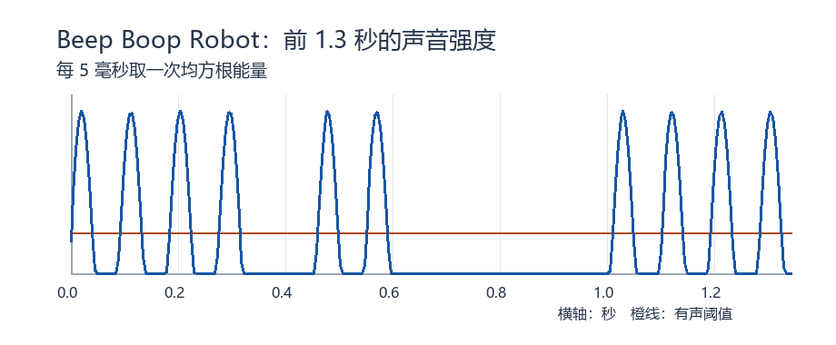

# Beep Boop Robot：短音、长音和空白各代表什么

TJCTF 2023 · 杂项 · [赛事目录](https://github.com/TJCSec/tjctf-2023-challenges/tree/main/forensics/beep-boop-robot)。本机从原音频读出了完整提示和答案文字。

## 先看这一步

只有一种鸣声时，先看音长和停顿。8 位 WAV 先减去 128，再按短窗口算能量，避免把过零误当静音。

**适用时**：单音开关清楚，音长和停顿能分档。 **留意**：换录音要重看阈值。

先看声音特征：附件是 8 位单声道 WAV，鸣声基本只有约 1000 Hz 的一个音。重点是持续时长，先不用按电话拨号的双音编码去猜。

1. 8 位 WAV 的采样是无符号整数，静音中心在 128。先减 128，再每 5 毫秒算一次均方根能量，也就是看这段声音的整体强度。逐个采样取绝对值会把正弦波过零点误判为停顿。
2. 用峰值能量的四分之一作为本题阈值。连续有声区分成约 0.04 秒和 0.13 秒两类，分别记作摩斯电码的点和划。
3. 无声区大致有 0.05、0.14 和 0.42 秒三档，分别表示同一字符内、字符之间、词之间。把点划组合按摩斯表读出来。

本机解出 51 个字符、9 个词，未出现未识别符号；末尾文字说明了答案是连在一起的。上述阈值是从本题的时长分布选出的，换音频时应重新观察。

## 配套代码

`kb/_code/r66/misc_samples.py`。从代码所在目录运行 `python misc_samples.py beep-boop-robot 原附件`。依赖见脚本开头；运行后会显示核对结果。
