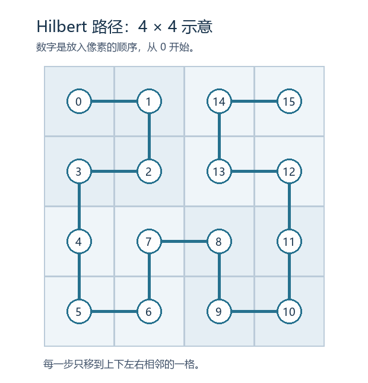

# Hilbert 像素还原：一列颜色如何走遍方格

## 先看这一步

一列像素的总数刚好是方阵面积时，留意折线路径。Hilbert 路径的下一点总在相邻一格，和逐行排图区别明显。

**适用时**：像素数等于 2 的幂边长的平方，并有线索指向 Hilbert 路径；起点与朝向用样本确认。

**留意**：单凭像素数无法确认路径。汇编的单列 PNG 从旧图逆向重建，核对的是像素流。

## 按路径填格子

本题一列有 65,536 个 RGB 像素，正好填满 256×256 的方格。把第 `i` 个像素放到第 `i` 个 Hilbert 坐标。代码按序号每两位处理一级小方格：先确定象限，再按象限旋转或翻转。图中用 4×4 的数字示意填格顺序。

## 怎么回验

检查每格出现一次，连续两点只相差上下左右一格。再沿同一路径把 RGB 字节读回来，与汇编中的像素校验值比较。此次也逐像素核对了随附还原图；带答案的原图仍在汇编目录。

## 配套代码

`kb/_code/r67/hilbert_pixels.py`。函数接收题目的公开数值；不会运行题目源码。

在代码目录运行 `python hilbert_pixels.py ct.png`（需要 Pillow）；默认只做检查，不写出答案图。

## 出处

- Hilbert 曲线像素流还原：汇编中的 `题目/upload-hilbert/WP.md`。
